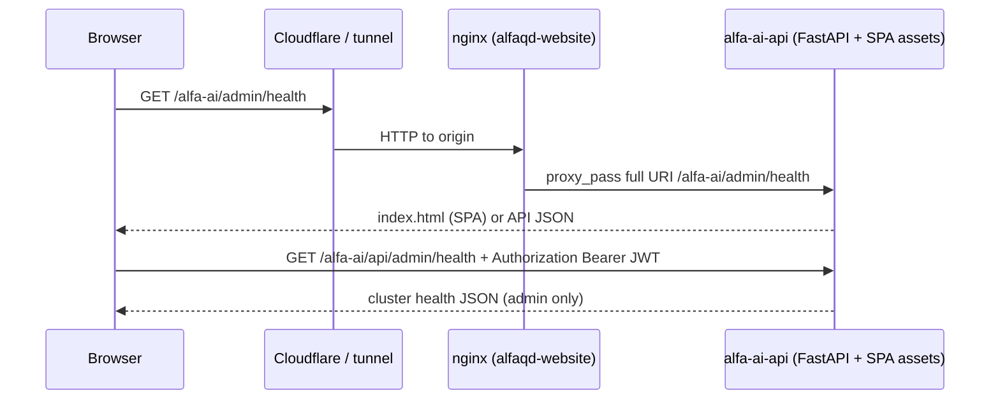

# Admin Health page — web workflow (www)

This document describes how **[Admin → Health](https://www.example.com/alfa-ai/admin/health)** works end to end: repositories involved, URLs, authentication, and how it differs from the **brain-only** operator dashboard. Use it so new code (including AI-assisted changes) stays aligned.

## Repositories

| Repository | Role |
|------------|------|
| **`alfa-ai`** | Single source of truth for behavior: React SPA (`frontend/`), FastAPI app (`src/api/`), admin router (`src/api/routers/admin.py`), auth (`src/api/routers/auth.py`, `src/api/deps.py`). Deployed as the **`alfa-ai-api`** container (or equivalent). |
| **`alfaqd-website`** | **Edge routing only** for `www.example.com`: nginx forwards `/alfa-ai` to the ALFa API container. No ALFa business logic lives here; do not implement auth or health logic in this repo unless you are deliberately adding an edge policy (rare). |

Other repos (WordPress, bots, etc.) are **not** on the request path for `/alfa-ai/admin/health`.

## alfa-ai website vs main-domain website (naming)

| Name | Repo | What it is | Cluster start/stop |
|------|------|------------|-------------------|
| **alfa-ai website** | **`alfa-ai`** (this repo) | Operator console/login SPA at `/alfa-ai/login`, Admin Health, guest chat API. Containers: `alfa-ai-api`, `alfa-ai-nginx` on `hub`; public entry via `inference` edge `:8420/alfa-ai/*`. | **Yes** — `start-brain` + `inference` edge; post-start verify hits `/alfa-ai/login`. |
| **alfaqd-website** | **Separate repo** | Main domain `www.example.com` WordPress + nginx (`alfa-nginx`). Proxies `/alfa-ai` to the brain; does not own ALFa logic. | **No** — never started or stopped by `Start-Stop-AlfaAi.ps1`. |

When docs or operators say "alfa-ai website," they mean the **`alfa-ai` repo SPA**, not the main-domain WordPress stack.

## Public URL vs internal paths

| What the user opens | Under the hood |
|---------------------|----------------|
| `https://www.example.com/alfa-ai/admin/health` | React **client-side** route: `BrowserRouter` **`basename="/alfa-ai"`** + route **`/admin/health`** → component **`HealthPage`**. |

The browser **never** calls `GET /admin/health` (no prefix) for this page. That path is used by the **separate** static operator UI on the brain host (e.g. `:8420/admin/health`). See [Brain vs web health APIs](#brain-vs-web-health-apis) below.

## Request flow (production)

1. **Nginx** (`alfaqd-website`, e.g. `nginx-config/alfa-nginx.conf`): `location /alfa-ai` proxies to `alfa-ai-api:8000` with the **full URI preserved** (not stripped). `Authorization` is forwarded so the API receives the JWT.
2. **First load**: the **`alfa-ai-api`** process serves the Vite build from `frontend/dist` when present: `GET /alfa-ai/` and client routes like `GET /alfa-ai/admin/health` return `index.html` (see `_register_alfa_ai_spa()` in `src/api/app.py`). The Docker image builds the SPA in **`deploy/Dockerfile.api`** (Node stage `npm run build`). Same origin as `/alfa-ai/api/*` keeps Bearer JWT from `localStorage` working without cookies.
3. **Data**: `HealthPage` loads cluster data via **`GET /alfa-ai/api/admin/health`** with **`Authorization: Bearer <access_token>`**.

## Frontend (alfa-ai)

| File | Responsibility |
|------|----------------|
| `frontend/src/main.tsx` | `BrowserRouter basename="/alfa-ai"` — all app routes are under `/alfa-ai/`. |
| `frontend/src/App.tsx` | **`AdminRoute`**: requires logged-in user with **`user.role === "admin"`**; others redirected to `/` or login. Nested route **`/admin/health`** → `HealthPage`. |
| `frontend/src/pages/admin/HealthPage.tsx` | **`const BASE = "/alfa-ai/api/admin"`**; calls e.g. **`apiFetch("/health", token)`** → **`GET /alfa-ai/api/admin/health`**. Renders **`pool_stats`** (context window, shards, last probe tok/s). Also uses `/workers` under the same base. |
| `frontend/vite.config.ts` | **`base: "/alfa-ai/"`** for asset URLs; dev server may proxy **`/alfa-ai/api`** to the local API port. |

**Do not** change `BASE` to `/api/admin` for this page — that would hit the **wrong** backend route (brain JSON, not cluster health).

## Backend (alfa-ai)

| Piece | Path | Auth |
|-------|------|------|
| **Cluster health (this page)** | **`GET /alfa-ai/api/admin/health`** | **`require_role("admin")`** — JWT access token, validated in `src/api/deps.py` (`get_current_user` + role check). Implemented as **`cluster_health`** in **`src/api/routers/admin.py`** (`APIRouter(prefix="/alfa-ai/api/admin")`). Includes **`operational_warnings`** (JWT secret, Prometheus scrape). |
| **Operational warnings (all admin tabs)** | **`GET /alfa-ai/api/admin/operational-warnings`** | Same admin JWT. Polled every 30s by **`OperationalAlertsBanner`** — modal for errors, banner until dismissed. See [ALFA_AI_OPERATIONAL_ALERTS.md](ALFA_AI_OPERATIONAL_ALERTS.md). |
| **Login / token refresh** | `/alfa-ai/api/auth/*` | Issue JWTs stored client-side as `alfa_ai_access_token` (see `frontend/src/contexts/AuthContext.tsx`). **`POST /alfa-ai/api/auth/login`** accepts **email or username** in JSON field `login` (legacy clients may still send `email`). Same SPA at `/alfa-ai/login` serves  admin (`inference:8420`) and www (`/alfa-ai/login`). |

The FastAPI app **`include_router`** registers **`auth`**, **`chat`**, **`guest`**, and **`admin`** (see `src/api/app.py` immediately after `/static` mount). Without these, login and `GET /alfa-ai/api/admin/health` would not exist. Router prefix **`/alfa-ai/api/admin`** is **not** optional for the web UI: it matches Vite `base` and `HealthPage` `BASE`.

## Brain vs web health APIs

These are **different** endpoints and **must not** be conflated in new code.

| Endpoint | Purpose | Typical caller | Server auth |
|----------|---------|----------------|-------------|
| **`GET /alfa-ai/api/admin/health`** | Cluster health: gateway poll, worker registry, Redis heartbeat merge, alerts, **inference pool stats** (`pool_stats`: context window, GPU shard count, last tok/s probe). | **This doc** — `HealthPage` at www. | **JWT + admin role** (`require_role("admin")`). |
| **`GET /api/admin/health`** | Brain operator JSON: Redis heartbeats + brain service checks (`app.py`). | Static page **`/admin/health`** on API host (e.g. LAN `:8420`). | **`require_brain_operator_health_auth`** when `ALFA_AI_REQUIRE_API_AUTH` or `ALFA_AI_LOCK_OPERATOR_HEALTH` is set (`src/api/auth_deps.py`). |

Naming similarity is historical; **path prefix** is the differentiator.

## nginx contract (alfaqd-website)

- **Preserve** `/alfa-ai` in the upstream path (do not rewrite to strip `/alfa-ai` unless every FastAPI route and static path is changed consistently — today they are **prefixed** with `/alfa-ai` for the web app).
- Forward **`Authorization`** to the API.

Reference: `location /alfa-ai` in `alfaqd-website/nginx-config/alfa-nginx.conf`.

## Checklist for contributors and AI agents

1. **Admin Health at www** = React **`HealthPage`** + **`GET /alfa-ai/api/admin/health`** + **admin JWT**. Not `GET /api/admin/health`.
2. **Do not** move admin API routes off **`/alfa-ai/api/admin`** without updating **`frontend`** `BASE` and **Vite** `base`, plus any docs and clients.
3. **Do not** add nginx-only “login” for ALFa in `alfaqd-website` unless product explicitly wants edge auth; today auth is **JWT inside ALFa**.
4. **Brain operator dashboard** (`/admin/health` static + `/api/admin/health`) is documented separately; changes there should not break **`cluster_health`** or the SPA.
5. After router or `basename` changes, verify **`/alfa-ai/admin/health`** still loads and **`/alfa-ai/api/admin/health`** returns **401** without Bearer and **200** with an **admin** access token.

## Host and probe inventory (inference / pool72)

Defined in `src/api/worker_monitoring.py` (`_CLUSTER_HOSTS_DEFAULT`,
`build_inference_stack_report`) and `src/api/inference_shards.py`.

| Surface | Contents |
|---------|----------|
| **Infrastructure Hosts** | `hub` brain+coord+shard, `inference` RPC shards only, `rag` CPU RAG (embed `:11435` + rerank `:8360`), `orchestrator` shard+Dockge, inference opt-in `gaming-a`/`gaming-c`/`gaming-b`/`secondary`/`pool-opt-in` (`gaming-c`/`gaming-b` train lock; no concurrent 27B+72B/80B), Pool72/80 same gaming hosts (exclusive load), `apps` apps (Dockge `:5001`) |
| **Inference stack RPC** | Core + gaming from baked `inference-shards*.env` (Pool72 reuses `inference-shards.active.env`); membership from mounted active file when present |
| **Inference stack RAG** | Defaults `EMBED_BASE_URL` / `RERANK_BASE_URL` → `rag` ([RAG_148_TO_110_MIGRATION.md](RAG_148_TO_110_MIGRATION.md), [deploy/env.example](../deploy/env.example)) |
| **Brain dependencies** | litellm, postgres, redis, coordinator `:31360`, pool shards (coordinator-derived) |
| **Active pool label** | `detect_active_pool()` — `inference` / `pool72` / `pool35` from `ALFA_INFERENCE_MODE` (+ URL heuristics). Pool72 sets `ALFA_INFERENCE_MODE=pool72` via `switch-pool-72b.sh`. |
| **Not probed (retired)** | `speed-tier-35b`, Petals gateway, Llama 70B; optional revive via `ALFA_PROBE_SPEED_TIER_35B=1` |
| **Worker GPU cards** | Registered workers polled at `:31331/stats`. Sidecar is `worker-monitor` (not Petals), started by `Invoke-AlfaWorkerDeploy` on `gaming-b` / `gaming-c` / `gaming-a`. |

Shard RPC status uses coordinator-derived OK while the coordinator is up (do not
TCP-probe shards — [GREV27_27B_OPERATOR.md](GREV27_27B_OPERATOR.md) guard 4).
Opt-in hosts **not** in `inference-shards.active.env` this start stay **not reachable**
(red card, check `ok: false`, `skipped: true`) -- that is expected for `gaming-c` /
`gaming-b` / `gaming-a` when they are not in the live pool.

**`hub` `brain-api` check:** the Admin Health process *is* `alfa-ai-api`. Do
**not** HTTP-probe `http://127.0.0.1:8000/health` from `GET /alfa-ai/api/admin/health`.
That route is `async def` and then runs blocking `httpx` on the event loop
([FastAPI `async def` vs `def`](https://fastapi.tiangolo.com/async/#path-operation-functions)).
Uvicorn serves one event loop per worker
([ASGI](https://uvicorn.dev/concepts/asgi/)); a loopback GET cannot be accepted
until the health handler finishes, so the self-check timed out (false red,
4/5) while Compose HEALTHCHECK from a **separate** process stayed green
([healthcheck](https://docs.docker.com/reference/compose-file/services/#healthcheck)).
`brain-api` is therefore **derived self** (`ok` if this process is serving the
report). LiteLLM stays Compose DNS `alfa-ai-litellm:4000`
([service names](https://docs.docker.com/compose/how-tos/networking/)). If
`ALFA_AI_CLUSTER_HOSTS_JSON` overrides the inventory, keep `derived: self` for
`brain-api` -- do not restore a same-container HTTP URL.

**`apps` apps check:** probe Dockge agent `http://apps/`
([DOCKGE_105_OPERATOR.md](DOCKGE_105_OPERATOR.md)). An empty `checks` list must
**not** paint the host red (`reachable` stays true when nothing was probed).

## Related references

- `src/api/routers/admin.py` — `cluster_health`, worker registry, `/health` route.
- `docs/inference_GAMING_HOST_JOIN.md` — gaming / opt-in shard join.
- `deploy/env.example` — `ALFA_AI_LOCK_OPERATOR_HEALTH` applies to **`GET /api/admin/health`** only, not the web Admin Health API above.
