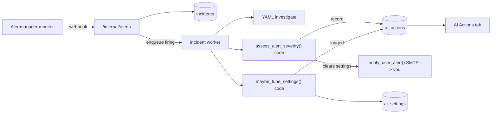

# AI Actions tab (alert routing, direct notify, self-tuning settings)

Admin UI at `/alfa-ai/admin/ai-actions` (tab label **AI Actions**) is a single feed of
**autonomous and operator-visible activity** in the alert/notification domain, with sub-tabs
to separate activity types. Every autonomous decision is recorded here and is reversible.

**Design rule (limited inference slots):** Alert **routing** (severity map, notify threshold,
quiet hours, dedup, playbook investigate/auto_fix) is **program code**. The LLM is reserved
for **judgment** surfaces: admin **Analyze**, **Ask ALFa**, and optional unknown-alert
summaries (`ALFA_AI_INCIDENT_LLM_TRIAGE`, default off). Do not call the model on every
Alertmanager webhook.

**Related:** [MONITORING_AI_REVIEW.md](MONITORING_AI_REVIEW.md), [INCIDENT_RESPONSE.md](INCIDENT_RESPONSE.md)

## What it shows

Sub-tabs (each maps to `GET /alfa-ai/api/admin/ai-actions?category=...`):

| Sub-tab | Category | Source |
|---------|----------|--------|
| All | `all` | union of both sources, newest first |
| Alert triage | `alert` | `ai_actions` type `alert_triaged` (programmatic severity map; not an LLM call) |
| Notifications | `notifications` | `ai_actions` types `notification_sent` / `notification_skipped` |
| Settings | `settings` | `ai_actions` types `setting_changed` / `agent_config_changed` (AI or human) |
| AI Config | (UI only) | Live-editable admin AI prompt, hosts, actions, context -- see below |
| Host actions | `host` | `ai_actions` types `host_command_executed`, `host_action_rejected`, `host_action_feedback` |
| Dump load | `dump` | Live last-tick panel (`GET /dump-status`, ~10s poll) plus `ai_actions` types `solar_dump_observed` / `solar_dump_recommended`. Observe + ledger; HA automations own switch on/off. See [HOME_ASSISTANT_BRAIN_INTEGRATION.md](HOME_ASSISTANT_BRAIN_INTEGRATION.md) Audit. |
| Incident AI | `incidents` | AI-typed rows in `incident_events` (`ai_analysis`, `llm_triage`, `remediation_started`, `remediation_complete`, `remediation_pr_opened`, `remediation_ops_recorded`) |

Operator **Measure** feedback (thumbs): `proposal_feedback` (Monitoring Analyze proposals),
`host_action_feedback` (Ask ALFa host actions after approve/reject).

Each row is normalized to `{ id, category, action_type, summary, detail, severity, created_by, created_at }`.
`created_by` is `program` for deterministic alert routing / volume tuning, `ai` for Ask ALFa /
Analyze-related autonomous rows where applicable, or the admin email for manual overrides.

## Flow: programmatic alert routing and direct notify

1. **monitoring** Alertmanager fires -> webhook -> `POST /alfa-ai/api/internal/alerts` (unchanged).
2. New firing incident is enqueued; the **background incident worker** picks it up and runs
   YAML playbook **investigate** steps (HTTP/script -- no LLM).
3. Worker runs `assess_alert_severity(incident)` in **code**: maps the Alertmanager
   `severity` label (common Prometheus values: `critical` / `error` / `warning` / `info`)
   into the internal scale (`low`|`medium`|`high`|`critical`) and sets a notify intent.
   Recorded as `alert_triaged` with `created_by=program` -- **no model call**.
4. If notify intent is true **and** severity clears `notify_min_severity`, is outside
   `notify_quiet_hours`, and is not a duplicate within `notify_dedup_minutes`, the worker sends
   a **direct ops email** (`notify_user_alert`) and records `notification_sent`. Otherwise it
   records `notification_skipped` with the reason.
5. That email is distinct from Alertmanager's own SMTP: subject `"[ALFa AI] Serious: <alertname>"`
   and body includes the programmatic reason string.
6. After routing, `maybe_tune_settings()` (also pure code) may conservatively adjust
   `notify_min_severity` from recent notification volume. Logged as `setting_changed`.

**LLM on this path:** only if `ALFA_AI_INCIDENT_LLM_TRIAGE=true` **and** no playbook matches
(`triage_unknown_alert`). Default is off so unknown alerts escalate as `needs_human` without
burning inference slots.



## Settings (`ai_settings` table)

Seeded on first run. AI may only write keys where `editable_by_ai` is true; the API rejects
AI writes to user-only keys. You can edit any key from the **Settings** sub-tab, which links
back to the per-key sections below (also surfaced as inline tooltips + examples in the UI).

| Key | Default | AI may change | Purpose |
|-----|---------|---------------|---------|
| [`ai_triage_enabled`](#ai_triage_enabled) | `true` | no | Master switch for programmatic alert notify routing |
| [`ai_can_adjust_settings`](#ai_can_adjust_settings) | `false` | no | Master switch for program self-tuning (`ALFA_AI_PROGRAM_AUTO_TUNE` also default off) |
| [`notify_email`](#notify_email) | from `ALFA_AI_INCIDENT_NOTIFY_EMAIL` | no | Where direct AI alerts are sent |
| [`auto_fix_allowlist`](#auto_fix_allowlist) | `` (none) | no | Comma-separated alertnames for L3 auto_fix when global flag on |
| [`notify_min_severity`](#notify_min_severity) | `high` | yes | Minimum assessed severity to notify you (`low` < `medium` < `high` < `critical`) |
| [`notify_quiet_hours`](#notify_quiet_hours) | `` (off) | yes | e.g. `22:00-07:00` local; alerts held during window |
| [`notify_dedup_minutes`](#notify_dedup_minutes) | `30` | yes | Suppress repeat notifications for the same alert |
| [`chat_thinking_label`](#chat_thinking_label) | `I'm Thinking.....\|I'm Thinnnking....\|I'mmmm Thiiinnnnkiinng` | no | Pipe-separated phrases the main chat / guest chat cycle through while the model streams a `<think>...</think>` reasoning block, instead of showing the raw tag text. Leave blank to show nothing while thinking. |
| [`ha_solar_dump_enabled`](#ha-solar-dump) | `true` | no (policy) | Arm dump-load ticker logic ([HOME_ASSISTANT_BRAIN_INTEGRATION.md](HOME_ASSISTANT_BRAIN_INTEGRATION.md)) |
| [`ha_solar_dump_auto_actuate`](#ha-solar-dump) | `false` | no (policy) | Unused for dump on/off (Home Assistant automations own switches) |
| [`ha_switch_allowlist`](#ha-solar-dump) | six `switch.sim_ac_plug_*` | no (policy) | Comma-separated `switch.*` / `light.*` the program may toggle |
| `ha_switch_watts` / `ha_never_auto` / `ha_*_entity` / thresholds | see that doc | no | Sensors, optional clamp overlay, SoC floor, surplus W, interval, dwell |

### Per-setting reference

#### `ai_triage_enabled`

Master on/off switch for the programmatic notify-routing pipeline (severity map + threshold +
quiet hours + dedup + direct ops email). When `false`, incoming alerts are still recorded in
`incidents` and playbooks still investigate, but the worker never sends a direct
`[ALFa AI] Serious:` email -- your normal Alertmanager SMTP stack is unaffected.

- **Values:** `true` or `false`.
- **Example:** set to `false` while you're deliberately firing test alerts (e.g. testing a new
  Alertmanager rule) so you don't get duplicate ops emails for noise you already expect.
- **You only** -- Ask ALFa / self-tuning cannot flip this switch.

#### `ai_can_adjust_settings`

Master switch for `maybe_tune_settings()` (see **Conservative self-tuning** below). When
`false`, the worker records tuning **suggestions** only (no mutation). Applying changes
requires this key `true` **and** `ALFA_AI_PROGRAM_AUTO_TUNE=1`.

- **Values:** `true` or `false` (default **`false`**).
- **Example:** set to `false` if you've manually tuned `notify_min_severity` to exactly the level
  you want and don't want the AI silently raising it again after a noisy night.
- **You only.**

#### HA solar dump load (policy)

Operator-owned Home Assistant load control. Full table and REST contract:
[HOME_ASSISTANT_BRAIN_INTEGRATION.md](HOME_ASSISTANT_BRAIN_INTEGRATION.md).
Ticker is **program code** (no LLM) and **observes only**. Dump switch on/off is
Home Assistant (`sim_dump_control.yaml`). Dump does **not** need 7B or 27B. Empty
`ha_switch_allowlist` means Ask ALFa `ha_switch_*` never toggles.
Requires `ALFA_AI_HOME_ASSISTANT_ENABLED=1` and a long-lived token file on `hub`.

- **You only** for the three policy keys (`ha_solar_dump_enabled`,
  `ha_solar_dump_auto_actuate`, `ha_switch_allowlist`). Ask ALFa may propose;
  Settings tab / Approve applies.
- **`ha_switch_on` / `ha_switch_off`:** optional remote one-shots; execute immediately
  when HA env + token (logged; no Approve). **`ha_set_number` / `ha_select_option`:**
  write dump helpers immediately the same way (solar dump is outside NIST).
  **`ha_dump_tick`:** observe immediately; does not POST `switch.turn_on` / `turn_off`.

#### `auto_fix_allowlist`

Comma-separated Prometheus `alertname` values allowed for L3 `auto_fix` when
`ALFA_AI_INCIDENT_AUTO_FIX=true`. **Empty = no auto_fix** even if the global env flag is on.

- **Policy key** -- Ask ALFa creates a pending proposal; Settings tab requires `confirm=true`.
- **Example:** `AlfaAiBrainHealthDown,LiteLLMProbeFailed` after playbooks define safe `auto_fix` steps.

#### `notify_email`

Destination address for alfa-ai's **direct** ops alert emails (subject prefix `[ALFa AI]`), sent
separately from whatever Alertmanager already emails. Falls back to `ALFA_AI_INCIDENT_NOTIFY_EMAIL`
from `deploy/.env` when blank.

- **Values:** a single email address, or blank to use the env default.
- **Example:** `operator@example.com` -- routes program-routed serious alerts to a shared inbox.
- **You only** -- autonomous code cannot redirect this address.

#### `notify_min_severity`

Minimum **mapped** severity before a direct `[ALFa AI]` email is sent. Severities are
ordered `low` < `medium` < `high` < `critical`; anything below the threshold is recorded as
`notification_skipped` (visible under the **Notifications** sub-tab) but not emailed.

- **Values:** `low`, `medium`, `high`, or `critical`.
- **Example:** set to `critical` if you only want to be woken up for outages, not warnings; set
  to `low` during an investigation when you want every routed alert emailed.
- **Program may edit** -- `maybe_tune_settings()` can raise this one step if notification volume is
  too high, or lower it one step if the threshold sits above `high` with no recent sends.
  Revert with one click from this tab.

#### `notify_quiet_hours`

A local time window during which direct `[ALFa AI]` ops emails are held back (alerts are still
routed and logged, just not emailed until the window ends).

- **Values:** `HH:MM-HH:MM` (24h, local time), or blank to disable.
- **Example:** `22:00-07:00` holds ops emails overnight; a `critical` alert that fires at 2am is
  still recorded immediately but the email arrives once the window closes at 07:00.
- **Program may edit** via Ask ALFa when you ask, or leave blank.

#### `notify_dedup_minutes`

Suppresses a repeat email for the **same alert** if it re-fires within N minutes of the last
notification, to avoid inbox flooding from a flapping alert.

- **Values:** a whole number of minutes.
- **Example:** `30` -- if `HighCPU` on the same host fires again 10 minutes after you were
  already emailed about it, you don't get a second email until 30 minutes have passed.
- **AI may edit** -- often the first knob raised when a flapping alert causes a
  burst of `notification_sent` rows (via Ask ALFa or bounded `maybe_tune_settings` on
  `notify_min_severity` only; dedup is operator/Ask ALFa).

#### `chat_thinking_label`

Pipe-separated phrases shown (cycling) in the main chat and guest chat while a "Thinking
(precise)" model streams its `<think>...</think>` reasoning block, instead of the raw tag text.
See **Chat "thinking" indicator** below for the full backend/frontend flow.

- **Values:** one or more phrases separated by `|`, or blank.
- **Example:** `Thinking...|Still thinking...|Almost there...` cycles through those three phrases
  every few seconds until the model closes the `<think>` block. Leaving it blank shows nothing
  while the model reasons (no cycling text at all).
- **You only.**

### Conservative self-tuning (v1)

`maybe_tune_settings()` only adjusts `notify_min_severity`, and only when notification volume
is clearly off in a recent window:

- Too noisy (many `notification_sent` recently) -> raise the threshold one step.
- Missed-signal pattern (repeated `notification_skipped` for the same serious alert) -> lower one step.

Every adjustment logs a `setting_changed` action with the old value, new value, and reason.
Revert from the Settings sub-tab (one click writes the old value back with your email as `created_by`).
Autonomy is bounded to the alert/notification domain (no data-loss risk) by design.

### Chat "thinking" indicator (`chat_thinking_label`)

The `frontier-code` / Qwen-hybrid models emit a raw `<think>...</think>` reasoning block
ahead of the real answer when the picker is set to **Thinking (precise)**. The chat UI never
renders that block literally:

- **Backend** ([src/api/qwen_mode.py](../src/api/qwen_mode.py) `strip_think_tags`) strips the
  `<think>...</think>` block before persisting the assistant message
  ([src/api/routers/chat.py](../src/api/routers/chat.py)), so stored/reloaded conversation
  history is always clean.
- **Frontend** ([frontend/src/lib/thinkTags.ts](../frontend/src/lib/thinkTags.ts),
  [ChatMessage.tsx](../frontend/src/components/ChatMessage.tsx)) detects an open, unterminated
  `<think>` while a response is still streaming and shows a **cycling text indicator**
  ([ThinkingIndicator.tsx](../frontend/src/components/ThinkingIndicator.tsx)) instead of the raw
  tag text, then swaps to the real markdown answer once `</think>` closes.
- The cycling phrases come from the `chat_thinking_label` key above (pipe-separated), fetched
  by both `GET /alfa-ai/api/config` (main chat) and `GET /alfa-ai/api/guest/config` (guest
  demo chat). Edit or blank it from the **Settings** sub-tab -- no redeploy needed, same one-click
  revert as any other setting.

## Ask ALFa (global chat widget)

Ask ALFa is the **official LAN-admin AI chat**: operator message in this dock, read-only
**inspect** tools in the same turn, model **reply** in this dock. **Audit host N**, **Review
errors**, and **Run host-facts on host N** finish here (inspect + LLM). Missions remain for
**feeder pause/resume**, **clear stuck**, and scheduled background jobs — see
[ADMIN_MISSIONS.md](ADMIN_MISSIONS.md).

A floating **"Ask ALFa"** chat widget is mounted in the admin shell
([AdminLayout.tsx](../frontend/src/pages/admin/AdminLayout.tsx)) and is available on every
admin tab (Health, Monitoring, AI Actions, Models, Users, Audit) -- not a page-specific
panel. This is separate from the Editor tab's file-scoped "Ask ALFa" agent
(`POST /alfa-ai/api/admin/agent`).

Both admin chat surfaces render the **same chat window template** as every other ALFa AI
chat window in the cluster (colors, avatar, header, message bubbles, input) -- only the
context/data and available actions differ by design. See
[docs/ALFA_AI_CHAT_WIDGETS.md](ALFA_AI_CHAT_WIDGETS.md) "Rule for every NEW chat surface."

### Chat pipe (official tools-in-thread)

Official tool-calling shape: [OpenAI function calling](https://platform.openai.com/docs/guides/function-calling),
[LiteLLM function calling](https://docs.litellm.ai/docs/completion/function_call).
v1 implements tools via JSON-in-text `inspect_host` / `propose_host_action` inside the
reply envelope (`ALFA_AI_NATIVE_TOOLS=0` default); native OpenAI `tools` remain opt-in.

| Step | What happens |
|------|----------------|
| 1 Widget | `POST /alfa-ai/api/admin/monitoring-agent/stream` with `message` + dock `history` |
| 2 Gather | Pack activity, cluster ops, host-action catalog into separate user messages |
| 3 Router | Deterministic **no-LLM** hot paths when intent is structured (activity, cluster status, blocklist, user count, settings, follow-up replay). Q&A and host audits that need facts run **pre_inspect + `llm_continue`** (HA weather, online research, zip weather, `Audit host N`, host-facts, Review errors). Feeder pause/resume and clear-stuck still **enqueue**. |
| 4 Tools | Read-only inspect in this turn: SSH catalog, HA REST (`ha_get_*`), **`web_search`** (internal HTTP to SearXNG via [`src.agent.tools.web_search`](../src/agent/tools.py) — same implementation as Missions). `ALFA_AI_WEB_SEARCH_ENABLED=0` → `{ok:false}` fail-closed; **no** mission fallback. |
| 5 Reply | SSE `done` with `reply` in this dock ([FastAPI SSE](https://fastapi.tiangolo.com/tutorial/server-sent-events/)) |
| 6 Mutate | Unchanged: `propose_host_action` → pending → operator **Approve** (NIST L2) |

Guest `/alfa-ai` SPA chat, WordPress guest docks, and consumer-bot widgets **never** call
`web_search` or `fetch_url` ([AGENT_RESEARCH_TOOLS.md](AGENT_RESEARCH_TOOLS.md)).

**Endpoints (admin only):**

| Method | Path | Purpose |
|--------|------|---------|
| POST | `/alfa-ai/api/admin/monitoring-agent` | Non-streaming Ask ALFa; full JSON response |
| POST | `/alfa-ai/api/admin/monitoring-agent/stream` | SSE progress while frontier-code runs (preferred by widget) |
| GET | `/alfa-ai/api/admin/ask-alfa/context-usage` | Packed-prompt estimate vs slot window (context ring; no LLM call) |

POST routes accept body `{ "message": "..." }` and share the same hybrid router + LLM logic.
The GET is admin-only, packs the same messages as a turn (empty operator line), and does
**not** call LiteLLM. Response shape: `{ "ok": true, "context_usage": { ... } }`.

### SSE stream (`/monitoring-agent/stream`)

Server-Sent Events over HTTP POST. Implemented with FastAPI
[`StreamingResponse`](https://fastapi.tiangolo.com/advanced/custom-response/#streamingresponse)
and the SSE wire format (`data: …\n\n`) per the
[FastAPI Server-Sent Events tutorial](https://fastapi.tiangolo.com/tutorial/server-sent-events/).
POST is supported (same pattern as MCP-style SSE over POST).

### MCP inspect (optional, default off)

When `ALFA_AI_MCP_ENABLED=1`, Cursor or other MCP clients may call read-only
`inspect_host` on `http://<brain>:8420/mcp` with the same admin JWT and LAN
allowlist as Ask ALFa. Mutate catalog keys are rejected without SSH. See
[ADMIN_AI_HOST_ACTIONS.md](ADMIN_AI_HOST_ACTIONS.md) MCP section and plan
[H4](../.cursor/plans/HARNESS_CUTTING_EDGE_2026-09.md). No public nginx `/mcp`.

**Response headers:** `Content-Type: text/event-stream`, `Cache-Control: no-cache`,
`X-Accel-Buffering: no`.

Each event is one JSON object in the `data:` field:

| `type` | When | Fields |
|--------|------|--------|
| `status` | LLM path started | `message` (string) |
| `inspect` | Each read-only inspect step completes (before heartbeats) | `step` (object: `action_key`, `host`, `command_run`, `stdout`, `stderr`, `exit_code`, `ok`, `duration_ms`) |
| `heartbeat` | Every ~3s while waiting on agent model | `elapsed_sec` (int) |
| `done` | Final success (deterministic or LLM) | Same keys as non-stream body: `ok`, `reply`, `applied_setting`, `pending_setting_proposal`, `host_action_proposal`, optional `cursor_handoff`, `ci_triage`, `inspections[]`, `readiness_block`, `context_usage` |
| `error` | Failure | `detail` (string, admin-visible) |

**Deterministic path:** one `done` event immediately (no LLM, no heartbeats).

**LLM path:** `status` then periodic `heartbeat` while `get_agent_completion` runs in a
worker thread (v1 -- token deltas deferred until LiteLLM stream is wired for agent role);
final `done` carries the same payload as `POST /monitoring-agent`.

The admin widget prefers the stream endpoint; the non-stream route remains for scripts and
fallback clients.

### Hybrid path (programs vs LLM)

Ask ALFa uses a **deterministic fast path** ([src/api/ask_alfa_router.py](../src/api/ask_alfa_router.py))
for structured operator intent. Most rows **do not call frontier-code**. Rows marked
inspect-then-act / HA weather run read-only inspect first, then the LLM on those findings
(same slot as a normal Ask ALFa turn -- **never** a Missions `audit-repo` substitute).

| Intent | Example | Handler |
|--------|---------|---------|
| Explicit catalog propose | `Propose docker_ps on host 111` | `validate_proposal` + pending row |
| HA dump observe propose | `Propose ha_dump_tick on host 105` | Immediate observe tick when HA env + token (`is_ha_auto_actuate`; no switch POST) |
| Script verify propose | `Propose brain_verify on host 111` | Same; then Approve + `bot_audit_excerpt` for Grok Bot ([GROK_BOT_SCRIPT_LOOP.md](GROK_BOT_SCRIPT_LOOP.md)) |
| Explicit setting change | `Set notify_min_severity to critical` | Bare command only (required single-token value); `validate_setting_value` then `AiSettingStore.set` |
| Policy / kill-switch setting | `Set ai_triage_enabled to false` | Bare command only (required single-token value); `validate_setting_value` then pending proposal -- **Approve** required |
| Structured reads | user count; `notify_min_severity=` lines; scope FAQ | Format from gathered context |
| Recent activity | `What has alfa-ai been doing for the last 8 hrs?`, `what jobs has alfa-ai completed in the last 2 hours?`, `analyze what alfa-ai has been doing for the last 1hr`, `what activities has alfa-ai doing recently?`, `show me all that activity` | Summarize **missions / operator AI actions / incidents + wedge health** from packed admin context (**no LLM**). Same path for jobs / requests / completed / last-N-hours paraphrases. **Dump observe ticks** are **not** completed jobs; the ~Nh dump count uses packed `dump_observe_created_at` (all dump timestamps in the fetch), not the 5-row example cap. Packed `recent_ai_actions` and `incident_counts_in_window` are **newest-N row samples** -- the formatter filters jobs by `created_at`. **Completed** missions use `updated_at` when present. **Active** missions in the asked window use **`created_at`** (when the run started). Runs still `pending`/`running` whose `created_at` is older than the window are **leftover / stuck**, not last-Nh jobs (HA weather Q&A must not be a mission going forward; leftover `mission_enqueue` rows need **Clear stuck missions**). |
| Cluster / ops status | `What is wrong with the cluster?`, `is the cluster healthy?`, `cluster status`, `is inference down?`, `firing alerts`, `is dump working?` | Format from gathered `cluster_health` + `prometheus_ops` + open incidents + `home_energy_ops` (no LLM). Host lines use `reachable` from `build_cluster_hosts_report` (that report has no top-level `ok`). Never propose inference shard restart. |
| Follow-up replay | `yes, show me all that`, `tell me more about that` | If last assistant turn is a **known program rollup** (activity, cluster status, fleet, wedge, user count, GitHub CI, inference block, scope FAQ, or a prior fact check), re-run that formatter (**no LLM**). Activity keeps the same `last ~Nh`. |
| Verify / audit follow-up | `audit your answer`, `is it correct?`, `are you sure?`, `did you invent that?` | Same replay when last turn was a program rollup. If last turn was **model judgment**, do **not** send frontier-code to grade itself: emit **ALFa AI fact check** from packed admin stores (missions_fleet presence, dump ticks vs jobs, open incidents, then activity + cluster rollups). A missing key in the LLM JSON slice is **truncation**, not proof the program invented run IDs. Must **not** match Approve or `Audit host N`. |
| Overnight / completed jobs | `What jobs were completed overnight?` | Same activity path; **overnight** uses a **12h** window (explicit `last N hrs` / `past N hours` overrides). Non-overnight "completed" phrases use the **8h** default. Completed missions are filtered by `updated_at` when present, else `created_at` (`missions_fleet` rows). |
| Mission wedge | `Are missions wedged?` | Stuck runs / missing Finding feedback / feeder blocked |
| Clear stuck | `Clear stuck missions` | Propose `mission_clear_stuck` (Approve fails wedged runs) |
| Review errors | `Review errors in alfa-ai and list them` | **pre_inspect + `llm_continue`:** packed incidents/errors context + LLM list in this chat (`skip_ssh`; no SSH). **Never** `mission_enqueue`. |
| Audit host N | `Audit host 105`, `Audit 148` | **pre_inspect + `llm_continue`:** `git_status`, `docker_ps`, `disk_usage`, `health_check` (+ `repo_tree` when `repo_dir` set) on host N, then LLM audit reply here. **Never** `mission_enqueue`. |
| Audit all hosts | `Audit all hosts` | Lists enabled workers with `Audit host N` phrases (each inspects in this chat) |
| Run host-facts on host N | `Run host-facts on host 105` | **pre_inspect + `llm_continue`:** `docker_ps`, `docker_stats`, `disk_usage`, `health_check` on host N, then LLM reply here. **Never** `mission_enqueue`. |
| Pause / resume feeder | `Pause audit feeder`, `Resume audit feeder` | Propose `mission_feeder_pause` / `mission_feeder_resume` (Approve to enqueue) |
| Analyze a named repo | `analyze rankings bot repo`, `inspect contracts-bot`, `look at the monitoring repo` | Inspect-then-act: deterministic pre-inspect (`repo_tree`, `git_status`, `docker_ps`, README, scraper grep on the owning host, no click) then LLM findings; a requested change becomes ONE pending mutate proposal (Approve). **Never** a mission. |
| HA / solar weather | `whats the weather for the next few hrs looking at host 105, HA, solar weather radar?` | **pre_inspect + `llm_continue`:** `ha_get_forecasts` (`hourly` when the prompt says hours/hrs) + `ha_get_state` on `weather.417373300314` in this chat (logical host `105`). **Never** `mission_enqueue` / `audit-repo`. No SSH. Official: [weather.get_forecasts](https://www.home-assistant.io/integrations/weather/). |
| Online research / zip weather | `research online …`, `check weather for 37658` | **pre_inspect + `llm_continue`:** inspect `web_search` (host `111`, internal SearXNG) then LLM answer in this dock. **Never** `mission_enqueue` for Q&A. No SSH. Kill switch: `ALFA_AI_WEB_SEARCH_ENABLED=0` fail-closed. Official: [SearXNG search API](https://docs.searxng.org/dev/search_api.html). |
| Fleet status | `Fleet status` | Mission workers + feeder + findings counts |
| inference piecemeal | `docker restart llamacpp-rpc-coordinator` | Blocklist reply, no proposal |
| CI failure paste | GitHub Actions email / log for consumer bots | `ci_triage` + Approve reproduce + `cursor_handoff` ([ASK_ALFA_CURSOR_OFFLOAD.md](../.cursor/plans/ASK_ALFA_CURSOR_OFFLOAD.md)) |

### Inspect-then-act (Cursor-parity loop)

When the operator asks to analyze, inspect, or look at a host or repo, Ask ALFa follows a
**read-then-act** loop (same shape as a Cursor agent): gather facts without a click, report
findings in chat, then propose **one** mutating catalog action if a change was requested.

**Inspect steps** are read-only, tier-1 catalog actions that auto-run inside the turn when
`ask_alfa_inspect_autorun` is on (default `true`). SSH catalog inspect also needs
`ALFA_AI_HOST_ACTIONS_ENABLED=1` and the SSH key in `alfa-ai-api`. **HA inspect**
(`ha_get_states` / `ha_get_state` / `ha_get_forecasts` / `ha_dump_tick`) and **`web_search`**
use internal HTTP from the brain API — **not** SSH and **not** `ALFA_AI_HOST_ACTIONS_ENABLED`.
HA needs `ALFA_AI_HOME_ASSISTANT_ENABLED=1` + token; `web_search` needs
`ALFA_AI_WEB_SEARCH_ENABLED=1` ([AGENT_RESEARCH_TOOLS.md](AGENT_RESEARCH_TOOLS.md)).

Inspectable catalog actions include existing reads (`git_status`, `docker_ps`, `docker_logs`,
`docker_stats`, `disk_usage`, `health_check`, `prom_targets`, `prom_alerts`, `prom_query`),
**`web_search`** (SearXNG via [`src.agent.tools.web_search`](../src/agent/tools.py)), and
repo-scoped reads:

| action_key | Purpose |
|------------|---------|
| `repo_tree` | `git -C <repo_dir> ls-files` (bounded file list) |
| `repo_read_file` | `sed -n 'start,endp'` on a repo-relative path |
| `repo_grep` | `git -C <repo_dir> grep -n -I -e` (bounded pattern search) |

Each inspect step is logged to `ai_actions` as `host_inspect_executed` and rendered in chat as a
collapsible **"Inspected (N steps)"** block above the reply. Each step shows the literal command
and stdout (stderr when non-empty).

**Budget:** up to **6** `inspect_host` tool calls and **150 s** of LLM-loop inspect time
per turn. Deterministic **pre-inspect** (`repo_tree`, `git_status`, `docker_ps`,
`README.md`, grep for `scraper`) does **not** consume that 6-call budget.

**Prompt packing:** admin context (catalog, health, incidents) is truncated to 12k
characters. Inspect stdout is **not** stuffed into that dump -- it is a separate
user message so the model always sees the SSH results. Do not treat a 27B "budget
exhausted" reply as authoritative unless a tool result actually returned
`inspect budget exhausted`.

**Readiness block:** when SSH is not ready (env off or key not mounted) and a turn needs
**SSH** catalog inspection, Ask ALFa replies **"Cannot inspect host N"** with numbered fix
steps and **never** substitutes a mission. HA and `web_search` inspect steps do **not**
require the SSH key. Payload key: `readiness_block: { host, reason, fix_steps[] }`.

**Response payload** (non-stream and `done` event): `inspections[]` -- each element
`{ action_key, host, command_run, stdout, stderr, exit_code, ok, duration_ms }`.

See [ADMIN_AI_HOST_ACTIONS.md](ADMIN_AI_HOST_ACTIONS.md) for `is_inspectable` rules and catalog
params.

**Busy on frontier-code with Health green:** Click **Stop**. The LLM path can wait up to
~600s per model call while inference still shows OK on Health. Prefer the activity / fleet
chips above for status questions.

The **LLM is used only for judgment**: diagnose cluster health, prioritize incidents, vague
intent ("check the brain"), tradeoffs, and freeform commands that are not parseable as explicit
catalog/settings/reads. Background alert triage (`assess_alert_severity`) is separate and already
the correct AI use.

**Busy UX:** While waiting on the LLM path, the widget consumes `/monitoring-agent/stream`:
`status` then ~3s `heartbeat` events update the thinking line; deterministic replies still
return in a single immediate `done` event. The one exception is the analyze-repo
`llm_continue` sentinel: it streams `inspect` events for the pre-inspect steps, then
`status`/`heartbeat` while the LLM runs, then `done`. Cycling `chat_thinking_label` phrases
show when no stream hint is active yet.

**Response timing on the bubble:** After each assistant reply (deterministic or LLM),
the widget records client wall time via `performance.now()` and shows it under the
bubble (same `ChatTimingMeta` / `formatTiming` as signed-in chat). Deterministic
fast paths (e.g. Fleet status) show wall seconds only; LLM paths that waited >=1s
also show rough `~tok/s` from reply length (v1 has no token deltas -- wall time
from first `status`/`heartbeat` through `done`).

### Context window ring (Cursor-like)

Ask ALFa shows a **context ring** to the left of the composer (same place as Cursor's
ring next to the prompt input -- [Cursor prompting / context usage](https://cursor.com/docs/agent/prompting)).
Hover shows percent + used/window. Click opens a breakdown tray.

**Window:** one llama.cpp **slot**, not the full coordinator `n_ctx`. Official
[llama-server README](https://github.com/ggml-org/llama.cpp/blob/master/tools/server/README.md)
and [PR #17767](https://github.com/ggml-org/llama.cpp/pull/17767): with `--parallel N`,
`--ctx-size` is **total** KV divided among slots. Production inference:
`CTX_SIZE=262144`, `PARALLEL=5` → **52428 tokens/slot**
([GREV27_27B_OPERATOR.md](GREV27_27B_OPERATOR.md)). `window_tokens = CTX_SIZE / PARALLEL`
(env on the API process, else those documented defaults). Do **not** TCP-probe shards
or add a coordinator call just for this ring.

**Used:** tokens in the **packed messages for this request**. Ask ALFa tabs stay
in `sessionStorage`. Each POST is still one HTTP call. The widget now resends the
last dock turns as OpenAI `messages` history
([Chat Completions `messages`](https://developers.openai.com/api/reference/resources/chat/subresources/completions/methods/create/)):
up to **8** `{role, content}` items (`MonitoringAgentRequest.history`), each
content clipped to **2000** characters. Queued (not-yet-POSTed) bubbles are omitted.

Categories:

| Key | What |
|-----|------|
| `system` | Ask ALFa system prompt (catalog / inspect rules) |
| `activity` | Recent activity JSON (actions, missions, audit, incident counts/alertnames, dump) -- **own user message**, cap `_ACTIVITY_CONTEXT_MAX_CHARS` |
| `ops` | Cluster ops JSON (health, prometheus, GitHub CI, models, settings, readiness) -- **own user message**, cap `_OPS_CONTEXT_MAX_CHARS` |
| `admin_context` | Host-action catalog + leftover keys -- **own user message**, cap `_ADMIN_CONTEXT_MAX_CHARS` |
| `inspect` | Inspect findings / tool-result messages when present |
| `conversation` | Operator message + resent dock history + loop assistant/tool follow-ups |

**Inspect compaction (H3, LLM prompt only):** When more than **two** inspect
steps are packed into the first LLM turn (deterministic pre-inspect) or accumulate
as `role=tool` results in the loop, **older** steps are summarized for the model
with a deterministic one-line extract per step (`Inspect summary (compacted):` user
message; older tool JSON shrunk to host / action_key / exit / ~80 chars stdout).
The last **two** inspect payloads stay verbatim in `Inspect findings` JSON. Counts
`inspect_steps_already_run` / `inspect_steps_remaining` still reflect **all**
steps. The HTTP/SSE `inspections[]` array and chat UI always keep the **full**
stdout for every step. In-flight `propose_host_action` tool JSON (pending
`action_id`) is never compacted. Pattern:
[Anthropic compaction](https://platform.claude.com/docs/en/build-with-claude/compaction),
[context editing](https://platform.claude.com/docs/en/build-with-claude/context-editing);
v1 is client-side extract only (no second LLM).

**Counts:** LiteLLM returns OpenAI-compatible `usage.prompt_tokens` /
`completion_tokens` / `total_tokens`
([LiteLLM usage](https://docs.litellm.ai/docs/completion/usage),
[OpenAI chat completion object](https://platform.openai.com/docs/api-reference/chat/object)).
When that field is present (LLM path, last loop turn), `used_tokens` is
`prompt_tokens` and `source` is `litellm_usage`. Otherwise estimate with
**~4 characters per token** ([OpenAI tokenizer](https://platform.openai.com/tokenizer/))
and `source` is `char_estimate`. `completion_tokens` is informational (decode
budget). The next POST resends dock `history` (clipped); do not also add
`completion_tokens` into `used_tokens`.

GET returns `{ "ok": true, "context_usage": { ... } }`. The inner object is also
on non-stream JSON and SSE `done` as `context_usage`:

```json
{
  "used_tokens": 8200,
  "window_tokens": 52428,
  "source": "char_estimate",
  "categories": [
    {"key": "system", "label": "System prompt", "tokens": 2100},
    {"key": "activity", "label": "Recent activity", "tokens": 1200},
    {"key": "ops", "label": "Cluster ops", "tokens": 1800},
    {"key": "admin_context", "label": "Host-action catalog", "tokens": 1200},
    {"key": "inspect", "label": "Inspect", "tokens": 0},
    {"key": "conversation", "label": "Conversation", "tokens": 2000}
  ]
}
```

Guest / signed-in brain chat and consumer docks do **not** get this ring in v1.

### Multi-session tabs

The Ask ALFa dock supports **multiple independent sessions** (tabs) in one panel:

| Rule | Detail |
|------|--------|
| Isolation | Each tab has its own message list, busy state, Approve cards, and FIFO follow-up queue |
| Concurrent LLM | **UI soft cap** of **3** sessions busy on the LLM path (`MAX_CONCURRENT_BUSY` in AskAlfaWidget only — **not** server-enforced; audit D-016). Direct API clients ignore it. Prefer LiteLLM virtual-key rate limits for real capacity control. Deterministic proposes are always allowed |
| Queue while busy | Composer stays enabled on a busy tab. Follow-ups appear immediately (**Queued**) and drain FIFO after the current stream ends. Cap **8** per session. [CHAT_AGENT_STREAMING.md](CHAT_AGENT_STREAMING.md) |
| New / close | **+** opens a tab; close removes one (at least one tab always remains). Closing a **busy** tab aborts the stream first (queue dies with the tab) |
| Cancel / Stop | **Stop** on the thinking bubble aborts the fetch (`AbortController`). Soft-cap slot frees immediately. Remaining queued posts still drain. Server checks `request.is_disconnected()` each heartbeat and never emits `done` / proposals after cancel (NIST L2 — cancel never Approves). **v1 limit:** sync LiteLLM in a worker thread may finish in the background; result is discarded |
| Persistence | Tabs survive panel close for the browser tab via `sessionStorage` (not server-side history). Reload drops **Queued** bubbles that never POSTed |
| Backend | One request per drained turn (`/monitoring-agent/stream` preferred). Body includes `message` plus last dock `history` turns so "yes, show me that" keeps prior replies |

**Planned (ROADMAP Phase 4c -- Turnstone cherry-picks, not a Turnstone install):**

| Item | Intent |
|------|--------|
| Eval harness | CI proves catalog/settings/blocklist never call `get_agent_completion` |
| Token deltas on stream | Optional upgrade when agent LiteLLM path supports streaming |
| Freeform-only LLM judge | **Planned (Priority #7 / L1):** independent mid-size `judge` model (not every tool call); off by default; never auto-approve — [.cursor/plans/LEARNING_LOOP_JUDGE_SLEEP.md](../.cursor/plans/LEARNING_LOOP_JUDGE_SLEEP.md) |
| 7B/27B Path B (`draft-judge:`) | **Implemented (default off):** 7B drafts, 27B (`frontier-code`) judges/guides, JSONL for Grok. On 27B confirm, auto-write workspace sandbox when sim dump plugs are the energy rail. Catalog `draft_judge_guide` stays Approve (SSH). No host/`run_command`/inference auto-apply. [ALFA_7B_27B_WORK_JUDGE.md](operations/ALFA_7B_27B_WORK_JUDGE.md) |

Run the eval harness: `python -m pytest tests/test_ask_alfa_router.py tests/test_monitoring_agent_hybrid.py tests/test_host_catalog_inspect.py tests/test_monitoring_agent_inspect.py -q`.
Structured prompts (`Propose docker_ps`, inference blocklist, three-line settings read) must never invoke
`get_agent_completion`; ambiguous cluster diagnosis falls through to the LLM in `POST /monitoring-agent`.

See [ASK_ALFA_TURNSTONE_CHERRY_PICKS.md](../.cursor/plans/ASK_ALFA_TURNSTONE_CHERRY_PICKS.md).

### Agent model circuit breaker (Ask ALFa LLM path)

`get_agent_completion` ([src/llm/client.py](../src/llm/client.py)) wraps the agent model call
with an in-process circuit breaker ([src/llm/agent_circuit.py](../src/llm/agent_circuit.py)).
Inspired by Turnstone `backend_up` / circuit metrics -- **no Turnstone dependency**.

| State | Behavior |
|-------|----------|
| Closed (default) | Each LLM-path `/monitoring-agent` request calls frontier-code (with configured fallback) as today |
| Consecutive failures | After **N** failed completions in a row (default **3**), the circuit **opens** |
| Open | Further Ask ALFa LLM requests **fail fast** without calling LiteLLM; HTTP **502** with admin `detail` like `Agent model circuit open: unreachable after 3 consecutive failures; retry in 42s` |
| Success | Any successful completion resets the failure count and closes the circuit |
| Cooldown | After **T** seconds (default **60**), one probe request is allowed; success closes, failure re-opens |

A failure is any exception from the agent completion stack (primary + fallback exhausted, timeouts,
connection errors). The deterministic router path is **not** gated -- catalog proposes, settings
reads, and inference blocklist replies still return immediately when the model is down.

**Timeouts (RULE #1):** LiteLLM agent calls use the OpenAI client `timeout=600` on
`chat.completions.create`. Anthropic/Ollama helpers use `httpx.Client(timeout=...)`, which
defaults to **5s** network inactivity unless overridden; connect/read/write timeouts raise
`httpx.TimeoutException` subclasses per the [HTTPX timeouts](https://www.python-httpx.org/advanced/timeouts/)
and [exceptions](https://www.python-httpx.org/exceptions/) docs. Circuit failures include those
timeout errors when they bubble out of `get_agent_completion`.

**Env knobs:** `ALFA_AI_AGENT_CIRCUIT_FAILURES`, `ALFA_AI_AGENT_CIRCUIT_OPEN_SEC` (see Environment
table below). v1 is in-process only (per API worker). A Prometheus gauge may be added later.

### JSON mode and reply envelope salvage (Ask ALFa synthesis)

The Ask ALFa system prompt already instructs the model to emit a single JSON object on the final
turn (`reply`, `setting_change`, `host_action_id`). That satisfies the LiteLLM/OpenAI precondition
that JSON mode must be paired with an explicit JSON instruction in the messages
([LiteLLM JSON mode](https://docs.litellm.ai/docs/completion/json_mode),
[LiteLLM input params — `response_format`](https://docs.litellm.ai/docs/completion/input)).

**Default path (`ALFA_AI_NATIVE_TOOLS=0`):** on every turn, `get_agent_completion_turn`
sends OpenAI-style `response_format={"type":"json_object"}` through LiteLLM. The loop carries
its `inspect_host` / `propose_host_action` protocol *inside* the JSON reply body
(`_parse_agent_tool_call`) rather than as native `tools`, so every turn — the first one included —
is expected to return a JSON object. Constraining the first turn matters most: that is where a
direct answer with no tool round is produced, and where an unescaped `"` inside `reply` has
actually reached operators. llama.cpp implements this as grammar-based JSON sampling
([llama.cpp server README — `response_format`](https://github.com/ggml-org/llama.cpp/blob/master/tools/server/README.md)).
We deliberately use `json_object` only — **not** `json_schema` — because llama.cpp and OpenAI use
different wrapper shapes for schema-constrained output.

**Opt-in native tools (`ALFA_AI_NATIVE_TOOLS=1`):** tool turns send OpenAI `tools`
(`inspect_host`, `propose_host_action`) and **not** `json_object`. The model may return
`tool_calls`; JSON-in-text (`_parse_agent_tool_call`) remains as fallback when no native calls
are present. The final synthesis turn (no tool) may send `json_object` without `tools`.

| Rule | Detail |
|------|--------|
| Env gate | `ALFA_AI_AGENT_JSON_MODE` (default **on**). When off, no `response_format` is sent. |
| Native tools gate | `ALFA_AI_NATIVE_TOOLS` (default **off**). When on, tool turns use `tools=` and omit `response_format`. |
| Tool turns | `response_format` is **never** combined with native OpenAI `tools` / `tool_calls` (enforced in `src/llm/client.py`). |
| Graceful degradation | If the provider returns HTTP 400 / `invalid_request` mentioning `response_format`, the client retries **once** without the parameter and logs a warning — unsupported backends must not break Ask ALFa. |
| Operator display | Malformed envelopes (e.g. unescaped `"` inside `reply`) are **never** shown as raw JSON. The API salvages `reply` text when possible; otherwise a short fallback message. The widget mirrors the same tolerant unwrap ([AskAlfaWidget.tsx](../frontend/src/components/admin/AskAlfaWidget.tsx)). Server-side salvage is logged at warning level. |

**Admin errors:** Failed `/monitoring-agent` responses surface actionable `detail` text in the
widget (circuit open, model unavailable). Public guest chat still uses generic error strings and
does **not** use this circuit breaker (`get_completion`, not `get_agent_completion`). Successful
replies always show plain `reply` prose in the chat bubble, never the raw JSON envelope.

Context given to the model on LLM turns (full alfa-ai admin visibility):

Packed as **three** user messages so a 12k-char mid-JSON slice cannot drop live
ops the same way activity is protected (each slice is its own message, not
mid-JSON-cut):

1. **Recent activity (authoritative)** -- `ACTIVITY_CONTEXT_KEYS`:
   `recent_ai_actions` (operator/catalog jobs only), `dump_observe_sample` /
   `dump_observe_in_sample`, `activity_facts_meta`, pending host actions,
   `missions_fleet`, audit sample, incident counts/alertnames (with
   `incident_window_kind` = last-N mixed-status **rows**), `home_energy_ops`.
   Cap `_ACTIVITY_CONTEXT_MAX_CHARS` (**8000** characters).
   `dump_observe_created_at` stays on the gatherer for the **formatter** but is
   **omitted from the LLM JSON** so a 99-tick timestamp list cannot slice
   `missions_fleet` off the 8000-char window
   ([Create chat completion](https://developers.openai.com/api/reference/resources/chat/subresources/completions/methods/create/)).
   Chat Completions are **stateless**; the server packs these as extra `user`
   messages on every turn
   ([Conversation state](https://developers.openai.com/api/docs/guides/conversation-state)).
   The model must **not** treat sample sizes (15 dump ticks, 50 incident rows)
   as "jobs completed in the last N hours". Activity / jobs / verify-follow-up
   questions should hit the **deterministic** formatter instead of frontier-code.
2. **Cluster ops (authoritative)** -- `OPS_CONTEXT_KEYS`: `cluster_health`,
   `prometheus_ops`, `github_ci`, `models_summary`, `user_count`,
   `host_actions_enabled`, `host_actions_readiness`, `recent_incidents`,
   `ai_settings`. Cap `_OPS_CONTEXT_MAX_CHARS` (**8000** characters).
3. **Host-action catalog (truncated)** -- `host_action_catalog` plus any leftover
   keys not in activity or ops. Cap `_ADMIN_CONTEXT_MAX_CHARS` (**12000**
   characters).

Empty activity/ops/catalog dicts still emit a user message with JSON `{}` so
ring prefixes stay stable.

Official chat API: multiple `user` messages in one `messages` list; conversation
state is caller-managed on each POST
([Create chat completion](https://developers.openai.com/api/reference/resources/chat/subresources/completions/methods/create/),
[Conversation state](https://developers.openai.com/api/docs/guides/conversation-state)).

JSON synthesis stays `response_format={"type":"json_object"}` via LiteLLM
([JSON mode](https://docs.litellm.ai/docs/completion/json_mode)). llama.cpp maps
that to grammar JSON ([server README `response_format`](https://github.com/ggml-org/llama.cpp/blob/master/tools/server/README.md)).
Do **not** invent extra salvage; do **not** send `json_schema` (llama.cpp wrapper differs).

**Scope guarantee:** admin data above is alfa-ai's own cluster console data only. It does **not**
include consumer bot business databases (ProBilliards/rankings player data, market-pie5, contracts,
etc.) -- see [chat-data-isolation.mdc](../.cursor/rules/chat-data-isolation.mdc).

Host actions may be proposed via the **deterministic path** (explicit `Propose <action> on host
<N>`, or `analyze <repo> repo`) or the **LLM path** (`propose_host_action` tool when intent is
ambiguous). Either way the operator sees the literal command and must click **Approve** before
anything runs, every time -- see [ADMIN_AI_HOST_ACTIONS.md](ADMIN_AI_HOST_ACTIONS.md).
If the model **describes** a proposal in chat but does not call that tool, there is **no**
Approve button -- the API appends a "nothing was queued" note instead of asking you to click
a missing control.

Setting changes work the same way: a **bare** `Set <key> to <value>` (required single-token
value, no trailing prose) or `Turn on|off <key>` (boolean keys only) is handled by the
deterministic router. Incomplete commands such as `Set notify_quiet_hours to` (no value) **do
not** match the fast path and fall through to the LLM. To **clear** a setting deliberately on
the bare-command path, use the literal token `""` (two double-quote characters), e.g.
`Set notify_quiet_hours to ""`. Messages that mix a setting command with additional questions
or explanation (e.g. `Set notify_email to operator@example.com and explain what else is required`)
**do not** match the fast path and fall through to the LLM so the model can both act and answer.
On the bare-command path a single trailing `.` is treated as sentence punctuation and is not
stored, so a bare value cannot end in a period; two or more trailing dots do not match at all.
Every value is validated per key via `validate_setting_value` in
[src/api/models/ai_setting.py](../src/api/models/ai_setting.py) **before** `AiSettingStore.set`
or before a pending proposal is created (including LLM-path `setting_change` JSON). On the LLM
path, a validation failure is **appended** to the model's reply; the explanation is preserved.
**Policy keys** (`ai_triage_enabled`, `ai_can_adjust_settings`, `notify_email`,
`auto_fix_allowlist`) create a **pending proposal** after validation -- the operator must click
**Approve** in the widget (or use `POST /ai-settings/proposals/{id}/approve`). Other keys apply
immediately and log `setting_changed` with `created_by` = operator email.

| Key | Validation (normalized stored value) |
|-----|--------------------------------------|
| `notify_email` | Empty allowed; otherwise exactly one valid email (no whitespace; no trailing period). Quoted local parts such as `"foo"@bar.com` are accepted when `parseaddr` returns the same addr-spec. |
| `notify_min_severity` | One of `low`, `medium`, `high`, `critical` (case-insensitive) |
| `notify_quiet_hours` | Empty allowed (or bare `Set … to ""`); otherwise `HH:MM-HH:MM` 24-hour with valid ranges |
| `notify_dedup_minutes` | Plain ASCII digits only (`0`--`10080`, max 7 days); rejects `+30`, `1_000`, negatives, and non-ASCII digit characters (superscript, Arabic-Indic, fullwidth) that `str.isdigit()` accepts but `int()` rejects |
| `auto_fix_allowlist` | Empty allowed (or bare `Set … to ""`); comma-separated alertname tokens with surrounding whitespace stripped per token; consecutive commas (`a,,b`) rejected; tokens must not contain internal whitespace |
| `ai_triage_enabled`, `ai_can_adjust_settings` | Boolean: `true`/`false`/`on`/`off`/`1`/`0`/`yes`/`no` (normalized to `true` or `false`). `Turn on|off` fast path applies to these keys only. |
| `chat_thinking_label` | Any string without newlines (pass-through) |

### Ask ALFa setting cards (pending and applied)

When Ask ALFa proposes or applies an `ai_settings` change, the widget shows a detail card
(not just raw values):

| Card | Color | Fields shown |
|------|-------|--------------|
| **Pending (policy key)** | Amber | Setting key; human **description** from `ai_settings`; value transition `old -> new` (blank shown as `(empty)`); **requires-approve reason** (policy / kill-switch keys need Approve); Approve / Reject |
| **Applied (non-policy key)** | Green | Setting key; **description**; value transition `old -> new`; link hint to AI Actions -> Settings |

`description` and `requires_approve_reason` are optional in API payloads so older cached
sessions still render; new responses include them from the seeded `ai_settings` descriptions.

## AI Config sub-tab (live admin AI policy)

The **AI Config** sub-tab on `/alfa-ai/admin/ai-actions` lets the operator change Ask ALFa
behavior **without redeploy**. All saves log `agent_config_changed` to the Settings category
feed.

| Section | Stored in | Effect |
|---------|-----------|--------|
| **Readiness checklist** | derived (env + SSH key) | One-time infra only; packs are not required before chatting |
| System prompt | `ai_agent_config.system_prompt_override` | Replaces the in-code default prompt when set; **Reset to default** clears override. **Prompt version history** (up to 20) is returned on `GET /agent-config` as `prompt_history` (`{text, updated_by, updated_at}` per entry; null/empty `text` = default prompt). The API list is oldest-first; the AI Config tab shows **newest first**. **Restore to draft** copies a prior version into the editor only; the operator must click **Save prompt** to persist. |
| Host registry | `ai_agent_config.host_overrides` | Merge/replace Phase 1 hosts, enable/disable, add keys (SSH pubkey must already exist on host) |
| **Capability packs** | `ai_agent_config.disabled_actions` | Optional defaults/lockouts. Soft-disabled actions may still be **proposed**; **Approve enables** them then runs |
| Context visibility | `ai_agent_config.context_sections` | When off, that data is not fetched for Ask ALFa at all (includes `prometheus_ops`) |

**Approve-first UX:** Ask ALFa shows an Approve card with auth level (read / ops / destructive) and
any packs it will enable. The operator does not need to pre-enable Freeform/Git/Cluster in AI Config
for a one-off request.

**Dock layout (Approve must stay clickable):** pending host-action and policy-setting cards
render in a **fixed bar above the composer**, not under the assistant markdown. Approve / Reject
sit at the top of that bar; the command summary is height-capped and scrolls by itself.
UI file map (which file to edit): [ALFA_AI_CHAT_WIDGETS.md](ALFA_AI_CHAT_WIDGETS.md)
"Ask ALFa admin dock".

**Expandable replies (Cursor-like):** long assistant markdown in the Ask ALFa dock
starts collapsed (`max-h-40`, `overflow: hidden` so the box does **not** steal
wheel events). An **Expand** / **Collapse** control uses the WAI-ARIA disclosure
pattern (`button` + `aria-expanded` + `aria-controls`)
([APG Disclosure](https://www.w3.org/WAI/ARIA/apg/patterns/disclosure/)).
Expanded content grows in the transcript; the message list still scrolls.
Fenced `<pre>` blocks use the same disclosure (collapsed `max-h-48`) plus a
**Copy** button (`navigator.clipboard.writeText` in a secure context;
[Clipboard writeText](https://developer.mozilla.org/en-US/docs/Web/API/Clipboard/writeText)).
Do not set unbounded `overflow-x: auto` on `<pre>` without a max height --
that is a CSS overflow trap (`overflow-y` computes to `auto` and eats wheel
events) ([CSS Overflow](https://www.w3.org/TR/css-overflow-3/#overflow-properties)).

Env kill switches unchanged: `ALFA_AI_HOST_ACTIONS_ENABLED` and SSH key path/mount.
See [ADMIN_AI_HOST_ACTIONS.md](ADMIN_AI_HOST_ACTIONS.md) for pack membership and new Prometheus actions.

**Ask ALFa context `prometheus_ops`:** when enabled, includes incident-metrics scrape health
(from operational warnings), a compact list of Prometheus firing alerts from
`ALFA_AI_PROMETHEUS_URL` (`GET /api/v1/alerts`,
[Prometheus HTTP API](https://prometheus.io/docs/prometheus/latest/querying/api/#alerts)),
and a curated **instant PromQL snapshot**
(CPU busy %, load1, package temps, top containers by CPU) when `/api/v1/query` succeeds.
Failures are soft -- empty fields plus `snapshot_error` never break Ask ALFa.
`Watchdog` is the Alertmanager heartbeat and is omitted from `firing_alerts`.

**Ask ALFa context incidents:** `list_incidents(limit=50)` is a mixed-status
**row sample** (newest first), not "incidents in the last 2 hours". Fields:

| Field | Meaning |
|-------|---------|
| `open_incidents_by_status` / `open_incident_alertnames` / `recent_alertnames` | Unresolved only (`received`, `investigating`, `remediation_attempted`, `needs_human`) |
| `recent_incidents` | Last 8 rows **with** `status` (may be `resolved`) |
| `incident_counts_in_window` | Status histogram of that 50-row sample |
| `incident_window_kind` | Always `last_n_rows` |
| `incident_window_row_limit` | Length of the fetched list (admin uses `list_incidents(limit=50)`) |

For "status right now", the model must prefer `prometheus_ops.firing_alerts` over
resolved incident history. A resolved `WindowsWorkerDown` row is not a current outage.
Do not report `incident_counts_in_window.resolved` as jobs or as a last-N-hours count.

**Ask ALFa context `ai_actions`:** `list_actions(limit=100)` is newest-first.
The packer **splits** dump-observe types (`solar_dump_observed`,
`solar_dump_recommended`, summaries mentioning `ha_dump_tick`) into
`dump_observe_sample` so they cannot be counted as completed operator jobs.
`recent_ai_actions` is the non-dump remainder (capped). `activity_facts_meta`
repeats this contract for LLM turns.

Suggested chip: **"Why is host 111 hot?"** routes deterministically to an L1 load-vs-temp briefing
plus a proposeable `docker_stats` read on that host. See [ADMIN_AI_HOST_ACTIONS.md](ADMIN_AI_HOST_ACTIONS.md)
for `prom_query` examples and `docker_stats` catalog action.

## API (admin only)

All routes are under the admin router (`require_role("admin")` + `ALFA_AI_ADMIN_ALLOWED_CIDRS`).

| Method | Path | Purpose |
|--------|------|---------|
| GET | `/alfa-ai/api/admin/ai-actions?category=&limit=` | Merged AI activity feed |
| GET | `/alfa-ai/api/admin/ai-actions/{id}` | Single action detail |
| GET | `/alfa-ai/api/admin/ai-settings` | List settings + `editable_by_ai` flags |
| POST | `/alfa-ai/api/admin/ai-settings` | `{ key, value }` operator override (logged) |
| POST | `/alfa-ai/api/admin/monitoring-agent` | `{ message }` Ask ALFa chat (non-stream) |
| POST | `/alfa-ai/api/admin/monitoring-agent/stream` | `{ message }` Ask ALFa SSE stream (`status` / `heartbeat` / `done` / `error`) |
| GET | `/alfa-ai/api/admin/host-actions/catalog` | Curated action catalog |
| GET | `/alfa-ai/api/admin/host-actions` | Host action proposals/history |
| POST | `/alfa-ai/api/admin/host-actions/propose` | Create pending host action |
| POST | `/alfa-ai/api/admin/host-actions/{id}/approve` | Execute approved action |
| POST | `/alfa-ai/api/admin/host-actions/{id}/reject` | Reject pending action |
| GET | `/alfa-ai/api/admin/agent-config` | Admin AI config (prompt, hosts, actions, context) |
| POST | `/alfa-ai/api/admin/agent-config/prompt` | `{ text \| null }` set/clear system prompt override |
| POST | `/alfa-ai/api/admin/agent-config/hosts` | `{ hosts: [...] }` replace host overrides |
| POST | `/alfa-ai/api/admin/agent-config/actions` | `{ disabled_actions: [...] }` (also used when toggling packs) |
| POST | `/alfa-ai/api/admin/agent-config/context` | `{ context_sections: {...} }` |
| POST | `/alfa-ai/api/admin/agent-config/packs` | `{ pack_id, enabled }` enable/disable a capability pack |

## Environment (brain `deploy/.env`)

No new secrets. Reuses the incident SMTP block for outbound email.

| Variable | Default | Purpose |
|----------|---------|---------|
| `ALFA_AI_ALERT_AI_TRIAGE` | `true` | Enable **programmatic** severity map + direct notify in the incident worker (no LLM) |
| `ALFA_AI_INCIDENT_LLM_TRIAGE` | `false` | Opt-in LLM summary when **no** playbook matches (uses inference slots) |
| `ALFA_AI_AGENT_CIRCUIT_FAILURES` | `3` | Ask ALFa: consecutive agent-model failures before circuit opens |
| `ALFA_AI_AGENT_CIRCUIT_OPEN_SEC` | `60` | Ask ALFa: seconds to fail fast while circuit is open |
| `ALFA_AI_AGENT_JSON_MODE` | `1` | Ask ALFa agent turns: send `response_format={"type":"json_object"}` via LiteLLM (never on native tool turns) |

Runtime settings (threshold, quiet hours, dedup, master switches) live in the `ai_settings`
DB table, not env, so the operator (or bounded `maybe_tune_settings`) can change them without
a redeploy.

## Where the LLM is used (intentionally)

| Surface | When | Slots |
|---------|------|-------|
| Monitoring **Analyze** | Operator clicks | On demand |
| **Ask ALFa** | Operator chats | On demand |
| Unknown-alert summary | `ALFA_AI_INCIDENT_LLM_TRIAGE=true` and no playbook | Opt-in |
| Webhook severity / notify / quiet hours / playbooks | Always program code | **None** |

## Deploy

New tables (`ai_actions`, `ai_settings`, `ai_agent_config`) auto-create via `_ensure_tables()` on first store use
(same pattern as `incidents`). Rollout touches the **brain API** and **incident worker**
containers; follow [cluster-sync-order](../.cursor/rules/cluster-sync-order.mdc):
commit/push from the owning host, `git pull` on consumers, rebuild/restart brain + worker,
verify with the health wait helper, then fire a test alert and confirm an `alert_triaged` row.
