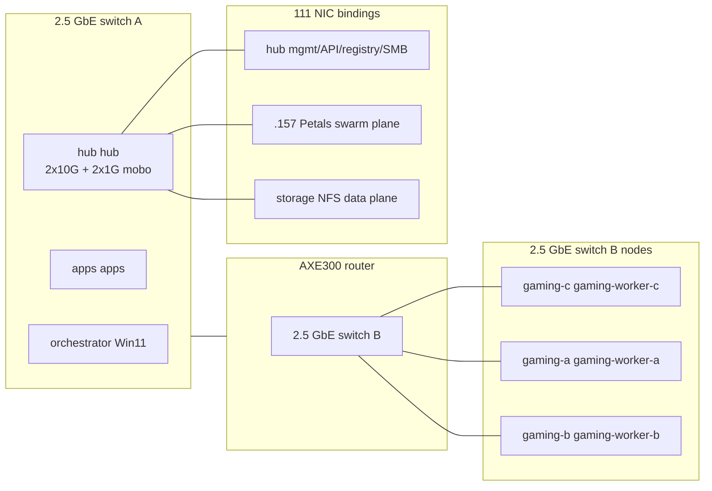

# Roadmap — operator-facing

> **PRIMARY WORKING SET — Phase H (2026-06-26).** `gaming-c` /
> `gaming-a` / `gaming-b` are **gaming / intermittent**. Day-to-day work runs on **`orchestrator` /
> **`apps` / `hub` / `inference`** (`.157` Petals plane **retired**; NFS VIP **`storage`** on `br1`).
>
> **Code (`frontier-code`):** **Qwen3.8-27B Q8_0** via llama.cpp RPC pool (production,
> flipped 2026-08-17). **Rollback:** **Qwen3.6-27B Q8_0** on hub via env --
> see [§ Model upgrade ladder (Aug 2026)](#model-upgrade-ladder-aug-2026).
> **CPU coordinator on `hub` `:31360`**. Shards: `inference:31356`/`:31357`
> (3060 + **5060**), `orchestrator:31350`, opt-in mesh + `hub:31353` (3050 tail).
> LiteLLM: **`http://127.0.0.1:31360/v1`**. RAG: CPU embed + rerank on **`rag`**
> (`:11435` + `:8360`) when cut over (else `inference` legacy).
>
> **`frontier` / `frontier-code`:** both **27B** RPC today; exclusive **Pool72**
> (Qwen2.5-72B Q5) / **Pool80** (Coder-Next Q5) via GUI `InferenceMode`.
>
> **Sub-frontier (35B MoE):** **`qwen3.6:35b-a3b`** via RPC when 27B stopped
> (optional; not day-default). Future chat: **Qwen3.5-122B-A10B** --
> mutually exclusive with 35B RPC pool on same GPUs.
>
> **`gaming-c`:** **`qwen3.5:27b` removed** — no quality chat LLM (embed opportunistic only).
>
> **Petals retired (2026-07-09):** gaming hosts **`gaming-c` / `gaming-a` / `gaming-b`** were offline
> during hub/runtime purge. **Deferred cleanup** when each comes online — see member
> READMEs (`gaming-worker-b-249`, `gaming-worker-c-59`, `gaming-worker-a-219`) and
> [FOUR_HOST_FRONTIER_POOL.md §9](../.cursor/plans/FOUR_HOST_FRONTIER_POOL.md).
>
> **SSoT:** [.cursor/plans/FOUR_HOST_FRONTIER_POOL.md](../.cursor/plans/FOUR_HOST_FRONTIER_POOL.md)
> Phase **G-rev** (implementation pending). Routing SoT: [`deploy/litellm_config.yaml`](../deploy/litellm_config.yaml)
> (update when G-rev lands).

Near-term work on the LAN llama.cpp RPC frontier pool + ALFa AI rollout.
**[DOCUMENTATION_CANONICAL.md](DOCUMENTATION_CANONICAL.md)** — canonical Git branch, `GIT_BRANCH` on NAS pulls, and prod-vs-`deploy/env.example` verification. See **[NODE_INVENTORY.md](NODE_INVENTORY.md)** for hostnames, IPs, and per-node hardware.

> **inference start-failure fix (2026-07-03, active):** five-agent audit of the failed
> `20260703-233033-start`. Root cause = RPC accept-queue wedge during `hub`
> coordinator cold-load (misread as shard failure) + missing `orchestrator` Hyper-V firewall
> rules; contracts-bot and the `cuda128-b8552` image are cleared. Executable fix plan
> for Composer 2.5: [.cursor/plans/inference_START_FIX_PLAN.md](../.cursor/plans/inference_START_FIX_PLAN.md).

## Next step: apps startup list cleanup (PR #12)

> [#12](https://github.com/example/alfa-ai/pull/12) (branch `fix/105-startup-list`) removes atems (`atems`), market-pie5-bot (`market`), monitoring (`monitor`), and uspbf (`probilliards`) from `deploy/cluster-members/apps/stacksapps.yml`, the list `deploy.sh` / `boot-all-stacks.sh` starts on `apps`. credit-check-bot and rv-auto-finder stay: their containers were still up on `apps` (do not `docker compose down` them).

- [ ] **apps after merging #12:** `cd /home/operator/alfa-ai && git pull`, then `docker ps` and confirm the removed stacks (atems, market-pie5-bot, monitoring, uspbf) are not running on `apps`. If one is, confirm its real host copy is healthy, then stop it on `apps`. Do **not** stop credit-check-bot, rv-auto-finder, contracts-bot, alfaqd-website, or shared postgres/redis.
- [ ] **Until `apps` has pulled #12, don't run `deploy/cluster-members/apps/deploy.sh` (or `boot-all-stacks.sh`) without `--only`**: the old list would start duplicate copies of the moved stacks (atems, market-pie5-bot, monitoring, uspbf) on `apps`.

## Next step: post-merge host steps from the 2026-09-26 review (PR #10 fixes, PR #11 deps)

> Open for review 2026-09-26: [#10](https://github.com/example/alfa-ai/pull/10) (bcrypt 72-byte 500s, `setup-2fa` could switch off 2FA, `glob_files` / admin file browser path containment, stale tests) and
> [#11](https://github.com/example/alfa-ai/pull/11) (asyncssh security fix, Python patch/minor bumps, frontend `npm audit` fixes, nginx 1.30.5-alpine).
> The two PRs don't depend on each other; merge in either order and do one rebuild after both. This section lives on the #10 branch but covers both PRs.
> No new env vars, no DB migration, no secrets to rotate.

**Before pulling**

- [ ] Nothing to back up (neither PR removes tracked files or changes `.env`).

**After merging PR #10 (fixes)**

- [ ] **hub brain:** `cd /mnt/HDDs/Alfa-AI/repo/alfa-ai && git pull --ff-only`.
- [ ] **hub brain — rebuild and recreate `alfa-ai-api`** (the image bakes in `src/`): `sudo bash deploy/cluster-members/hub/build-start-alfa-ai-111.sh --skip-pull` (the new commit gives a new `alfa-ai-app:<hash>` tag, so the API image is rebuilt). By hand instead: `cd deploy && bash ../scripts/preflight_api_ownership.sh compose-will-manage-api && docker compose --env-file .env -f docker-compose.yml build alfa-ai-api && docker compose --env-file .env -f docker-compose.yml up -d alfa-ai-api`.
- [ ] **Verify:** log in normally; `POST /auth/setup-2fa` for a user who already has 2FA on now returns 409; setting a password longer than 72 bytes returns a clear 422 (logins with existing long passwords keep working).

**After merging PR #11 (deps)**

- [ ] **hub brain:** `git pull --ff-only`, then the same rebuild + recreate of `alfa-ai-api` as above (`pip install -r requirements.txt` runs in `deploy/Dockerfile.api`; the frontend is built in the image). If #10 and #11 are merged together, one rebuild covers both.
- [ ] **hub brain — nginx 1.30.5:** `cd /mnt/HDDs/Alfa-AI/repo/alfa-ai/deploy && docker compose --env-file .env -f docker-compose.yml pull alfa-ai-nginx && docker compose --env-file .env -f docker-compose.yml up -d alfa-ai-nginx`.
- [ ] **inference edge stacks — nginx 1.30.5:** after `git pull --ff-only` in the alfa-ai clone on inference: `cd deploy && docker compose -f docker-compose.edge-api.yml pull && docker compose -f docker-compose.edge-api.yml up -d`, and the same for `docker-compose.contracts-edge.yml` (or re-run `deploy/cluster-members/_common/start-edge-api.sh` and `start-contracts-edge.sh`).
- [ ] **Non-Docker frontend builds** (any host that builds `frontend/` outside Docker): `cd frontend && npm ci` before the next build (lockfile regenerated).
- [ ] **Verify:** `docker ps` shows the new `alfa-ai-app:<hash>` image and `nginx:1.30.5-alpine`; the GUI loads and chat works.

**Decisions for you**

- [x] **LiteLLM pin** is `ghcr.io/berriai/litellm:v1.103.2` in compose ([STABLE_RELEASES.md](STABLE_RELEASES.md)). Recreate on `hub` still has to pull that tag; SpendLogs index note is in the same doc.
- [ ] **Guest chat message size cap:** `GuestChatMessage.content` has no max length (`src/api/routers/guest.py:57`); pick a cap (product decision). (#10 deferred)
- [ ] **Revoke tokens on password change / admin reset:** needs a token-version column (schema change); refresh tokens currently last 70 days. (#10 deferred)
- [ ] Guest limiter in-memory fallback `_memory_usage` is never pruned (tied to the on-hold client-IP work); `editor_agent` returns raw exception text (admin-only, low). (#10 deferred)
- [ ] **react-router-dom 6 → 7** is the only fix for the 2 remaining moderate `npm audit` advisories (not reachable today); needs a UI smoke test. Other majors (openai 3, redis 8, React 19, tailwind 4, TypeScript 7, …) are listed in #11. `packages/chat-widget` has no lockfile and wasn't audited. (#11)
## Next step: post-merge host steps from the 2026-09-25 security review

> Merged 2026-09-25: [#5](https://github.com/example/alfa-ai/pull/5) (login lockout + per-IP limit),
> [#6](https://github.com/example/alfa-ai/pull/6) (deploy/config drift, Petals leftovers),
> [#7](https://github.com/example/alfa-ai/pull/7) (src hardening),
> [#8](https://github.com/example/alfa-ai/pull/8) (aria2 RPC secret from env, `frontend/node_modules` untracked).
> Do these on the next pull/deploy, then tick or remove this section. Placeholders only; real values stay in `.env`.

- [ ] **Rotate the aria2 RPC secret.** The old default is in git history; treat it as public. New value: `openssl rand -hex 24`. (#8)
- [ ] **Every aria2 host** (hub hub + any host running the `alfa-aria2` stack): put `ARIA2_RPC_KEY=<new>` in `deploy/aria2/.env` (or the Dockge stack Environment), then `docker compose up -d` in `deploy/aria2/`. The stack **refuses to start** without it (bootstrap scripts write it if `ARIA2_RPC_KEY` is exported first). (#8)
- [ ] **hub brain — `git pull --ff-only`, then `deploy/.env`:**
  - [ ] Add `ARIA2_RPC_KEY=<new>` (else Admin → Models downloads return 503). (#8)
  - [ ] Check which client IP the API sees for public logins via the `inference` edge. If it is `orchestrator`, add it to `FORWARDED_ALLOW_IPS` (e.g. `127.0.0.1,10.0.0.0/8,172.16.0.0/12,orchestrator`; never `*`), otherwise all public users share one failed-login bucket and can all get 429. (#5)
  - [ ] Optional: `ALFA_AI_LOGIN_IP_MAX_FAILURES` / `ALFA_AI_LOGIN_IP_WINDOW_SEC` (defaults 20 / 900 s); make sure `REDIS_URL` works so the limit is shared across workers. (#5)
- [ ] **hub brain — recreate LiteLLM** (`docker compose up -d alfa-ai-litellm`, or the normal full stop/start from orchestrator) unless `deploy/.env` already sets `EMBED_BASE_URL`/`RERANK_BASE_URL` to rag. Leave `LLAMACPP_7B_URL` unset until the 7B is promoted. (#6)
- [ ] **hub brain — redeploy/recreate `alfa-ai-api`** in the normal order. No DB migration and no other new env vars. (#5, #7, #8)
- [ ] **pool-opt-in:** `git pull --ff-only` (no redeploy). If `docker ps` still shows `alfa-ai-embed-ollama` / `alfa-ai-reranker`, run `operator-cluster-100.sh stop-rag` (pool-opt-in is inference shard only). (#6)
- [ ] **apps, rag, gaming-c, gaming-b:** `git pull --ff-only` only. (#6)
- [ ] **Clients** (apps / orchestrator / gaming-b / gaming-c / gaming-a shells, cron jobs, Windows user env): export `ARIA2_RPC_KEY` before sourcing `aria2-env.*` or running `http_fetch.sh`, `hub_hub_models.sh` or the aria2 smoke scripts. (#8)
- [ ] **Any host after pull:** `frontend/node_modules` is deleted from the working tree; run `npm ci` in `frontend/` before any local (non-Docker) frontend build. Docker builds are unaffected. (#8)
- [ ] **Smoke:** public + LAN login works; a locked account (incl. admin) now sees the generic "Invalid email, username, or password" for up to 15 min — unlock with `POST /alfa-ai/api/admin/users/{id}/unlock`, Admin → Users → set password, or `scripts/reset_admin_password.py` ([AUTH_ACCOUNT_LIFECYCLE.md](AUTH_ACCOUNT_LIFECYCLE.md)). Run the host's aria2 smoke script with the new secret. (#5, #8)
- [ ] **Tests:** GitHub Actions is disabled (`ci.yml` last ran 2026-09-11). Run `pytest` locally, or re-enable Actions. (#5–#8)

Open decisions / deferred:

- [ ] X-Forwarded-For (review Medium #8): switch `get_client_ip()` (admin CIDR allowlist, guest limit, honeypot, audit IP; `routers/pool_switch.py` has its own copy) to the proxy-resolved IP once the `inference` edge-IP question above is answered. (#5, #8)
- [ ] Admin UI "Unlock" button + lock-status column; `count_recent_failures` is not reset by a successful login. (#5)

## Model upgrade ladder (Aug 2026)

> **inference production (2026-08-17):** **Qwen3.8-27B Q8_0** is live on `frontier-code`
> / `frontier` (same RPC mesh, `PARALLEL=5`, `CTX_SIZE=262144`). LiteLLM/coordinator
> served id stays **`qwen3.6-27b`** per [LiteLLM proxy configs](https://docs.litellm.ai/docs/proxy/configs).
> **Rollback:** `inference_MODEL_FILE=Qwen3.6-27B-Q8_0.gguf` +
> `ALFA_inference_FAMILY=qwen36` (keep 3.6 Q8 on hub). Prefer **Q8_0** for dense 27B;
> F16 is not a goal.

### Primary (inference / `frontier-code`)

| Status | Model | Notes |
|--------|-------|-------|
| **Production (now)** | **Qwen3.8-27B Q8_0** (~29 GB) | [unsloth/Qwen3.8-27B-GGUF](https://huggingface.co/unsloth/Qwen3.8-27B-GGUF); arch [Qwen/Qwen3.8-27B](https://huggingface.co/Qwen/Qwen3.8-27B); TTFT ~191 s on full mesh for simple Instruct prompts (accepted) |
| **Hub rollback** | **Qwen3.6-27B Q8_0** (~28.6 GB) | Env-only rollback; do not remove from hub |

### Other fleet models we already run or stage (same week / follow-on)

| Role | Today | Watch / upgrade | Constraint |
|------|-------|-----------------|------------|
| **Exclusive code (Pool80)** | Qwen3-Coder-Next **Q5_K_M** @ CTX 86016 | Qwen3.8 **coder** or Max-derived MoE that fits ~57–62 GiB full-mesh | Exclusive vs 27B; same YOLO margin rules as [GREV80_80B_OPERATOR.md](GREV80_80B_OPERATOR.md) |
| **Exclusive chat (Pool72)** | Qwen2.5-72B-Instruct **Q5_K_M** @ CTX 86016 | Next dense **~70B Qwen instruct** GGUF (3.x line) when published | Exclusive; not concurrent with inference/80 |
| **Sub-frontier MoE (optional)** | Qwen3.6-**35B-A3B** | Qwen3.8 **~35B-A3B-class** MoE if released | Switch-only on `:31360`; not day-default |
| **Large MoE chat (staged)** | Qwen3.5-**122B-A10B** (hub) | Stay until a 3.8 MoE chat clearly beats it on our mesh | Exclusive vs 27B/35B |
| **Embed / rerank** | Qwen3 embedding + rerank (`rag` cutover) | Newer **Qwen3.8** embed/rerank if shipped and TEI/llama.cpp compatible | Re-embed corpora on switch |
| **Qwen3.8-Max open weights** | — | Evaluate **only** if a GGUF quant fits exclusive full-mesh (~84 GB physical) | Likely too large; research note only until sized |

### Operator sequence (rollback to 3.6 Q8 only)

1. On `hub` brain `deploy/.env`: `inference_MODEL_FILE=Qwen3.6-27B-Q8_0.gguf`,
   `ALFA_inference_FAMILY=qwen36` (or run `switch-pool-27b.sh` with 3.6 file).
2. Full **stop** then **start** (orchestrator only). Smoke `frontier-code`
   (LiteLLM alias still `qwen3.6-27b`).
3. To return to production 3.8: clear overrides / default `Qwen3.8-27B-Q8_0.gguf`,
   `ALFA_inference_FAMILY=qwen38`, stop+start.

SSoT checklist: [.cursor/plans/FOUR_HOST_FRONTIER_POOL.md](../.cursor/plans/FOUR_HOST_FRONTIER_POOL.md) **A4** (done 2026-08-17).

### Post-Pool80 research: SwitchYard-style routing + Nemotron weak sidecar

> **2026-08-11 eval:** NVIDIA NeMo SwitchYard (per-request model routing) overlaps
> LiteLLM + exclusive pool switching; **do not** add a SwitchYard proxy in production.
> Nemotron 3 Nano is a candidate **concurrent weak** backend for escalation routing
> implemented in LiteLLM/brain — **after** Pool80 is green. Full mapping:
> [experimental/NEMOTRON_SWITCHYARD_EVAL.md](experimental/NEMOTRON_SWITCHYARD_EVAL.md).
> Plan hook: FOUR_HOST **A5**.

## Priority queue (Jul 2026)

| # | Item | Status | Plan / doc |
|---|------|--------|------------|
| **0** | **NIST AI RMF + Google SRE alignment** (oversight, progressive autonomy, all repos/hosts) | **TOP — Composer 2.5** | [.cursor/plans/COMPOSER_NIST_SRE_ALIGNMENT.md](../.cursor/plans/COMPOSER_NIST_SRE_ALIGNMENT.md), [AI_GOVERNANCE.md](AI_GOVERNANCE.md), [standards/](standards/README.md) |
| **1** | Alert L1 enrichment briefing (Analyze quality + verifier dual-check) | After Wave 0–1 of #0 | COMPOSER plan Wave 3; then resume alert chat purpose |
| **2** | Context window / Ask-AI prompt limits (contracts-bot dashboard exceeds inference `n_ctx`) | **Phase 2** `PARALLEL=10` + `CTX_SIZE=163840` (16384/slot) + `-b 4096` repo 2026-07-10 — verify after full start; see [inference_PERF_AND_SHARDS.md](inference_PERF_AND_SHARDS.md) | [.cursor/plans/CONTEXT_WINDOW_ASK_AI.md](../.cursor/plans/CONTEXT_WINDOW_ASK_AI.md) |
| **3** | Agent platform Phase 0 + research memory + SearXNG | **Live on `hub` (2026-09-04):** SearXNG + `web_search` verified; hub tarball `searxng-searxng-latest.tar.gz`; **LAN admin missions only** (not guest/public). Phase 2 WorkflowRunner next | [.cursor/plans/AGENT_PLATFORM_GROK_ALIGNMENT.md](../.cursor/plans/AGENT_PLATFORM_GROK_ALIGNMENT.md), [AGENT_RESEARCH_TOOLS.md](AGENT_RESEARCH_TOOLS.md) |
| **4** | Protected dedicated Postgres/Redis on `hub` (runtime bring-up + verify) | **Complete** (2026-07-07) | This doc, § below |
| **5** | Gaming-host opportunistic boost (§9 gaming-worker-b/gaming-worker-c) | After #0–2 stable | [.cursor/plans/FOUR_HOST_FRONTIER_POOL.md](../.cursor/plans/FOUR_HOST_FRONTIER_POOL.md) §9 |
| **6** | CPU RAG on **`inference`**; **1660S** (`pool-opt-in`) + **1070** (`secondary`) as inference shards — 6-shard pool | **`inference` RAG + `pool-opt-in` shard landed** (2026-07-09; pending one full cluster stop/start to add `pool-opt-in` to `RPC_BACKENDS`). **Paused on `secondary`** — SSH/OS done (`Nickey-Nakita`, 16 GiB, Wi‑Fi); resume when **1070** installed | [.cursor/plans/RAG_248_VM100_SHARD.md](../.cursor/plans/RAG_248_VM100_SHARD.md) |
| **7** | **Learning loop + custom model ladder** — flywheel, hub publish, alfa-train QLoRA | **L2 hub publish + MANIFEST v1 landed** (2026-08-12); **OP-LL-3** when trainer island free; Pool80 deferred while `gaming-a` gaming | [LEARNING_LOOP_JUDGE_SLEEP.md](../.cursor/plans/LEARNING_LOOP_JUDGE_SLEEP.md), [TRAIN_PACK_MANIFEST.md](operations/TRAIN_PACK_MANIFEST.md) |
| **8** | **Ask ALFa Cursor-token offload** — CI paste triage, reproduce, Cursor handoff | **Implemented** (Waves A–E in repo); brain redeploy + operator habit | [.cursor/plans/ASK_ALFA_CURSOR_OFFLOAD.md](../.cursor/plans/ASK_ALFA_CURSOR_OFFLOAD.md) |
| **9** | **SwitchYard-style routing + Nemotron Nano weak sidecar** (LiteLLM/brain escalation; no SwitchYard proxy) | **Research done**; implement **after Pool80 green** | [experimental/NEMOTRON_SWITCHYARD_EVAL.md](experimental/NEMOTRON_SWITCHYARD_EVAL.md), FOUR_HOST **A5** |
| **10** | **Harness cutting-edge (conservative)** -- Ask ALFa native tools opt-in, skills progressive disclosure, inspect compaction, MCP inspect-only | **H1--H4 in repo** (H1/H4 default off; H3 always-on prompt compact). Operator smoke + env flags still off. | [.cursor/plans/HARNESS_CUTTING_EDGE_2026-09.md](../.cursor/plans/HARNESS_CUTTING_EDGE_2026-09.md) |
| **P** | **Incident-worker SMTP** (`ALFA_AI_INCIDENT_SMTP_*` on `hub` `deploy/.env`) | **Parked 2026-09-02** -- not a current workstream. `monitor` Alertmanager mail is separate and still live. | [INCIDENT_RESPONSE.md](INCIDENT_RESPONSE.md) Email notification |

## Operational hardening: protected dedicated Postgres/Redis + apps edge stacks (2026-06-30, complete 2026-07-07)

**Big picture / why we are doing this**

Routine cluster start/stop (`orchestrator` `Start-Stop-AlfaAi.ps1` + `hub` `operator-cluster-111.sh` + `scripts/stop.sh`) was doing full `docker compose down` on the monolithic brain stack (and an explicit down of the edge proxy on `apps`). This stopped the shared `alfa-ai-postgres` / `alfa-ai-redis` (previously defined inside `deploy/docker-compose.yml`) and the `alfa-ai-edge-api` (nginx) on `apps`.

These are **cross-repo shared infrastructure**:
- Postgres and Redis on `apps` and `hub` are used by the alfa-ai brain + many bots and websites (rankings-bot, alfa website, uspbf, probilliardssoftware, contracts-bot, credit-check, etc.).
- The `apps` edge nginx is used by other site frontends on `apps` for  admin login (`/alfa-ai/login`) and `/alfa-ai/*` routing.

Priority rule: these must **never** be taken down by normal cluster lifecycle, and their data must never be at risk (`-v` / volume removal is forbidden).

**Goal**
- Postgres and Redis are always managed as their own "own file" dedicated protected stacks (re-using the existing split compose files `docker-compose.postgres.yml` / `docker-compose.redis.yml`).
- Declared in `stackshub.yml` (and already in `stacksapps.yml`) as `critical: true` and explicitly excluded from stop.
- The `apps` `alfa-ai-edge-api` is also treated as protected cross-site infra.
- The brain monolithic compose no longer owns the DB containers/services.
- Existing named volumes / fast-pool bind data are attached (zero data loss, no re-initialization).
- Brain and consumers talk to the dedicated containers over a shared Docker network (DNS names `alfa-postgres` / `alfa-redis`).
- All stop/start paths, deploy scripts, health checks, backup sidecar, and docs are updated.
- Immediate support for safe per-repo DB copies (for isolation now) + natural path to per-VM segregation later.

**Approach (followed the attached segregation plan, doc-first)**
- Docs updated first (DOCKGE_111_OPERATOR, DOCKGE_105_OPERATOR, DOT105_SHARED_DATA_PLANE, CLUSTER_START_STOP_OPERATOR, HOST_STORAGE_AND_NETWORK_STANDARDS, DEPLOYMENT_BASELINE, operations/POSTGRES_BACKUP_RESTORE_111, plus cross-refs in many other docs).
- Manifests: added dedicated `postgres` + `redis` stacks in `stackshub.yml`.
- Brain compose cleaned of the two DB services + their volumes.
- Stop paths hardened (`stop.sh` --app-only semantics + notes, operator-cluster-111.sh now calls --app-only, orchestrator on orchestrator no longer downs DBs or the apps edge by default).
- Network made flexible in the split ymls via `ALFA_SHARED_DOCKER_NETWORK`.
- hub `deploy.sh` updated to bring the dedicated DB stacks before the brain.
- Backup sidecar retargeted to the dedicated container name.
- Added `scripts/copy-shared-db-to-per-repo.sh` + guidance.
- Filters, health scripts, comments, and port guards cleaned up.
- Volume attach support via `ALFA_POSTGRES_DATA_PATH` / `ALFA_REDIS_DATA_PATH` for binding to existing SSD data.

**Current status (2026-07-07 — complete)**

- Dedicated stacks on `hub`: `alfa-postgres` + `alfa-redis` (healthy, SSD bind mounts at `/mnt/ssd/alfa-ai/{postgres,redis}`).
- DNS: `alfa-ai-api` resolves `alfa-postgres` / `alfa-redis` on `alfa-ai-network`.
- Protection proof: full cluster **stop** (100s) left both DB containers **Up (healthy)** while brain/LiteLLM/pool downed; **start** (557s) all post-start checks OK.
- Stop path: `scripts/stop.sh --app-only` — dedicated DB stacks never downed.

**Priority #1 closed.** Next: [CONTEXT_WINDOW_ASK_AI.md](../.cursor/plans/CONTEXT_WINDOW_ASK_AI.md).

This work protects data and availability for all sites on the shared data plane and is a prerequisite for per-VM DB segregation.

## Agent platform — Grok/Cursor alignment on 27B (2026-07-01 research pass)

> **SSoT:** [.cursor/plans/AGENT_PLATFORM_GROK_ALIGNMENT.md](../.cursor/plans/AGENT_PLATFORM_GROK_ALIGNMENT.md)
>
> Multi-agent research pass (alfa-ai architecture, contracts-bot integration, Grok
> Build harness). **Inference is production-ready** (inference `qwen3.6-27b` on
> `hub:31360`; contracts-bot bid-brief + Ask AI proven). **Orchestration Phase 0
> shipped:** `skills/` (audit-repo, implement, review, check-work), coder wired to
> `run_agent()`, editor sidebar + tool-event SSE. **Cursor IDE project skills** added
> for daily cluster/git/deploy ops (see [CURSOR_TOOLS_AND_SKILLS.md](CURSOR_TOOLS_AND_SKILLS.md)).
> Still JSON-in-text tool protocol (native function calling = Phase 3). Phase 3 **27B-safe waves H1--H4** are in [HARNESS_CUTTING_EDGE_2026-09.md](../.cursor/plans/HARNESS_CUTTING_EDGE_2026-09.md) and do **not** wait for Pool80; Pool80 still gates Phase 4 budget raises.

### Operator goals (this plan)

| Goal | Today | Next |
|------|-------|------|
| **Browser usage** | SPA chat, operator console, guest widget | Editor AI sidebar + tool-event SSE |
| **Auditor in programs** | `POST /api/runs` research_only (LAN) | `skills/audit-repo` + `POST /api/agent/review` JSON |
| **Code editor** | Monaco admin editor (human-only) | Ask ALFa panel with open-file context |
| **Autonomous maint** | Incident playbooks (ops) | Scheduled audit missions → patch+test with human gate |
| **Cursor/Grok parity** | LiteLLM consumer pattern only in bots | implement→review→fix loop + SKILL.md library |

### Architecture snapshot (three patterns)

1. **LiteLLM consumer** — contracts-bot, rankings-bot → `:8413/v1/chat/completions`
   (HTTP only; no workspace tools). **Keep this boundary.**
2. **ALFa web** — JWT chat, Monaco editor, admin health at `/alfa-ai/*`.
3. **Orchestrator** — Bearer `:8420/api/runs*` → `run_agent()` tools under
   `ALFA_AI_WORKSPACE_ROOT`.

### Grok Build vs alfa-ai (what transfers locally)

Grok Build (`~/.grok/`) uses cloud `grok-build` for inference but ships a
**replicable orchestration layer**. Highest-leverage patterns for homelab:

| Pattern | Adopt in alfa-ai |
|---------|------------------|
| `SKILL.md` workflow library | `alfa-ai/skills/` (audit, implement, review, check-work) |
| Orchestrator never implements | `WorkflowRunner` spawns roles; API parent never edits files |
| Structured review artifacts | `artifacts/{run_id}/review.md` with severity + file:line |
| implement→review→fix loop | Max 3 rounds on 27B; expand on 70B/80B |
| Implement memory | Per-repo pattern file at `$ALFA_AI_DATA/implement-memory/` |
| check-work verifier | `VERDICT: PASS/FAIL` + fix rounds before merge |
| MCP (later) | Filesystem + git on LAN; Playwright deferred until 80B |

**Not portable without cloud:** 512K context, backend search, xAI session auth.

### Model-size policy (27B now; 35B/70B/80B when loaded)

Build interfaces model-agnostic; tune **budgets** per tier:

| Parameter | 27B (active) | 70B/80B (future HW) |
|-----------|--------------|---------------------|
| Agent max steps | 6–8 | 12–20 |
| Tool protocol | JSON-in-text | OpenAI `tools` + parallel reads |
| Review rounds | max 3 | max 5 |
| Parallel reviewers | 1 | 2–3 |
| Autonomous PRs | no (human gate) | Milestone 8 batch runner |
| Browser automation | `fetch_url` only | Playwright tool |

27B and 35B MoE pools remain **mutually exclusive** on shared GPUs. contracts-bot
keeps `CONTRACT_AI_FALLBACK_ENABLED=false` during inference.

### Phased execution (summary — detail in SSoT plan)

**Phase 0 (foundations, no new models):**

1. Wire **coder** role to `run_agent()` — `src/runtime/roles.py` (biggest gap).
2. Add **`edit_file`** tool + **`skills/`** scaffold (`audit-repo`, `implement`, `review`).
3. Port **personas** + structured **review.md** artifact format.
4. Emit **tool_events** to operator UI.

**Phase 1 (browser, 27B) — implemented 2026-07-01 (deploy pending):**

5. ✅ Monaco **Ask ALFa** sidebar + `POST /alfa-ai/api/admin/agent`.
6. ✅ Tool-event **SSE** `GET /api/runs/{id}/events`; **auto process-next** via `agent-worker` profile.
7. ✅ Read-only **multi-repo audit roots** (`ALFA_AI_AUDIT_ROOTS=name=/path`).
8. ⏳ Rebuild frontend + deploy on `hub`; run live audit on inference.

**Phase 2 (workflow loops):**

8. **WorkflowRunner** implement→review→fix (Grok `/implement` adaptation).
9. **`POST /api/agent/review`** for contracts-bot and other consumers.
10. **check-work** verifier + implement memory.

**Phase 3–4 (tool upgrade + HW unlock):**

11. Native function calling via LiteLLM; inspect-only MCP first (H4 in [HARNESS_CUTTING_EDGE_2026-09.md](../.cursor/plans/HARNESS_CUTTING_EDGE_2026-09.md)); filesystem/git MCP parked.
12. When 80B RPC un-defer gate passes → raise budgets, Milestone 8 overnight PRs.

**Phase 5 (learning loop — Priority #7):**

13. Error catalog + corrective-analyst + scheduled read-only audits + eval smoke (**L0**).
14. Independent **judge** model on `gaming-c` dual-check 27B (**L1**).
15. Sleep Tier A memory curator + preference export (**L2**). **Data flywheel MAPE Tier A**
    (`run_data_flywheel.py`) + **LoRA registry/coordinator wrapper** — see
    [DATA_FLYWHEEL_OPERATOR.md](operations/DATA_FLYWHEEL_OPERATOR.md),
    [LORA_ADAPTER_OPERATOR.md](operations/LORA_ADAPTER_OPERATOR.md).
16. Sleep Tier B QLoRA on trainer island (full Blackwell or gaming subset) via **alfa-train** (**L3**).
17. Optional judge adapter + progressive autonomy gates (**L4**).
18. **Custom model ladder** — merged SFT / DPO / production alias promote (**L5+**); see
    [§ Custom model / fine-tune ladder](#custom-model--fine-tune-ladder-l3l7) below.

SSoT: [.cursor/plans/LEARNING_LOOP_JUDGE_SLEEP.md](../.cursor/plans/LEARNING_LOOP_JUDGE_SLEEP.md).

### Parallel tracks (Aug 2026)

| Track | Operator focus now | Does not block |
|-------|-------------------|----------------|
| **Pool80 inference** | Bring up exclusive Qwen3-Coder-Next Q5 (`-InferenceMode Pool80`); `secondary` online + hub `b10355` | Learning-loop data collection on brain |
| **Custom model ladder** | Enable flywheel; nightly Tier A + **hub publish**; accumulate train packs | Pool80 when gaming mesh idle (`gaming-a` free) |

**Policy:** Production pool (inference / Pool72 / **Pool80**) stays on **official base GGUF**
until a home-trained checkpoint passes the **morning eval gate** (≥70% vs base on gold
suites). LoRA overlays and merged weights are **promoted**, never silently swapped.

### contracts-bot integration (proven path — extend, don't replace)

contracts-bot is a **pure LiteLLM consumer** (`api/services/litellm_client.py`).
27B works for structured bid briefs, Ask AI, and deferred queue analysis. Add
**review API** for code-audit phases without breaking
[ALFA_AI_BOUNDARY.md](../../contracts-bot/docs/ALFA_AI_BOUNDARY.md) consumer policy.

### Immediate next actions (operator priority)

1. **L2 data loop (when cluster is up):** set `ALFA_AI_FLYWHEEL_ENABLED=1` on brain; run
   `bash scripts/learning_loop_tier_a.sh` nightly. Verify packs under
   `/mnt/HDDs/Alfa-AI/training/alfa-train/datasets/from-alfa-ai/` —
   [TRAIN_PACK_MANIFEST.md](operations/TRAIN_PACK_MANIFEST.md). Admin:
   `GET /alfa-ai/api/admin/learning-loop/status`.
2. **Pool80:** when `gaming-a` gaming mesh idle, full orchestrator start with
   `-InferenceMode Pool80` (see [GREV80_80B_OPERATOR.md](GREV80_80B_OPERATOR.md)).
   After Pool80 is green, smoke `ALFA_AI_NATIVE_TOOLS=1` (JSON-in-text remains fallback).
3. First **OP-LL-3** QLoRA night when `gaming-c` is free and hub train packs exist.
4. **OP-LL-1** judge install on `gaming-c` when that host is free (not required for Pool80).

## Learning loop, judge, sleep training (Priority #7 — 2026-07-11)

> **SSoT plan:** [.cursor/plans/LEARNING_LOOP_JUDGE_SLEEP.md](../.cursor/plans/LEARNING_LOOP_JUDGE_SLEEP.md)  
> **Research:** [research/LEARNING_LOOP_AND_JUDGE_RESEARCH.md](research/LEARNING_LOOP_AND_JUDGE_RESEARCH.md)  
> **Train island:** sibling repo `alfa-train` — **`gaming-c` + `gaming-b`** (~24 GB), optional **`gaming-a`**; **`inference` stays on inference core**

### Goals

| Goal | Approach |
|------|----------|
| Agents from simple host-repo checks → project analysis → online best-practice research | Skills + scheduled `POST /api/runs` (read-only first) |
| Error lists + corrective action analysis | `error-cataloger` → `corrective-analyst` → human-gated implement |
| **Judge** double-checks 27B | Independent **14B-class** model on **`gaming-c`** (LiteLLM `judge`); tests/`check-work` remain primary for code |
| Learn during sleep hours | **Tier A:** memory consolidation + preference export (no weight train). **Tier B:** QLoRA overlays via alfa-train when gaming hosts free |
| **Train your own model** | PEFT on open bases first (LoRA → merge → full SFT → DPO); **not** foundation pretrain on this hardware |
| Not training a foundation model | PEFT on open bases you already run; production routes frozen until eval gate |

### Phase map (L0–L7)

| Phase | Name | When | Exit |
|-------|------|------|------|
| **L0** | Harness | After / with agent Phase 2 WorkflowRunner | Error catalog + corrective memos + eval smoke |
| **L1** | Judge install | `gaming-c` free | LiteLLM `judge`; freeform + research dual-check; never auto-approve |
| **L2** | Sleep Tier A + flywheel | After L0 | Night curator; preference packs; MAPE reports on hub |
| **L3** | Sleep Tier B QLoRA | alfa-train 0–2 done; hosts free | 7B checkpoint ≥70% eval; production routes unchanged |
| **L4** | Judge adapter / autonomy | After L1–L3 data | Progressive autonomy only where gates pass |
| **L5** | LoRA promote | L3 checkpoint + hub GGUF | `--lora` on coordinator after full stop/start |
| **L6** | Merged / full SFT | L5 wins on eval | New GGUF on hub; optional LiteLLM alias |
| **L7** | DPO + domain CPT | Preference volume | Beats base on role suites; eval-gated promote |

### Custom model / fine-tune ladder (L3–L7)

**Ultimate goal:** a **home-trained model** that reflects your cluster's missions, audits,
feedback, and domain — deployed like any other pool, with eval gates and rollback.

**Not in scope:** training a new foundation model from random init on homelab GPUs.

```text
L2 (brain, no weights)     L3 (alfa-train)           L5+ (your model)
─────────────────────      ───────────────           ─────────────────
errors + feedback    →     QLoRA 7B sandbox    →     LoRA on inference/80 coordinator
sleep curator        →     QLoRA 27B/80B overlay →   merge LoRA → full GGUF
export_train_pack    →     eval ≥70% vs base   →     DPO from preference pairs
flywheel MAPE report →     hub checkpoint      →     new LiteLLM alias / pool mode
```

| Stage | What you get | Base models (today) | Where |
|-------|----------------|---------------------|--------|
| **L2 — data** | Train packs, preference JSONL, lessons | n/a | `hub` brain — [DATA_FLYWHEEL_OPERATOR.md](operations/DATA_FLYWHEEL_OPERATOR.md) |
| **L3 — adapter** | PEFT checkpoint → LoRA GGUF | Qwen3.6-27B; later **Pool80 Coder-Next** | Full Blackwell or gaming subset — [SLEEP_TRAIN_TIER_B.md](operations/SLEEP_TRAIN_TIER_B.md) |
| **L5 — overlay** | `--lora` on running coordinator | Same base as active pool | `hub` — [LORA_ADAPTER_OPERATOR.md](operations/LORA_ADAPTER_OPERATOR.md) |
| **L6 — merged** | Single GGUF replaces base+adapter | Winning checkpoint only | alfa-train merge + hub seed |
| **L7 — aligned** | DPO / CPT on domain corpus | L6 weights | alfa-train; eval on [EVALUATION_FRAMEWORK.md](EVALUATION_FRAMEWORK.md) |

**Training signal sources (flywheel):**

| Signal | Use |
|--------|-----|
| Mission failures + error catalog | SFT corrections, negative examples |
| Sleep curator lessons | Domain SFT |
| Thumbs + `(chosen, rejected)` pairs | DPO |
| Audit / research artifacts | CPT chunks (operator-reviewed) |
| Gold smoke + role suites | Promotion gate — never ship a worse model |

**Hardware split:**

- **Day:** inference / Pool72 / **Pool80** on core mesh (`orchestrator`, `inference`, `hub`, `pool-opt-in`, `secondary`, gaming opt-in).
- **Night / pool stopped:** full Blackwell trainer island runs alfa-train; hub holds datasets + checkpoints.
- **Promote:** full `Start-Stop-AlfaAi.ps1 stop` → set `LORA_GGUF` or swap `MODEL_FILE` → `start`.

**Governance:** L2 operator approves train nights; L3 eval gate before any route change;
no silent weight updates ([AI_AUTONOMY_AND_OVERSIGHT.md](AI_AUTONOMY_AND_OVERSIGHT.md)).

**First concrete milestone (OP-LL-3):** one successful QLoRA night on `gaming-c` + eval ≥70%
vs base 7B sandbox, then repeat on 27B overlay while **Pool80 remains production coder
pool** until a trained adapter wins eval.

Plan detail: [.cursor/plans/LEARNING_LOOP_JUDGE_SLEEP.md](../.cursor/plans/LEARNING_LOOP_JUDGE_SLEEP.md) § Phase L5–L7.

### Host roles (sleep / judge)

| Host | Role |
|------|------|
| `hub` | Schedule, export JSONL, hub checkpoints |
| inference | Daytime 27B producers; idle Tier A if spare |
| `gaming-c` | **Judge J1** day (when not training); train rank 0 night |
| `gaming-b` / `gaming-a` | Train ranks 1–2; optional spare judge |

### Explicit non-goals

- LLM judge on **every** tool call (still **Skip** — Phase 4c #6).
- Online RL against live production 27B during day traffic.
- Automatic public web scraping schedules.
- Replacing inference 27B or Pool80 base with a home-trained model without eval gate.

## Hardware change — `apps` apps host on `pve-i5.home`/`hypervisor` (2026-06-22)

> **Fresh Proxmox on NVMe in progress (2026-06-22).** Hostname **`pve-i5.home`**
> (was `pvei7`). Intel **i5-9600K**, **64 GB** DDR4-2133, GTX 1660 Super
> passthrough to VM 105. SATA `rpool` retired with the reinstall. VM 105 backups
> on `hub` at `/mnt/HDDs/Alfa-AI/backups/pvei7-105/` (including pre-reinstall
> 2026-06-22 GUI backup). Canonical record:
> [NODE_INVENTORY.md](NODE_INVENTORY.md) § "`orchestrator` (`pve-i5.home` ...) — 2026-06-22".

**Phase 1 (done):** VM 105 backed up; hub copies verified; pre-reinstall vzdump
taken before wipe.

**Phase 2 (done — 2026-06-22):**

- [x] **Fresh Proxmox on NVMe** — `pve-i5.home`, UEFI, kernel 7.0.2-6-pve.
- [x] **LVM layout** — `pve-root` 400 GB + `pve/data` 500 GB (`local-lvm`).
- [x] **Restore VM 105 from hub** — `qmrestore` over NFS from
  `/mnt/HDDs/Alfa-AI/backups/pvei7-105/`; VM running, `apps` ping OK.
- [ ] **Physically remove the 2 SATA SSDs** after confirming boot from NVMe only.

### VM 105 restore checklist (`pve-i5.home` after install) — **completed 2026-06-22**

Run on **`pve-i5.home` (`orchestrator`)** unless noted.

1. **BIOS:** Intel **VT-D Tech = Enabled** (do not reset CMOS).
2. **GRUB IOMMU** (legacy BIOS host — edit `/etc/default/grub`, not
   `/etc/kernel/cmdline`):
   `GRUB_CMDLINE_LINUX_DEFAULT="quiet intel_iommu=on iommu=pt"` then
   `update-grub` and `proxmox-boot-tool refresh`.
3. **ZFS ARC cap 8 GB** (host has 64 GB; passthrough pins VM RAM):
   `echo "options zfs zfs_arc_max=8589934592" > /etc/modprobe.d/zfs.conf` then
   `update-initramfs -u -k all`.
4. **Pull newest backup from `hub`** (on `pve-i5.home`):
   `rsync -ahP operator@hub:/mnt/HDDs/Alfa-AI/backups/pvei7-105/vzdump-qemu-105-2026_06_22-* /var/lib/vz/dump/`
   (adjust date stamp to match the pre-reinstall backup filename).
5. **Restore:** `qmrestore /var/lib/vz/dump/vzdump-qemu-105-<stamp>.vma.zst 105 --storage local-zfs`
   (or your NVMe VM storage pool name).
6. **VM settings** (if not preserved in backup):
   `qm set 105 --cores 5 --memory 32768 --balloon 0 --cpu host`
7. **GPU passthrough** — bind GTX 1660 Super group (check `lspci -nn`):
   `qm set 105 --hostpci0 01:00,pcie=1` (adjust BDF if different).
8. **Start + verify:** `qm start 105` then `ping apps` and guest agent.

**Phase 2 follow-up (optional / later):**

- [ ] **Partition plan for remaining NVMe space** — ISOs, backups, fast cache.
- [ ] Re-verify Petals worker + apps on `apps` after restore.

## Model currency & upgrade plan (June 2026 research pass)

> Added 2026-06-17 after a fresh per-tier model/runtime research pass against
> official vendor sources (model cards, technical reports, GitHub releases).
> **Planning doc only** — no port bindings, `tunnel_network`, or nginx changes
> are proposed here (workspace `.cursorrules`; LAN exceptions stay as documented
> in [PORT_ASSIGNMENTS.md](PORT_ASSIGNMENTS.md)). Every recommendation below is
> **intent** until validated on the live hosts per
> [DOCUMENTATION_CANONICAL.md](DOCUMENTATION_CANONICAL.md). SWE-bench / IFEval /
> Creative-Writing figures are **vendor-published proxies tied to a scaffold +
> eval version** — re-measure on our frozen builds before claiming parity
> ([MODEL_FIT_AUDIT.md](MODEL_FIT_AUDIT.md)).

### Pre-req drift to fix first (config vs docs)

[deploy/litellm_config.yaml](../deploy/litellm_config.yaml) still encodes the
**April 2026 four-host `qwen3-coder:30b-a3b-q4_K_M` MoE fleet** for tiers 0/1/2,
but [NODE_INVENTORY.md](NODE_INVENTORY.md) and
[QWEN3_MIGRATION.md](QWEN3_MIGRATION.md) record that fleet as **retired May 2026**
in favour of dense **`qwen3:32b` on `gaming-c` only**. Reconcile the LiteLLM
`model_list` to the May 2026 decision (single `gaming-c` deployment per sub-frontier
alias) **before** layering the model bumps below on top, so the upgrade lands on
the documented topology rather than the stale fleet.

### Per-tier recommendations (ranked, with the fit constraint that drove them)

| Tier / role | Today | Recommended change | Why (one line) |
|---|---|---|---|
| **0/1/2 CPU chat** (`gaming-c`, i7-12700, 64 GB, CPU-only ~2–5 tok/s) | `qwen3:32b` dense | **Switch primary → `qwen3.5:27b` dense (Q5_K_M ~19.4 GB)** | Same RAM, slightly faster (27B<32B), strictly better: IFEval **95.0**, big reasoning/coding jump; Apache-2.0; same vendor successor. |
| **0/1/2 "speed" alias** (optional, `gaming-c`) | — (one model) | **Add `qwen3.5:35b-a3b` small-MoE (~3B active) as a `fast`/`autocomplete` alias** | CPU tok/s tracks **active** params → ~2.5–3× faster than 27B dense; quality now within ~1–3 pts (this is a *generation newer* than the retired 30B-A3B). |
| **emb** (`gaming-c` primary, `gaming-b` standby) | `nomic-embed-text` | **Switch → `qwen3-embedding:0.6b`** (639 MB, 1024-dim, 32K ctx; or `:4b` ~2.5 GB for a bigger jump) | Higher MTEB-R, family-matched to the Qwen stack, native in Ollama. **Re-embed all corpora on switch.** |
| **rerank** (`gaming-b`, planned) | `BAAI/bge-reranker-v2-m3` | **Switch plan → `Qwen3-Reranker-0.6B`** (+~8.8 MTEB-R, same ~0.6 GB) | Family-matched to the embedder. **Caveat: Ollama has NO rerank endpoint** — serve via TEI / Infinity / llama.cpp, not Ollama. |
| **3a frontier-chat** (Petals swarm, 76 GB) | `Llama-3.3-70B-Instruct` NF4 | **Stay on Petals/Llama-3.3-70B for now**; treat the real upgrade as a **runtime migration off dormant Petals** (see below) | Nothing newer is loadable on Petals: every better model (GLM-4.5/4.6, Qwen3-Next, Mistral Small 4, Llama 4) is a *new architecture* + needs `transformers≥4.51–4.57`; our Petals image pins ~4.43.x and upstream is dormant. |
| **3b frontier-code** (llama.cpp RPC, 76 GB, exclusive vs 3a) | `Qwen3-Coder-Next-80B-A3B` (deferred) | **Keep 80B-A3B as the eventual target; run `Qwen3.6-35B-A3B` (~22 GB Q4) on 1–2 GPUs NOW** to get a frontier coder today **without** the fragile multi-host RPC path | 80B-A3B is still the best capability-per-GB + ideal 3B-active profile for 1 GbE, but RPC is still unsafe (below). Qwen3.6-35B-A3B is newer and scores **higher** SWE-bench Verified (~73.4% vs ~70.6%) and fits on a single 5070-class card. |

### Tier 3a — Petals exit (the actual frontier-chat upgrade path)

Petals upstream is dormant and the pinned `transformers` band cannot import any
2026 frontier architecture, so **the model can't move until the runtime does.**
Recommended sequence (deferred / opt-in, not a production blocker):

1. **Stand up a llama.cpp-RPC (or GPUStack-orchestrated) path** for distributed
   chat on the same 76 GB pool. llama.cpp RPC is the credible CUDA-native,
   over-Ethernet, mixed-GPU option for this rig; **GPUStack** is worth
   evaluating as the scheduling/observability layer across the heterogeneous
   cards. (exo = Apple-Silicon only; vLLM/Ray = needs homogeneous GPUs + fast
   fabric; `distributed-llama` = 2ⁿ-node + Q40-only, backup not primary.)
2. **Then run `GLM-4.5-Air` (106B/12B-A, ~55–60 GB Q4 — best quality that fits)**
   or **`Qwen3-Next-80B-A3B` (~43–46 GB Q4, 3B active — best fit for the slow
   LAN)** as the new frontier-chat model.
3. **Low-risk alternative that sidesteps distribution entirely:** `Gemma 3 27B-IT`
   likely runs on 1–2 of the 12 GB cards alone — strong chat, no LAN penalty.

Caveat: distributed inference over ~1 GbE is a **capacity** tool, not a speed
tool (single-digit tok/s; 28–55% token-gen loss to RPC sync even at 2.5 GbE) —
which is exactly why a low-active-param MoE (A3B/A12B) is the right shape.

### Tier 3b — llama.cpp RPC readiness: STILL DEFER the 80B on RPC

The four originally-tracked issues
([#17938](https://github.com/ggml-org/llama.cpp/issues/17938),
[#18882](https://github.com/ggml-org/llama.cpp/issues/18882),
[#19745](https://github.com/ggml-org/llama.cpp/issues/19745),
[#20587](https://github.com/ggml-org/llama.cpp/issues/20587)) are now
closed/non-blocking, but the blocker **moved**: a model-specific full-offload
CUDA crash in Qwen3-Coder-Next's 512-expert routing
([#19705](https://github.com/ggml-org/llama.cpp/issues/19705), open/stale) plus a
steady stream of 2026 RPC+MoE regressions
([#20259](https://github.com/ggml-org/llama.cpp/issues/20259),
[#21006](https://github.com/ggml-org/llama.cpp/issues/21006),
[#22643](https://github.com/ggml-org/llama.cpp/issues/22643),
[#24177](https://github.com/ggml-org/llama.cpp/issues/24177)). Maintainer
guidance — **byte-identical builds on every node and full op support on every
backend** — is hardest precisely for our heterogeneous mix (Blackwell + Ampere +
**Turing GTX 1660 Super**, mixed Windows-WSL/Linux; the 1660S/3050 are the
op-parity weak links).

**Un-defer gate (concrete acceptance test):** (1) [#19705](https://github.com/ggml-org/llama.cpp/issues/19705)
closed with the `qwen3next` `mul_mat_id` full-offload fix in a **tagged**
release, **and** (2) a release that explicitly stabilizes the RPC
protocol-version handshake, **then** `llama-cli`/`llama-server` generate >128
tokens with `-ngl 99` on a single 5070 host, **then** the same across RPC with
byte-identical builds on every node.

### Runtime/version currency (verified 2026-06-17)

| Component | Pinned | Latest stable | Verdict |
|---|---|---|---|
| LiteLLM | `v1.83.14-stable.patch.3` | **`v1.89.1`** (2026-06-16; `v1.88.2` on the 1.88 stable line) | **Routine** — already past CVE-2026-42208; diff `router_settings` changelog, then bump (Phase 5). |
| Ollama | `0.23.3` | **`v0.30.8`** (2026-06-12) | **Routine but now gating** — newer Ollama/llama.cpp graph support is required for `qwen3.5:27b`/`qwen3.5:35b-a3b`/`qwen3.6` (new Gated-DeltaNet hybrid arch). Validate build has the graph before retiring `qwen3:32b`. |
| llama.cpp | `b7186` | **`b9670`** (2026-06-16) | **Hold/test** — RPC still officially proof-of-concept ("never expose on an open network"); bump only behind the tier-3b un-defer gate. |
| Petals | GitHub SHA `22afba6` / pip 2.2.0 | **dormant** | **Plan migration** (tier 3a exit above). |
| Redis | `7.4-alpine` | **`7.4.9`** (2026-05-05, flagged SECURITY) | **Routine** — rebuild `7.4-alpine` to pull 7.4.9. |
| Postgres / nginx | `16.13-alpine` / `1.29.8-alpine` | `16.13` / `1.29.8` (current, patched) | **Hold** — in support. |

### Updated near-term TODO (this research pass)

1. **Reconcile `litellm_config.yaml`** tiers 0/1/2 to the May 2026 `gaming-c`-only
   `qwen3:32b` topology (close the config-vs-docs drift) **before** model bumps.
2. **CPU chat bump:** validate Ollama/llama.cpp build has Qwen3.5 graph support →
   pull `qwen3.5:27b` (Q5_K_M) on `gaming-c` → smoke against contract/email/story
   prompts → cut `gaming-c` primary over (keep `qwen3:32b` until the smoke passes).
3. **Optional speed alias:** add `qwen3.5:35b-a3b` and point `fast`/`autocomplete`
   at it after validating on real prompts.
4. **Embeddings:** pull `qwen3-embedding:0.6b` (or `:4b`) on `gaming-c` (+`gaming-b`
   standby), **re-embed all RAG corpora**, then flip `EMBED_BASE_URL` model.
5. **Reranker:** when RAG lands, deploy `Qwen3-Reranker-0.6B` via TEI/Infinity/
   llama.cpp on `gaming-b` (**not** Ollama).
6. **Tier 3b interim:** stand up `Qwen3.6-35B-A3B` (~22 GB Q4) on 1–2 GPUs as the
   `frontier-code` backend now; keep `Qwen3-Coder-Next-80B-A3B` as the deferred
   RPC target behind the un-defer gate above.
7. **Tier 3a (deferred/opt-in):** prototype a llama.cpp-RPC / GPUStack chat path,
   then evaluate `GLM-4.5-Air` vs `Qwen3-Next-80B-A3B` to replace Llama-3.3-70B;
   `Gemma 3 27B-IT` on 1–2 GPUs is the low-risk non-distributed fallback.
8. **Version bumps (Phase 5):** rebuild `redis:7.4-alpine` (→7.4.9, security);
   LiteLLM → current `vX.Y.Z`; Ollama → `0.30.x` (also unblocks #2/#3).

### Operator-selected models (2026-06-26) — GPU swap (CONFIRMED)

**SSoT:** [FOUR_HOST_FRONTIER_POOL.md](../.cursor/plans/FOUR_HOST_FRONTIER_POOL.md) Phase **G-rev**.

| Host | GPU / CPU | Model | Role |
|------|-----------|-------|------|
| **`inference`** | RTX **3060 + 3050** | **`qwen3.6-27b`** | Local dual-GPU `llama-server` **`:31358`** (`frontier-code`) |
| **`hub`** | RTX **5060** | **`qwen3.6:35b-a3b`** | RPC shard **`:31353`** (35B pool) |
| **`apps`** | GTX **1660S** | **`qwen3.6:35b-a3b`** | RPC shard **`:31354`** (35B pool) |
| **`orchestrator`** | RTX **3060** | **`qwen3.6:35b-a3b`** | RPC shard **`:31350`** (35B pool) |
| **`hub`** | CPU (7900X) | **`qwen3.6:35b-a3b`** | RPC **coordinator** **`:31360`**; CPU spill |
| **`orchestrator`** | CPU (7900X) | **`qwen3.6:35b-a3b`** | CPU spill only (no coordinator) |
| **`gaming-c`** | — | **none** | **`qwen3.5:27b` removed** — opportunistic embed/Petals only |

**Target LiteLLM routing:** `fast` / speed aliases → **`LLAMACPP_35B_URL`** (`hub:31360/v1`);
`frontier-code` → **`inference:31358/v1`**; `frontier` → Petals 70B (unchanged until 122B cutover).

**Why swap (2026-06-26):** Code27 RPC pool (`hub`/`apps`/`inference` 3050) loaded weights but
`inference` 3050 crashed on **Gated Delta Net** compute during slot init. Official fix path:
run 27B on **one host** with layer split ([multi-gpu.md](https://github.com/ggml-org/llama.cpp/blob/master/docs/multi-gpu.md));
pool 35B MoE across the three larger spread GPUs via RPC
([tools/rpc/README.md](https://github.com/ggml-org/llama.cpp/blob/master/tools/rpc/README.md)).

**Cutover:** Phase **G-rev** in the plan (`litellm_config.yaml` + compose profiles TBD).

<details>
<summary>Superseded 2026-06-25 Phase G (35B on dual 3060 Ollama + 27B RPC pool)</summary>

Do not deploy. See git history and plan §Phase G (completed items retained for audit).

</details>

<details>
<summary>Superseded 2026-06-17 CPU pool (`gaming-c` qwen3.5:27b + `orchestrator` CPU 35b)</summary>

Do not deploy. See git history for the old two-host table and routing.

</details>

## hub auxiliary CPU roles (Lane A — ops simplicity)

> Added 2026-06-17. Decision: ops simplicity is the priority — minimise the
> number of inference servers and eliminate Ollama from hosts where it has no
> job. `hub` gets exactly two lightweight auxiliary CPU workloads; nothing
> larger that would compete with the brain stack + ZFS ARC.

**What `hub` CPU does (Lane A):**

| Workload | Size | Inference server | Port | Purpose |
|---|---|---|---|---|
| ~~`qwen3:8b`~~ (Ollama, CPU-only) | ~5 GB | **Removed 2026-07-05** — Ollama App uninstalled from `hub` entirely | `11434` (retired) | `operator_internal` LiteLLM alias now routes to the sub-frontier RPC pool (`LLAMACPP_35B_URL`/`LLAMACPP_CODE27_URL`) per `deploy/litellm_config.yaml` instead of a host-local Ollama. |
| **`Qwen3-Reranker-0.6B` GGUF** | ~0.6 GB | `llama-server` sidecar — **NOT Ollama** (Ollama has no rerank endpoint) | `8360` | `rerank` LiteLLM alias for RAG. Colocated with LiteLLM = zero LAN hop on rerank. |

**What `hub` CPU does NOT do:**

- No chat LLM of any size — sub-frontier chat is `gaming-c` + `orchestrator`, frontier is Petals 70B.
- No embedding (`gaming-c` primary, `gaming-b` standby).
- No MoE or 30B weights of any kind (already failed RAM budget; brain + ZFS ARC fills the gap).

**Ollama on `hub` existed only for `qwen3:8b`.** Once `operator_internal`
routed to the RPC pool, no other service needed it there — the Ollama App was
deleted from `hub` on 2026-07-05 per this note's own condition.

**Rollout order for Lane A (historical — steps 1-3 superseded 2026-07-05):**

1. ~~On `hub`: pull `qwen3:8b` via Ollama; set `OLLAMA_111_URL=...`.~~ Retired —
   Ollama App removed from `hub`; `OLLAMA_111_URL` is unset.
2. ~~Smoke `qwen3:8b` via `:11434`.~~ Retired.
3. ~~Set `OPERATOR_CHAT_MODEL=qwen3:8b`.~~ Retired — `operator_internal` routes
   to the RPC pool per `deploy/litellm_config.yaml`.
4. When RAG pipeline lands: deploy `docker-compose.reranker.yml` (TBD) on `hub`,
   set `RERANK_BASE_URL=http://hub` in `deploy/.env`, uncomment
   the `rerank` alias in `litellm_config.yaml`.

## Production readiness plan (June 2026)

> Added 2026-06-09 after a research pass against current upstream releases/docs.
> Detailed finding-level backlog: **[audit/audit-findings.md](audit/audit-findings.md)**
> (May 2026 audit — 64 findings; backlog rows largely remediated in-repo). This
> section tracks only what still blocks calling the cluster **production**, plus
> upstream-currency deltas found since the audit. Planning doc only — no port
> bindings, `tunnel_network`, or nginx changes are proposed here (workspace
> `.cursorrules`; LAN exceptions stay as documented in
> [PORT_ASSIGNMENTS.md](PORT_ASSIGNMENTS.md)).

### Current state snapshot (2026-06-09)

- **Rollout:** `hub` / `apps` / `orchestrator` **GA** (see June 2026 rollout table below);
  `gaming-a`, `gaming-b`, `gaming-c` pending WSL migration; `secondary` offline. Tier 3b (llama.cpp
  RPC 80B) deferred on upstream issues.
- **Audit remediations landed in-repo:** image pins (`postgres:16.13-alpine`,
  `redis:7.4-alpine` + `requirepass`/`maxmemory`, `nginx:1.29.8-alpine`,
  `litellm:v1.83.14-stable.patch.3` + cosign verify in
  `deploy/cluster-members/hub/deploy.sh` §4b), uvicorn `--proxy-headers`,
  `LITELLM_SALT_KEY`/`LITELLM_MODE=PRODUCTION`/`NO_DOCS=True`/`--num_workers`,
  hub-first `pull-models.{sh,ps1}` (HUB-001), upstream "never expose" RPC warning
  in [LLAMACPP_RPC_OPERATOR.md](LLAMACPP_RPC_OPERATOR.md), hard-coded admin
  bootstrap removed, missing `docker-compose.{postgres,redis}.yml` committed.
- **Still open:** the phases below.

### Upstream currency check (verified against official sources 2026-06-09)

| Component | Pinned in-repo | Upstream now | Verdict |
|---|---|---|---|
| LiteLLM | `v1.83.14-stable.patch.3` | `v1.88.0` (2026-06-06) | **Safe** — above the **CVE-2026-42208** fix line (pre-auth SQL injection in proxy key-verification path; affected `v1.81.16`–`v1.83.6`, fixed `v1.83.7+`, exploited in the wild ~36 h after advisory — [LiteLLM advisory blog](https://docs.litellm.ai/blog/cve-2026-42208-litellm-proxy-sql-injection)). Note upstream has **deprecated `main-stable`/`main-latest`** rolling tags; plain `vX.Y.Z` tags are canonical and cosign-signed ([Docker Image Security guide](https://docs.litellm.ai/docs/proxy/docker_image_security)) — our pin form is already compliant. Upgrade is routine (Phase 5), not urgent. |
| Ollama (hub/Docker image) | `0.23.3` | `v0.30.6` GA (2026-06-05) | The audit-time concern ("0.30 only as RC") is resolved — 0.30.x is GA. Validate on one host then bump per the [OLLAMA_INSTALL_GOTCHAS.md](OLLAMA_INSTALL_GOTCHAS.md) pin process (Phase 5). |
| Petals | pip `v2.2.0` (pinned in `Dockerfile.ml-base`) | **Upstream dormant** — last release v2.2.0 (2023-09), last push to `bigscience-workshop/petals` 2024-09 | No upstream security fixes will arrive for tier 3a. Pin is correct; treat as a **frozen dependency** — see risk register. |
| llama.cpp RPC | `b7186` | Upstream still labels RPC "fragile and **insecure** — never run the RPC server on an open network" (quoted in [LLAMACPP_RPC_OPERATOR.md](LLAMACPP_RPC_OPERATOR.md)) | Tier 3b stays deferred **and** LAN-firewalled (Phase 2). |
| Postgres / Redis / nginx | `16.13-alpine` / `7.4-alpine` / `1.29.8-alpine` | All in support windows | OK. |

The table above is a **2026-06-09 snapshot**. Live numbered pins and the next stable
candidates (not applied) are in [STABLE_RELEASES.md](STABLE_RELEASES.md). Do not
treat `:latest`, `main-latest`, or llama.cpp nightly `bNNNN` tags as the upgrade path.

### Phase 0 — verification gates (read-only, do first)

Per [DOCUMENTATION_CANONICAL.md](DOCUMENTATION_CANONICAL.md), committed values are
**intent** until verified on the live hosts. Record results in
`logs/cluster-status/`:

1. `scripts/smoke-litellm-tiers.sh` from `apps` against `http://hub`
   — every alias (`fast`…`frontier`, `embed`) returns.
2. Diff live `deploy/.env` on `hub` and `apps` against `deploy/env.example`
   routing keys (audit CROSS-105-002/-003/-004 class of drift).
3. `scripts/cluster-post-startup-status.sh` shows **RESULT: OK** for all GA hosts.

### Phase 1 — finish tier 3a rollout (active, June 2026)

Unchanged from the "Active rollout" section below: **`gaming-a` → `gaming-b` → `gaming-c`**
WSL migration + redeploy per
[WINDOWS_WSL_ROLLOUT_CHECKLIST.md](WINDOWS_WSL_ROLLOUT_CHECKLIST.md); `secondary`
joins when reachable. Acceptance: `orchestrator` gateway `/health` shows
`loaded_models: ["llama3.3-70b-instruct"]` and `reachable_peers` reflects all
online workers.

### Phase 2 — security hardening (production blocker)

1. **Host-firewall lockdown of the documented LAN exceptions** (bindings do not
   change; sources get restricted to `orchestrator/24` or tighter):
   `8413`/`8420` on `hub`, `orchestrator` gateway `8413`, RPC plane `31350–31360`
   (upstream "insecure" warning above), aria2 `6800`, registry `5000`. Commit
   per-host UFW / Windows Defender rule snippets under
   `deploy/cluster-members/<host>/` (audit RPC-002 recommended this; snippets
   are still not committed for every host).
2. **Live-secret verification on `hub`/`apps`:** `LITELLM_MASTER_KEY`,
   `LITELLM_SALT_KEY` (must be identical across brain copies — LiteLLM salt-key
   consistency requirement), `ALFA_AI_PRIMARY_ADMIN_PASSWORD`,
   `ALFA_AI_JWT_SECRET`. Rotate anything predating the May 2026 audit (the
   removed `TestPass123!` bootstrap was public on GitHub — rotation is the
   root-cause close-out, not just code removal).
3. Confirm cosign is installed on `hub` so `deploy.sh` §4b actually verifies
   (it soft-skips when the binary is absent).

### Phase 3 — backup & disaster recovery (production blocker)

> **Status 2026-06-09:** brain-DB backup workstream **landed in-repo**
> (items 1–3 below); operator deploy on `hub` + first restore drill, the
> `apps` apps-DB job, and ZFS snapshots remain open. Canonical doc:
> **[operations/POSTGRES_BACKUP_RESTORE_111.md](operations/POSTGRES_BACKUP_RESTORE_111.md)**.

1. **Postgres (brain on `hub`)** — ✅ **in-repo**: nightly `pg_dump -Fc`
   (every database + `pg_dumpall --globals-only`) via the
   `alfa-ai-postgres-backup` Compose sidecar
   (`deploy/docker-compose.postgres-backup.yml` +
   `deploy/postgres/backup/pg-backup.sh`), each dump verified with
   `pg_restore --list`, **7 daily / 4 weekly** rotation onto the canonical
   HDD hub tier (`/mnt/HDDs/Alfa-AI/backups/postgres`,
   [CLUSTER_SHARED_STORAGE.md](CLUSTER_SHARED_STORAGE.md) §1). Compose stays
   the single process owner on `hub` (`deployment-process-ownership.mdc`);
   deploy hook: `hub-111/deploy.sh` §5b. WAL archiving / PITR documented
   **out of scope** (PG-005 operator choice — ≤24 h loss window;
   [continuous-archiving manual](https://www.postgresql.org/docs/16/continuous-archiving.html)
   if that changes). **Open:** operator `git pull` + deploy on `hub`; the
   **`apps` apps DB** (`deploy/docker-compose.postgres.yml`) still needs its
   own job (systemd timer on `apps`).
2. **Restore runbook + periodic restore test** — ✅ **in-repo**: runbook with
   exact `hub` operator commands + quarterly throwaway-container drill
   (`deploy/postgres/backup/pg-restore-test.sh`). **Open:** first drill run on
   `hub` (record `RESULT: OK` in `logs/cluster-status/`) — a backup that has
   never been restored does not count.
3. **Redis** — ✅ **documented decision** (runbook §5): cache-only
   (`allkeys-lru` eviction + TTL'd/reconstructible keys), AOF-on-named-volume
   for restart persistence, **no backup job**; acceptable-loss contract
   recorded so this is a decision, not drift.
4. **`hub` app-state:** ZFS snapshot schedule for the NVMe-pool datasets
   ([hub_111_NVME_POOL.md](hub_111_NVME_POOL.md)) — snapshots are not
   yet documented as configured. A snapshot/replication schedule on the HDD
   hub dataset also gives the Postgres dumps an off-pool copy.

Backup-freshness hook for Phase 4: every run writes
`backups/postgres/metrics/alfa_ai_pg_backup.prom` (node_exporter
textfile-collector format) — see runbook §4 for the metric names and the
suggested staleness alert.

### Phase 4 — observability & alerting (production blocker, joint with `monitoring` repo)

**Wave A (2026-06-25 — monitoring repo config landed; operator deploy on `hub` pending):**

Today the central monitoring stack blackbox-probes `:8420/health` and
`:8413/health/liveliness` on `hub`. Wave A added:

1. **Brain DB metrics on `hub`** — `monitoring/hosts/hub/` brain
   exporter compose + scrape jobs `postgres-alfa-brain` / `redis-alfa-brain`.
   ⏳ Operator: `setup-brain-exporters.sh` on `hub`.
2. **Petals swarm health** — blackbox job `blackbox-http-petals-gateway`
   (`orchestrator:8413/health`) + `PetalsGatewayReachablePeersLow` when
   `reachable_peers` is null or `<4`.
3. **Postgres backup freshness** — node_exporter textfile collector on `hub`
   for `alfa_ai_pg_backup.prom` + staleness/failure alerts in monitoring.
4. **Bot API scrape jobs** — contracts, market-pie5, credit-check, atems
   (mirror rankings-bot Docker DNS pattern on `apps`).

Monitoring outages remain advisory only (graceful-degrade contract unchanged).

**Wave B (alfa-ai — incident response loop, joint with monitoring `monitor`):**

**Phase 0 delivery wired (2026-07-07):** Alertmanager **`email-ops`** receiver on **`monitor`**
sends operator **email** and **`webhook_configs`** to brain
`http://hub/alfa-ai/api/internal/alerts` (Bearer token in monitoring
`secrets/alfa_ai_webhook_token`, matching brain `ALFA_AI_ALERT_WEBHOOK_TOKEN`).
Monitoring repo commit `f996cce`; brain smoke returned HTTP 200 + queued incident.
Runbook: [MONITORING_AI_REVIEW.md](MONITORING_AI_REVIEW.md) Phase 0;
plan detail: [`.cursor/plans/ALERT_INCIDENT_RESPONSE.md`](../.cursor/plans/ALERT_INCIDENT_RESPONSE.md).

5. **Alertmanager → alfa-ai incident loop**
   - [x] **In-repo:** webhook ingest (`POST /alfa-ai/api/internal/alerts`), incidents DB,
     incident worker, YAML playbooks, **Monitoring** admin tab, optional AI review / PR remediation
     ([INCIDENT_RESPONSE.md](INCIDENT_RESPONSE.md), [MONITORING_AI_REVIEW.md](MONITORING_AI_REVIEW.md)).
   - [x] **Cross-repo Phase 0:** monitoring Alertmanager email + alfa-ai webhook (above).
   - [ ] **Phase 0 polish:** `monitoring/docs/ALERT_CATALOG.md`, consistent `runbook_url`
     annotations, end-to-end `amtool` drill verifying email **and** webhook on one synthetic alert.
   - [ ] **NIST/SRE L1 enrichment (Wave 3):** structured Analyze briefing + verifier dual-check
     ([COMPOSER_NIST_SRE_ALIGNMENT.md](../.cursor/plans/COMPOSER_NIST_SRE_ALIGNMENT.md) Wave 3) —
     blocked on Composer Waves 0–1 governance gates.
   - Template (already applied on `monitor`): [monitoring/ALERTMANAGER_ALFA_AI_WEBHOOK.example.yaml](monitoring/ALERTMANAGER_ALFA_AI_WEBHOOK.example.yaml).

### Phase 4c — Ask ALFa UX & reliability (Turnstone cherry-picks, 2026-07-10)

Inspired by [turnstonelabs/turnstone](https://github.com/turnstonelabs/turnstone) (local-first
agent harness). **Do not adopt Turnstone as a product** — cherry-pick patterns that fit
alfa-ai's hybrid path (programs for structured ops; LLM for judgment only) and NIST L2
approve-before-mutate. Plan: [`.cursor/plans/ASK_ALFA_TURNSTONE_CHERRY_PICKS.md`](../.cursor/plans/ASK_ALFA_TURNSTONE_CHERRY_PICKS.md).

| # | Item | Status | Notes |
|---|------|--------|-------|
| 1 | Multi-session Ask ALFa tabs | **Done** (`5598eaa`) | Soft cap 3 concurrent LLM waits; `sessionStorage` |
| 2 | SSE / streaming Ask ALFa (Turnstone workstream events) | **Done** (`aa62916`) | `POST .../monitoring-agent/stream`; heartbeat+done v1 |
| 2b | Queue posts while a turn runs | **Done** | Client FIFO; composer stays enabled; [CHAT_AGENT_STREAMING.md](CHAT_AGENT_STREAMING.md) |
| 3 | Eval harness for hybrid router + host proposals | **Done** (`aa62916`) | `tests/test_monitoring_agent_hybrid.py` + router tests |
| 4 | Circuit breaker / degraded mode for agent model | **Done** (`aa62916`) | `src/llm/agent_circuit.py`; admin 502 detail |
| 5 | Doctor-style read-only diagnose pack | Later | Catalog actions that inspect then return paste-ready fix commands — no freeform shell default |
| 6 | LLM judge on every tool call | **Skip** | Burns scarce 27B slots; keep programmatic risk_tier + Approve |
| 7 | Optional LLM judge for **freeform `run_command` only** | **Planned (Priority #7 / L1)** | **Independent mid-size judge** (14B on `gaming-c`), not 27B self-score. Off by default; never auto-approve. SSoT: [LEARNING_LOOP_JUDGE_SLEEP.md](../.cursor/plans/LEARNING_LOOP_JUDGE_SLEEP.md) |

**Explicitly out of scope:** running Turnstone console beside brain; auto-approve tools;
prompt self-optimizer; Discord/Slack channel gateway as primary ops path.

### Phase 4d — Ask ALFa cancel / Hermes cherry-picks (2026-07-11)

Plan: [`.cursor/plans/ASK_ALFA_CANCEL_INFLIGHT.md`](../.cursor/plans/ASK_ALFA_CANCEL_INFLIGHT.md).

| # | Item | Status | Notes |
|---|------|--------|-------|
| 1 | Cancel in-flight Ask ALFa turn | **Done** | AbortController + Stop; server `is_disconnected`; no late `done`/proposals |
| 2 | Slash commands on hybrid router | Backlog | `/retry`, `/undo`, … |
| 3 | Doctor-style diagnose pack | Backlog | Moved from 4c #5 |
| 4–6 | MEMORY / progressive skills / session FTS | Backlog | See Hermes plan |

### Phase 5 — version upgrades (scheduled, not blocking)

1. LiteLLM → current `vX.Y.Z` (cosign verify → staging smoke on `apps` → brain)
   per the upstream upgrade flow (verify → stage → pin → deploy → watch
   `/health`).
2. Ollama hub image `0.23.3` → validated `0.30.x` GA (one host first).
3. React 18 → 19 (audit VITE-002) — low priority.

### Phase 6 — deferred / optional (not production blockers)

- Tier 3b `frontier-code` 80B cutover — gated on upstream llama.cpp issues
  ([#17938](https://github.com/ggml-org/llama.cpp/issues/17938),
  [#18882](https://github.com/ggml-org/llama.cpp/issues/18882),
  [#19745](https://github.com/ggml-org/llama.cpp/issues/19745),
  [#20587](https://github.com/ggml-org/llama.cpp/issues/20587)).
- Brain → `orchestrator` move ("optional future" section below).

### Risk register (accepted / mitigated)

| Risk | Mitigation |
|---|---|
| **Petals upstream dormant** (no releases since 2023, no commits since 2024-09) | Version pinned (`v2.2.0`); swarm is LAN-only (never internet-exposed); exit path is tier 3b llama.cpp RPC once stable; watch CVEs in the pinned ML-base deps (hivemind, transformers, torch). |
| Single-replica 70B swarm — no hot standby across the 80 blocks | Accepted until more VRAM; loss of one worker degrades tier 3a only — tiers 0–2 unaffected (documented graceful degrade). |
| Windows host reboots kill gateway/workers | LiteLLM fallback chain (`orchestrator` → `hub` → `apps`); Task Scheduler persistence wrappers per host (audit WTS-001). |
| Monitoring stack on **`monitor`** (Grafana VM; Alertmanager email + alfa-ai webhook wired 2026-07-07) | Stack live; Phase 0 delivery complete (`email-ops` + brain webhook). Remaining Wave A items (brain exporters, backup staleness alerts) and Phase 0 polish (alert catalog) tracked in [ALERT_INCIDENT_RESPONSE.md](../.cursor/plans/ALERT_INCIDENT_RESPONSE.md). See [REPO_HOST_MAPPING.md](REPO_HOST_MAPPING.md). |

## Cluster rebalance: `hub` Petals + CPU MoE (April 2026) — SUPERSEDED

> **SUPERSEDED by the May 2026 rebalance.** This section describes the April
> 2026 state (CPU MoE `qwen3-coder:30b-a3b-q4_K_M` across `hub`/`orchestrator`/`gaming-c`/`gaming-b`).
> **Current:** tiers 0/1/2 = dense `qwen3:32b` on `gaming-c` only; MoE + multi-host
> fleet retired; `hub`/`orchestrator`/`gaming-b` run no chat LLM. Kept for history — see
> [QWEN3_MIGRATION.md](QWEN3_MIGRATION.md) / [NODE_INVENTORY.md](NODE_INVENTORY.md).

**Canonical Git:** `main` (merged from `cluster-rebalance-111-moe` 2026-05).

**In repo (templates + wiring):** [deploy/env.example](../deploy/env.example) is the **routing SSoT** for `deploy/.env` on the brain; [deploy/litellm_config.yaml](../deploy/litellm_config.yaml) encodes the tier matrix; `operator-93` runs the **primary** Petals gateway (`:8413` LAN); [deploy/cluster-members/hub/deploy.sh](../deploy/cluster-members/hub/deploy.sh) pulls by `GIT_BRANCH` (default `main`) and smoke-tests gateways.

**Operator-owned:** Record a **diff** of production `deploy/.env` against `deploy/env.example` (routing keys) and gateway health (`orchestrator` primary, `apps` last resort) using the checklist in [DOCUMENTATION_CANONICAL.md](DOCUMENTATION_CANONICAL.md). Until that is done, treat committed values as **intent**, not verified production.

The cluster was rebalanced so `hub` rejoins the Petals swarm (GPU bound to
`.157`) while its Ryzen 9 7900X CPU runs LiteLLM + Ollama serving
`qwen3-coder:30b-a3b-q4_K_M` for everything below tier 3. `gaming-b` is a pure
Petals worker (keeps the llama.cpp RPC coordinator). Embeddings are on
`gaming-c` primary with `gaming-b` cold-standby. Legacy sparse tiers (`qwen3:4b` /
`qwen3:8b`) and the `.173` NIC are retired from operator-facing routing; `storage`
data-plane IP.

### Target topology



- `hub` CPU (7900X 12c/24t, DDR5-5200): LiteLLM + Ollama running
  `qwen3-coder:30b-a3b-q4_K_M` (MoE, ~3B active — CPU-viable with DDR5
  bandwidth). Replaces old tiers 0/1/2.
- `hub` GPU (**RTX 5060 8 GB**): Petals worker, `PETALS_ANNOUNCE_IP=orchestrator`.
- `hub` mgmt hot path (`hub` address): API, LiteLLM host port, registry
  mirror, SMB, Dockge.
- `hub` data plane (`storage`): NFS export for HF + Ollama + Petals caches.
- `hub` weight reads for the Petals worker happen on the **SSD pool
  (2× 500 GB mirrored SSDs — `sdj` + `sdk`)** via a new ZFS dataset
  `ssd/petals` bind-mounted into `/mnt/cluster/petals` — not the NVMe
  (Samsung 990 is boot-pool) and not the HDDs pool (too slow for Petals
  block load).
- `.173` deleted from all NIC lists.
- `gaming-b` GPU → fully Petals worker (drops tier-2 Ollama). Still runs
  `llama-server :31360` coordinator (CPU/net I/O).
- `gaming-c` primary embedding host (`nomic-embed-text` via Ollama, 12c/20t
  DDR4 has more CPU headroom); `gaming-b` cold-standby only.
- Petals gateway: primary on `orchestrator` (**`:8413`**, WSL Docker Engine), fallback
  `hub`, last-resort `apps`.
- Petals swarm VRAM: **76 GB across 7 hosts / 8 GPUs** — [NODE_INVENTORY.md](NODE_INVENTORY.md)
  (`hub` **5060 8**; **`orchestrator` 2× 3060 12**; **`secondary`**; others).
  **PENDING RECOMPUTE (2026-06-21):** `orchestrator` is now **1× RTX 3060 (12 GB)** — its
  2nd card was removed, dropping the swarm to **7 GPUs / ~64 GB**. The 76 GB
  figure is held until `apps` is re-captured (`hub` confirmed unchanged).

### Tier matrix after change

- tiers 0/1/2 (`fast` / `inline` / `autocomplete` / `chat` /
  `public-chat` / `app-chat` / `agent` / `code`) → all route to
  `ollama_chat/qwen3-coder:30b-a3b-q4_K_M` on `hub:11434` via
  `OLLAMA_BASE_URL`.
- tier 3a `frontier` → Petals swarm (Llama-3.3-70B-Instruct NF4) through
  gateway primary on `orchestrator`.
- tier 3b `frontier-code` → llama.cpp RPC **Qwen3-Coder-Next-80B-A3B** (`gaming-b`
  coordinator + `rpc-server` on **each** participating GPU; **6 GB** hosts
  last — see [LLAMACPP_RPC_OPERATOR.md](LLAMACPP_RPC_OPERATOR.md)). **Mutually
  exclusive** with Petals **3a** on those GPUs.
- `embed` → `http://orchestrator` (new `EMBED_BASE_URL` env var;
  `gaming-b:11434` cold-standby).

### Implementation snapshot

Landed in `main` (post-merge from `cluster-rebalance-111-moe`):

- [deploy/litellm_config.yaml](../deploy/litellm_config.yaml) — tiers 0/1/2 on `qwen3-coder:30b-a3b-q4_K_M` fleet; `frontier` via Petals gateways (primary `orchestrator` **`:8413`**); `frontier-code` via llama.cpp RPC when wired; `embed` via `gaming-c`.
- [deploy/env.example](../deploy/env.example) — `PETALS_GATEWAY_*`, `OLLAMA_*`, `OLLAMA_FLEET_*`, `EMBED_BASE_URL`, optional `LLAMACPP_RPC_URL`.
- Brain stack compose + petals-gateway fallback — `deploy/docker-compose.yml` et al.; hub orchestration — [deploy/cluster-members/hub/deploy.sh](../deploy/cluster-members/hub/deploy.sh) (brain smoke + `orchestrator`/`apps` gateway probes + optional Blackwell worker).
- Primary gateway on `orchestrator` — [deploy/cluster-members/orchestrator/deploy.ps1](../deploy/cluster-members/orchestrator/deploy.ps1).
- Tier 3b deploy tree — `deploy/llamacpp-rpc/` and [LLAMACPP_RPC_OPERATOR.md](LLAMACPP_RPC_OPERATOR.md).

**Outstanding doc / infra cleanup** still tracked separately: NFS bind narratives in [NODE_INVENTORY.md](NODE_INVENTORY.md), [CLUSTER_SHARED_STORAGE.md](CLUSTER_SHARED_STORAGE.md) — reconcile when operators confirm bindings. (Legacy tier wording and `.173` NIC cleanup landed May 2026 — grep those strings if they reappear.)

### Operator verification (blocking “done” claims)

Follow [DOCUMENTATION_CANONICAL.md](DOCUMENTATION_CANONICAL.md): diff `deploy/.env` routing keys vs `deploy/env.example`, run gateway curls (`orchestrator` then `apps`), set `GIT_BRANCH` if production must not track `main`, then smoke tiers (for example `scripts/smoke-litellm-tiers.sh` when available).

**Per-host env:** each host has a committed `env.*.example` template under `deploy/cluster-members/<host>/`. Operators copy it into the live `.env` / `.env.worker` / `.env.apps` / `.env.gateway` on that machine and fill secrets locally (never commit). See [docs/petals/PER_HOST_ENV_TEMPLATES.md](petals/PER_HOST_ENV_TEMPLATES.md).

Historical phased rollout bullets (pull 30b on `hub`, stand up `orchestrator` gateway, flip env, embeddings on `gaming-c`, retire legacy tags, NIC cleanup) remain valid **per-host** sequencing when bringing a stale environment forward; use them together with the verification checklist rather than assuming greenfield defaults.

### Risks & mitigations

- **30B on CPU latency**: `~3B active × DDR5-5200` projects ~8–15
  tok/s; first-token ~2–4 s. If unacceptable after smoke, add a **local**
  smaller Ollama tag as an optional inline fallback (off the default LiteLLM path — keep `deploy/litellm_config.yaml` as SSoT).
- **Gateway on `orchestrator` Win11 uptime**: Windows reboots kill the gateway.
  `hub` fallback entry in LiteLLM handles this automatically (duplicate
  `model_name` load-balance rows).
- **`hub` joining swarm breaks mgmt path**: mitigated by binding
  `PETALS_ANNOUNCE_IP=orchestrator` and firewall-allowing `31330/tcp`
  only on that alias — mgmt, registry, SMB stay on `hub` alias.
- **NFS rebind to `storage`**: schedule during maintenance window; all
  Linux clients need `/mnt/cluster` remount (`mount -o remount` or
  reboot).

## Brain to `orchestrator` — status: optional future

**Not current production.** This section documents a hypothetical move of the
brain stack (API, LiteLLM, nginx) from `hub` to `orchestrator`; see headers in
[deploy/litellm_config.yaml](../deploy/litellm_config.yaml). Do not confuse with
today’s LiteLLM on `hub` (`:8413`/operator mapping).

**If pursued:** the brain containers (API, LiteLLM, nginx) would move from `hub` to `orchestrator`; `hub` would keep `qwen3-coder:30b-a3b-q4_K_M` (MoE) on Ollama CPU for tiers 0/1/2 and remain the model server + hub + Petals worker. `orchestrator` would host routing containers only (no Ollama weights in `orchestrator` RAM — LiteLLM would call `hub:11434` over LAN).

### Why

1. **Simplifies `hub`** — shedding the API/LiteLLM/nginx containers means
   less Docker overhead on hub; Ollama + Petals worker + hub is all it
   runs.
2. **`orchestrator` only needs ~1–2 GB** for the brain containers (API + LiteLLM +
   nginx). It already runs the primary Petals gateway, **1× Petals worker**
   (2nd RTX 3060 removed 2026-06-21), Dockge, and one rpc-server. No model
   weights land on `orchestrator` — `OLLAMA_BASE_URL` points to `http://hub`.
3. **`hub` has ~46 GiB RAM** — `qwen3-coder:30b-a3b-q4_K_M` is ~18 GB, leaving
   headroom for hub + NFS/SMB + Petals worker + ZFS ARC.

### What moves

| Component | Current host | Planned host |
|-----------|-------------|--------------|
| `alfa-ai-api` (`:8420`) | `hub` | **`orchestrator`** |
| `alfa-ai-litellm` (`:8413`) | `hub` | **`orchestrator`** |
| `alfa-ai-nginx` (`:8090`) | `hub` | **`orchestrator`** |
| In-stack petals-gateway fallback | `hub` Docker net | **`orchestrator`** Docker net |
| Ollama CPU (`:11434`) — `qwen3-coder:30b-a3b-q4_K_M` | `hub` | `hub` (stays) |
| Petals worker (`:31330` on `.157`) | `hub` | `hub` (stays) |
| NFS/SMB/registry/hub | `hub` | `hub` (stays) |
| Postgres/Redis | `apps` | `apps` (stays) |
| Primary gateway (`:8413`) | `orchestrator` | `orchestrator` (stays) |

### Config changes required

- **`deploy/docker-compose.yml`**: `OLLAMA_BASE_URL` changes from
  `host.docker.internal:11434` to `http://hub` when the
  brain leaves `hub`.
- **`ALFA_BRAIN_URL`** in all worker env files: `hub` →
  `orchestrator` after cutover.
- Docs: NODE_INVENTORY, DISTRIBUTED_AI, QWEN3_MIGRATION, PORT_ASSIGNMENTS,
  DOCKGE_111_OPERATOR, DOCKGE_105_OPERATOR.

### Execution order (safe rollout)

1. Stand up brain containers on `orchestrator` with `OLLAMA_BASE_URL=http://hub`.
2. Smoke-test all tier aliases via `orchestrator`'s LiteLLM endpoint.
3. Flip `ALFA_BRAIN_URL` on all worker env files to `orchestrator:8420`.
4. Shut down brain containers on `hub` (keep Ollama running).
5. Run `scripts/smoke-litellm-tiers.sh` from `apps`.

---

## Idle CPU model serving: `hub`, `orchestrator`, `gaming-c`, `gaming-b` — status: `hub` Beta (2026-05-12); `orchestrator`/`gaming-c`/`gaming-b` planned

Leverage CPU capacity on all four Ollama-capable hosts to run
`qwen3-coder:30b-a3b-q4_K_M` (MoE, ~18 GB, ~3B active/token) as LiteLLM backends
for tier 0/1/2. **Official Qwen3** lineup and Transformers requirements:
[Qwen3 blog](https://qwenlm.github.io/blog/qwen3/), [Qwen Transformers](https://qwen.readthedocs.io/en/latest/inference/transformers.html).

- `routing_strategy: latency-based-routing` in `deploy/litellm_config.yaml`.
- Env vars: `OLLAMA_FLEET_93_URL`, `OLLAMA_FLEET_59_URL`, `OLLAMA_FLEET_249_URL`
  (see `deploy/env.example`).

---

## Qwen3 migration (April 2026) — status: shipped

Tiers 0/1/2 use **`qwen3-coder:30b-a3b-q4_K_M`** on **CPU** (fleet). Tier **3a** is **Petals** **`Llama-3.3-70B-Instruct`** on **all** swarm **GPUs** (unchanged). Tier **3b** is **llama.cpp RPC** **`Qwen3-Coder-Next-80B-A3B-Instruct`** (GGUF) on **all** swarm **GPUs** via an expanded **`rpc-server`** layout — **replacing** the prior **GPU** **`Qwen3-Coder-30B-A3B`** RPC path. **3a** and **3b** are **mutually exclusive** on GPU VRAM (operator stops one stack before starting the other); **CPU** MoE is unaffected. Canonical detail: **[QWEN3_MIGRATION.md](QWEN3_MIGRATION.md)**.

### Petals 70B (tier 3a) — `apps` GPU shard (committed)

**Production posture:** **`apps`** (`web-sites`, **GTX 1660 Super 6 GB**) runs **`petals-worker`** as part of the **same** **`meta-llama/Llama-3.3-70B-Instruct`** NF4 swarm counted in the **76 GB / seven-host** plan — not “bootstrap-only.” It also owns **`PETALS_IS_BOOTSTRAP=1`** (DHT seed + brain/NFS multiaddr publication) and **`alfa-ai-petals-gateway`** (**last-resort** after **`orchestrator`** / **`hub`**).

- **Why keep the GPU in Petals:** every shard adds **redundancy** and **fault tolerance** for frontier-chat; a 6 GB card contributes a **small fraction** of the **80** transformer blocks but remains **valuable** under peer loss or imbalance ([NODE_INVENTORY.md](NODE_INVENTORY.md), [petals/WORKER_ROLLOUT.md](petals/WORKER_ROLLOUT.md)).
- **Repurpose rule:** moving this GPU to embeddings-only or small-model Ollama requires an **explicit** architecture change (LiteLLM + worker env), not a silent ops tweak — default remains **Petals worker** per [`deploy/cluster-members/apps/env.worker.example`](../deploy/cluster-members/apps/env.worker.example).
- **Bootstrap on `secondary`** remains a **future** migration option; until then **`apps`** is both **bootstrap** and **70B shard**.

Bring-up: [`deploy/cluster-members/apps/deploy.sh`](../deploy/cluster-members/apps/deploy.sh), [`DOCKGE_105_OPERATOR.md`](DOCKGE_105_OPERATOR.md), [`DOT105_SHARED_DATA_PLANE.md`](DOT105_SHARED_DATA_PLANE.md).

Most of the tables below retain the **pre-migration baseline** so operators
can compare before/after. Read QWEN3_MIGRATION as the current source of
truth for which model is active on which tier.

## Architecture shift (April 2026): brain → `hub`

**Status: `hub` Beta as of 2026-05-12** — brain stack (API, LiteLLM, nginx,
Petals gateway fallback) + Ollama CPU MoE operational. LiteLLM router fully
configured for partial-cluster operation. **`apps` Petals bootstrap + worker**
(GTX 1660 Super shard toward **Llama-3.3-70B**) is **operational** as of **2026-05-14**
— bring **`hub`** Petals worker online when ready using the same swarm discovery
(brain `GET /api/petals/bootstrap`). See
[NODE_INVENTORY.md § Host lifecycle status](NODE_INVENTORY.md#host-lifecycle-status-may-2026)
for the canonical per-host status table and
[petals/WORKER_ROLLOUT.md § Per-host build phase — expected errors](petals/WORKER_ROLLOUT.md#per-host-build-phase--expected-errors)
for the operator playbook covering the remaining hosts.

The "brain" (ALFa AI orchestration: API, LiteLLM, Petals gateway, nginx) is
moving **from `apps` Ubuntu to `hub` hub Scale 25.04 (Docker-native)**.

| Dimension | Before | After (brain moved + GPU swapped) |
|-----------|--------|------------------------------------|
| Brain host | `apps` (i7-6700K, 2015, DDR4-2133) | `hub` (Ryzen 9 7900X, DDR5) |
| Brain CPU class | 4c/8t Skylake | 12c/24t Zen4 AVX-512 |
| Storage for brain data | `apps` local SSD | `hub` Samsung 990 NVMe pool (600 GB hot) |
| Brain GPU | 3050 6 GB (pre-swap) | **RTX 3060 12 GB** (post-swap — 3060 moved `apps` → `hub`) |
| `apps` GPU | 3060 12 GB | **RTX 3050 6 GB** (post-swap — 3050 moved `hub` → `apps`) |
| Brain LAN NICs | single 1 GbE | **`br1`** — mgmt **`hub/24`**, NFS VIP **`storage/32`** (same L2; **`.157` Petals — retired**) — see [hub_111_10G_NIC.md](hub_111_10G_NIC.md) |
| Petals swarm VRAM | 60 GB across 6 nodes (3050 was weak link) | **46 GB across 5 nodes** (3060 left the swarm with the GPU swap; `apps` now contributes 6 GB instead of 12 GB) |
| Ollama tiers 0–2 | (legacy multi-tag plans) | **`qwen3-coder:30b-a3b-q4_K_M` CPU MoE** on `hub` / `orchestrator` / `gaming-c` / `gaming-b` (LiteLLM latency-routed) |
| Apps + Postgres + Redis + VMs | `apps` | `apps` (unchanged) |
| Primary Dockge UI | `orchestrator` | `orchestrator` (unchanged) |

**Follow-on (same era, separate event):** `apps` and `secondary` later **swapped their 6 GB GPUs** — canonical inventory today is **`apps` = GTX 1660 Super**, **`secondary` = RTX 3050** ([NODE_INVENTORY.md](NODE_INVENTORY.md)). The **`apps` GPU row above** describes only the **brain relocation** swap (3060 ↔ 3050 between `apps` and `hub`), not that second swap.

**Why:**

1. `apps`'s i7-6700K is 2015-era 4-core — too weak to run heavy agent workloads
   alongside websites, Postgres, Redis, and VMs.
2. `hub`'s 7900X is the best CPU in the cluster by a wide margin — ideal for
   **fast chat / inline** on Ollama; **tier-2 coding** is pinned to **`gaming-b`**
   (`qwen3-coder:30b-a3b-q4_K_M`) per [QWEN3_MIGRATION.md](QWEN3_MIGRATION.md).
3. hub 25.04 is Docker-native (no K3s). Plain docker-compose works the
   same as on Ubuntu — the biggest objection to running the brain on hub
   dissolved in the 25.04 release.
4. Pulling `hub` out of Petals removes the swarm's slowest GPU host;
   Petals actually runs **faster** with 5 better-matched nodes than with 6
   where one is bottlenecked by disparate VRAM.
5. `apps`'s workload becomes CPU-light (orchestration + I/O-bound web apps +
   occasional VM bursts) — well within its envelope.
6. **GPU swap rationale** (applied after the architecture decision): the
   3060 12 GB is wasted on `apps`'s i7-6700K + DDR4-2133 (CPU-spill
   throughput is ~4× slower than on the 7900X + DDR5-5200). Pairing the
   12 GB card with the fast Ryzen delivers much better **tier 0/1 Ollama**
   throughput on `hub`; **tier 2** is pinned to **`gaming-b`** in the Qwen3
   layout. Cost: swarm VRAM drops 52 → 46 GB, and tier 3a (Petals) loses
   single-worker fault tolerance. See "Post-GPU-swap model sizing" below.

**Risk mitigations:**

- `alfa-ai-petals-gateway` on `apps` remains the **last-resort** hedge (**`orchestrator`** primary gateway, **`hub`** in-stack fallback). If hub needs a reboot, Petals inference via **`orchestrator`/`hub`** gateways and the **websites** can survive; LiteLLM routing + brain Ollama (tier 0/1) may still be affected depending on what runs on `hub`.
- Postgres + Redis stay on `apps`. Relieves `hub` RAM pressure (**~46 GiB**
  visible on `hub`, Apr 2026 — tight with ZFS ARC + brain + Ollama).
- ZFS ARC on `hub` capped to ~12–16 GB to prevent OOM when Ollama runs.

## Model tier plan (April 2026, LiteLLM routing)

Legacy table retained for benchmarking notes; authoritative routing and tiers for the **April 2026 cluster rebalance** are **[deploy/litellm_config.yaml](../deploy/litellm_config.yaml)** and the **[Cluster rebalance](#cluster-rebalance-111-petals--cpu-moe-april-2026)** section above (`qwen3-coder:30b-a3b-q4_K_M` CPU fleet; Petals tier 3a; llama.cpp tier 3b).

Post-Qwen3 migration (what is actually wired in
`deploy/litellm_config.yaml` today). For the full deep-dive see
**[QWEN3_MIGRATION.md](QWEN3_MIGRATION.md)**.

| Tier | Model | Runtime | Host | Typical use |
|------|-------|---------|------|-------------|
| **0–2** (aliases: fast/inline/autocomplete/chat/agent/code) | `qwen3-coder:30b-a3b-q4_K_M` (MoE, ~3B active) | Ollama CPU | `hub`, `orchestrator`, `gaming-c`, `gaming-b` (latency-routed) | All sub-tier-3 chat + coding via LiteLLM |
| **3a frontier chat** | `meta-llama/Llama-3.3-70B-Instruct` (NF4) | **Petals swarm** | all Petals nodes incl. **`orchestrator` 2×** + **`secondary`** (see inventory) (76 GB) | Whole-repo reasoning, long-form prose |
| **3b frontier-code** | `Qwen3-Coder-Next-80B-A3B-Instruct` Q4_K_M | **llama.cpp RPC** | `gaming-b` coordinator + `rpc-server` on **all** swarm GPUs (6 GB integration deferred) | Distributed coding at **80B**-class quality (opt-in) |

Why two tier-3 runtimes? **Petals** serves **Llama** checkpoints (**70B** chat); **llama.cpp** serves **Qwen** GGUF (**80B** coder). They are **not** combined into one runtime; on **GPU** they **alternate** by operator mode (see [QWEN3_MIGRATION.md](QWEN3_MIGRATION.md)).

**Performance targets — April 2026 post-Qwen3** (single-user, single-request,
gigabit LAN, cut ~30% under concurrent load):

| Workload | CPU MoE tier (`qwen3-coder:30b-a3b-q4_K_M`, latency-routed) | Tier 3a (Llama-3.3-70B Petals) | Tier 3b (Qwen3-Coder-Next-80B RPC) |
|----------|--------------------------------------|---------------------------------|-------------------------------------|
| First-token latency | ~1–3 s (fastest fleet host wins) | 2–5 s | TBD (re-benchmark after 80B cutover) |
| Throughput | **~6–18 tok/s** (host-dependent MoE) | 5–8 tok/s | TBD |
| Inline chat (150 tok) | ~5–15 s | 20–35 s | TBD |
| Email review (300 tok) | ~10–25 s | 40–70 s | TBD |
| Code refactor (800 tok) | ~40–90 s | ~2–3 min | TBD |
| Story / doc (1500–2000 tok) | ~1.5–4 min | 4–7 min | TBD |

**Supporting models** (tiny, run on CPU or GPU fragment):

- `nomic-embed-text` (Ollama on **`gaming-c`** primary; **`gaming-b`** cold-standby) — embeddings for RAG
- `BAAI/bge-reranker-v2-m3` — reranker (optional, big quality boost for RAG)

## Post-GPU-swap model sizing (historical — pre-Qwen3 analysis)

> **Note (Apr 2026):** the tables below are the pre-Qwen3-migration sizing
> analysis that justified the GPU swap and quantization choices. Current
> active stack is the Qwen3 matrix in
> [§ Model tier plan](#model-tier-plan-april-2026-litellm-routing) above
> and in [QWEN3_MIGRATION.md](QWEN3_MIGRATION.md). Kept for posterity and
> for the hardware-upgrade decision trees (Blackwell swap options, swarm
> VRAM math).

**Goal:** maximum quality; some spillover OK. The 3060 12 GB now lives on
`hub` with a Ryzen 9 7900X + DDR5-5200 (~83 GB/s), which changes what each
tier can afford.

### Tier 1 / Tier 2 — pre-Qwen3 Ollama sizing (archived tables)

> **Inactive (historical).** Post–April 2026 rebalance, tiers **0–2** share **`qwen3-coder:30b-a3b-q4_K_M`** on the CPU MoE fleet — see [QWEN3_MIGRATION.md](QWEN3_MIGRATION.md). Older dense-tag quantization tables live in
> **[history/PRE_QWEN3_ROADMAP_OLLAMA_SIZING.md](history/PRE_QWEN3_ROADMAP_OLLAMA_SIZING.md)**.

### Tier 3 — frontier (Petals swarm, 76 GB VRAM — Apr 2026)

**Current (Qwen3 migration):** **`meta-llama/Llama-3.3-70B-Instruct` (NF4)** on
Petals — see [QWEN3_MIGRATION.md](QWEN3_MIGRATION.md). **Seven-host / eight-GPU**
swarm, **76 GB** aggregate Petals VRAM (see [NODE_INVENTORY.md](NODE_INVENTORY.md));
**`orchestrator`** runs **two** Petals workers (2× 3060 12).
**PENDING RECOMPUTE (2026-06-21):** `orchestrator` now has **1× RTX 3060** (single worker;
2nd card removed), so the swarm is really **7 GPUs / ~64 GB**. The 76 GB / 8-GPU
figure is held until `apps` is re-captured.

Historical options (pre-Qwen3 / superseded):

1. **Pre-Qwen3 72B instruct (Petals)** — **superseded**; Petals does not run Qwen3;
   frontier-chat is Llama 3.3 per QWEN3_MIGRATION. Old HF id preserved in
   [history/ARCHIVED_PETALS_PRE_QWEN3_FLIP.md](history/ARCHIVED_PETALS_PRE_QWEN3_FLIP.md).
2. **Llama-3.1-70B-Instruct NF4** — **rollback** path only (see rollback section
   later in this doc).
3. **Single-node GGUF** for 70B-class models — still **not recommended** vs swarm
   for tier 3a; **tier 3b** uses **llama.cpp RPC** for Qwen3-Coder instead.
4. **Next hardware step:** the remaining **8 GB** Blackwell is **`gaming-a`** —
   upgrading to **12 GB** (or shuffling a 5070) would add headroom. **`secondary`**
   is optional in the Petals pool.

### Blackwell-worker options (historical — partial upgrade applied Apr 2026)

**Operator canonical hardware** is the **[NODE_INVENTORY.md](NODE_INVENTORY.md)**
line item including **`hub` 5060 8**, **`orchestrator` 1× 3060 12** (2nd card removed
2026-06-21; was 2×), and **`secondary`**.

| Note | Swarm VRAM | Notes |
|------|-----------|-------|
| **Current (operator list)** | **76 GB** / **7** hosts / **8** GPUs | see inventory |
| Optional: drop **`secondary`** from Petals if not needed | 70 GB | 6 hosts remain |
| Optional: **`gaming-a`** 8 → 12 GB | +4 GB | single-card swap |

### Recommended final stack (April 2026 — post-Qwen3)

| Tier | Model | Where | Why |
|------|-------|-------|-----|
| 0–2 | `qwen3-coder:30b-a3b-q4_K_M` | CPU MoE on `hub` / `orchestrator` / `gaming-c` / `gaming-b` | Single quality tier below 3; LiteLLM latency-routes |
| 3a frontier | `meta-llama/Llama-3.3-70B-Instruct` NF4 | Petals swarm (76 GB) | Petals-compatible frontier chat |
| 3b frontier-code | `Qwen3-Coder-Next-80B-A3B-Instruct` Q4_K_M | llama.cpp RPC (all GPUs; exclusive vs 3a) | Distributed **80B** coding tier |
| embed | `nomic-embed-text` | Ollama **`gaming-c`** (primary) | RAG embeddings |
| reranker (optional) | `BAAI/bge-reranker-v2-m3` | CPU / optional | RAG quality |

Action items (operator):

- On **`gaming-c` only** (sole CPU chat): `bash deploy/cluster-members/_common/pull-models.sh quality` (pulls `qwen3:32b`). The MoE pull on every fleet host is retired.
- On **`gaming-c`**: `ollama pull nomic-embed-text` (embed tier).
- Petals: `PETALS_MODEL=meta-llama/Llama-3.3-70B-Instruct` on every worker;
  `HF_TOKEN` + license acceptance for gated Meta weights.
- Run the hub NIC speed-test (see [hub_NIC_SPEEDTEST.md](hub_NIC_SPEEDTEST.md))
  and rebind `hub` to the fastest NIC — faster data plane directly helps
  Petals block streaming and NFS model loads.
- Decide whether to upgrade a Blackwell 8 GB → 12 GB; if yes, file that
  against the "Blackwell workers rollout" line in the execution order.

## Admin / Cluster Health

- **Cluster host roll-up in operator UI** — `/alfa-ai/admin/health` shows a
  **Cluster hosts** section alongside Brain services and Petals workers:
  `hub` (new brain + agent + hub), `apps` (apps + Petals worker + gateway
  primary), `orchestrator` (primary Dockge UI). Canonical inventory:
  **[NODE_INVENTORY.md](NODE_INVENTORY.md)**. Host list is overridable via
  `ALFA_AI_CLUSTER_HOSTS_JSON`.
- Post-migration, `hub`'s brain-internal checks (alfa-ai-api, litellm,
  petals-gateway) use compose service names so they work from inside the
  bridge network.

## Near-term execution order (post-Qwen3)

1. **Smoke-test the Qwen3 tier matrix end to end.** Verify Ollama tiers 0/1
   on `hub` and tier 2 on `gaming-b`; verify the Petals swarm with Llama-3.3-70B;
   verify llama.cpp RPC with Qwen3-Coder-30B-A3B. Use
   `scripts/smoke-litellm-tiers.sh` from a LAN peer (for example `apps`) or the
   curl matrix in [DISTRIBUTED_AI.md § Step 4](DISTRIBUTED_AI.md#step-4-test-tier-routing).
   On the brain, recreate `alfa-ai-litellm` after pulling compose so the LiteLLM
   host port is published on the LAN (required for smoke from `apps`).
2. **Watch tier-3 stability.** Petals Llama-3.3-70B swarm is **76 GB** aggregate
   VRAM (see [NODE_INVENTORY.md](NODE_INVENTORY.md)); llama.cpp RPC is new
   infrastructure and may surface upstream bugs (#17938 / #18882 / #19745
   / #20587 — see Phase 5 below).
3. **Blackwell workers rollout** (continuing pre-Qwen3 work): confirm `gaming-c`,
   `gaming-a`, `gaming-b` Blackwell paths per
   [petals/WORKER_ROLLOUT.md](petals/WORKER_ROLLOUT.md) Phase 3.
4. **Redundancy upgrade (optional).** **`gaming-c`** is already 12 GB; swapping
   **`gaming-a`** 5060 8 → 5070 12 would add **+4 GB** swarm VRAM. See
   "Blackwell-worker options" above.
5. **Phase 5 (deferred): `frontier-code` → Qwen3-Coder-Next 80B-A3B** once
   llama.cpp RPC upstream issues
   [#17938](https://github.com/ggml-org/llama.cpp/issues/17938),
   [#18882](https://github.com/ggml-org/llama.cpp/issues/18882),
   [#19745](https://github.com/ggml-org/llama.cpp/issues/19745),
   [#20587](https://github.com/ggml-org/llama.cpp/issues/20587) close.

## Flip the Petals swarm — operator procedure (Llama 3.3 70B, Apr 2026)

**Current swarm model:** `meta-llama/Llama-3.3-70B-Instruct` (NF4 at runtime,
~42 GB across 5 workers — same 80-block topology as the pre-Qwen3
Qwen-72B plan, but on a Petals-supported Llama backbone).

**Pre-requisites:**

- **76 GB** Petals pool — [NODE_INVENTORY.md](NODE_INVENTORY.md) (7 hosts, 8 GPUs).
- `HF_TOKEN` set in every worker's `.env.worker` and the Meta license
  accepted on the HF page (**Llama-3.3 is gated**).

**Procedure:**

1. **Pre-stage weights.** On `hub`:
   ```bash
   docker run --rm \
     -v /mnt/HDDs/Alfa-AI/models/huggingface:/hf \
     -e HF_HOME=/hf -e HUGGINGFACE_HUB_CACHE=/hf/hub \
     -e HF_TOKEN="$HF_TOKEN" \
     python:3.12-slim bash -c '
       pip install --quiet "huggingface_hub>=0.25" hf_xet
       hf download meta-llama/Llama-3.3-70B-Instruct
     '
   ```
   ~140 GB bf16 weights on NFS; NF4 quantization happens at worker load time.

2. **Block-range planning.** Llama-3.3-70B has **80 transformer blocks**.
   Same auto-assignment as Qwen-72B; expected distribution across the 46 GB
   post-swap swarm is essentially unchanged — ~55–56 block-units covered
   across 80 blocks → **single-replica, no hot standby**, same fragility
   warning as before.

3. **Flip `PETALS_MODEL` on every worker simultaneously.** Same ordering
   rule as any swarm flip — a single-node restart splits the DHT prefix.
   ```bash
   # In each worker's .env.worker:
   PETALS_MODEL=meta-llama/Llama-3.3-70B-Instruct
   HF_TOKEN=<token>
   ```
   On each worker host:
   ```bash
   docker compose --env-file .env.worker -f docker-compose.worker.yml \
     up -d --force-recreate petals-worker
   ```

4. **Watch DHT convergence.** From `apps`:
   `curl -s http://alfa-ai-petals-gateway:8000/health` should show
   `reachable_peers >= 4` and `loaded_models: ["llama3.3-70b-instruct"]`.

5. **Smoke test.** Same as before with `"model": "frontier"` against
   `http://hub/v1/chat/completions`. First token ~2–5 s;
   steady ~5–8 tok/s.

6. **Roll back fast** if any worker refuses to load: flip every
   `PETALS_MODEL` back to `meta-llama/Llama-3.1-70B-Instruct` (or the
   previous working model) and restart. Weights are still on NFS.

## Flip to Llama 3.1 70B (fallback path)

Kept as the fallback if the Llama-3.3 license accept is pending or if 3.3
has any surprise regression. Same procedure, different weights:

- Pre-stage `meta-llama/Llama-3.1-70B-Instruct` (140 GB bf16, NF4 ≈ 43 GB).
  **Gated** — accept Meta license on the HF page first.
- Set `PETALS_MODEL=meta-llama/Llama-3.1-70B-Instruct` everywhere.
- 80 blocks, same block-range math.

## Flip to Qwen-72B (historical — Petals)

**Do not use.** Qwen 2.5 is out of the tier matrix (replaced by Qwen3 on
Ollama + Llama-3.3 on Petals). Kept here only as a reminder: Petals
`2.2.0.post1` does accept Qwen 2.5 but we no longer ship it.

## Petals workers (LAN cluster expansion) — **RETIRED 2026-07-09**

Historical swarm detail: **[NODE_INVENTORY.md](NODE_INVENTORY.md)** (audit). Rollout steps archived under `history/`.

**Superseded 2026-09-04:** `hub` (hub) is **not** in Petals — **`br1`** carries mgmt **`hub`** + NFS VIP **`storage`** only; **`.157` announce retired.** Production GPU on `hub` is llama.cpp RPC shard/coordinator, not Petals.

## Deployment pipeline (canonical)

- **Code:** `apps` develops, commits, pushes to GitHub. Every node `git pull`s.
- **Artifacts:** `hub` (hub) holds Docker image tarballs, HF models,
  Ollama models, PyPI wheels, NVIDIA installers. See
  [CLUSTER_SHARED_STORAGE.md](CLUSTER_SHARED_STORAGE.md).
- **Hot Docker state:** `hub` NVMe pool hosts `/var/lib/docker`,
  `/root/.ollama`, `alfa-ai/app-state/` — see
  [hub_111_NVME_POOL.md](hub_111_NVME_POOL.md).
- **Registry mirror:** `http://hub/` (pull-through). Every
  Linux/WSL client writes `{ "registry-mirrors": ["http://hub/"] }`
  to `daemon.json`.
- **SMB hub for Windows workers:** `\\hub\temp\cluster_members\`.
- **Per-node deploy scripts:** `deploy/cluster-members/<name>/`.

See **[SOURCE_OF_TRUTH_AND_SYNC.md](SOURCE_OF_TRUTH_AND_SYNC.md)** for full
workflow.

### Health poll after service start (mandatory)

After `compose up`, `restart`, or `--force-recreate`, **never** one-shot `curl`
while a container is `(health: starting)`. Use shared wait helpers in
`deploy/cluster-members/_common/` — see **[WAIT_POLL_OPERATOR.md](WAIT_POLL_OPERATOR.md)**
and rollout checklist **[`.cursor/plans/WAIT_POLL_ROLLOUT.md`](../.cursor/plans/WAIT_POLL_ROLLOUT.md)**.

| After | Helper |
|-------|--------|
| LiteLLM recreate | `wait-litellm-liveliness.sh 120` |
| Brain API up | `wait-brain-health.sh 60` |
| Petals gateway up | `wait-petals-gateway-health.sh HOST PORT TIMEOUT` |
| Windows generic | `Wait-AlfaHttpPoll.ps1` |

Deploy smoke reference: [hub-111/deploy.sh](../deploy/cluster-members/hub/deploy.sh).
Cursor rule: [operator-health-poll-after-start.mdc](../.cursor/rules/operator-health-poll-after-start.mdc).

## Primary working set: scenario #2 — four-host llama.cpp pool — 2026-06-22

**Operator decision (confirmed):** While **`gaming-c` / `gaming-a` / `gaming-b` are offline**,
production stays on **scenario #2** only:

| # | Hosts | Runtime | Status |
|---|--------|---------|--------|
| **2** | `orchestrator`, `apps`, `hub`, `inference` CPU+GPU | **llama.cpp RPC** | **Active** — current rollout |
| 1 | same 4-host | Petals swarm | Not selected (70B cap; MissingBlocks risk on subset) |
| 3-4 | + `gaming-c`, `gaming-a`, `gaming-b` CPU+GPU | Petals or llama.cpp | **Deferred** — decide when gaming hosts are up |
| 5-6 | full fleet GPU-only | Petals or llama.cpp | **Deferred** — decide later |

**Does this change the current plan?** **Yes (2026-06-26 G-rev).** Scenario #2 now
swaps GPU roles: **27B code on `inference` dual GPU**, **35B MoE via RPC pool** with
coordinator on **`hub:31360`**. See
[FOUR_HOST_FRONTIER_POOL.md](../.cursor/plans/FOUR_HOST_FRONTIER_POOL.md) Phase **G-rev**.
Until G-rev lands in compose/LiteLLM, tier **0/1/2 quality** aliases may still
fall back (`orchestrator` MoE → `frontier` → `qwen3:8b`) instead of hitting `gaming-c` `qwen3.5:27b`.

**Operator decision (2026-06-22, revised 2026-06-26):** `gaming-c` / `gaming-a` / `gaming-b` are
**gaming machines** with intermittent availability, so routine project work runs on
the four **always-on** hosts `orchestrator`, `apps`, `hub`, `inference` (`.157` Petals plane **retired**).

**G-rev layout (2026-06-26):**

| Tier | Where | How |
|------|-------|-----|
| **Sub-frontier / speed** | `hub` + `apps` + `orchestrator` GPUs | **35B MoE** llama.cpp RPC; coordinator **`hub` CPU `:31360`** |
| **Code (`frontier-code`)** | `inference` 3060 + 3050 | **27B** local dual-GPU **`llama-server :31358`** |
| **Frontier chat (`frontier`)** | Petals gateway **`orchestrator:8413`** | Llama 3.3 70B (unchanged until 122B cutover) |

**Coordinators:** **35B** on **`hub:31360`** (CPU-only). **27B** has no RPC
coordinator. Future **122B chat** may use a dedicated coordinator profile when loaded.
Concurrency via llama.cpp `--parallel` slots; degraded fallback = small always-on model
on `hub`/`apps`. See SSoT plan for caching + context-extension levers.

**Model picks (G-rev):**

| Tier | Pick | Alternative |
|------|------|-------------|
| **Sub-frontier / speed** | **Qwen3.6-35B-A3B** MoE (~24 GB Q4, RPC pool) | — |
| **frontier code** | **Qwen3.6-27B** dense (SWE ~77.2%; **`inference` 3060+3050**, `-ts 2,1`) | **Qwen3-Coder-Next-80B-A3B** (full RPC pool, deferred) |
| **frontier chat** | **Llama 3.3 70B** via Petals | **Qwen3.5-122B-A10B** when Chat profile loaded |

Server-class SWE leaders that score higher (MiniMax M2.5 ~80.2%, DeepSeek V4 ~80%,
GLM-5, Kimi K2.6) do **not** fit this pool — reachable only when a gaming host adds
GPU/RAM. Full plan + topology + TODO checklist:
[.cursor/plans/FOUR_HOST_FRONTIER_POOL.md](../.cursor/plans/FOUR_HOST_FRONTIER_POOL.md).

The 7-host / 76 GB Petals 70B target below is an **opportunistic boost** when the
gaming hosts are free, not a dependency for normal work. **Do not block scenario-2
llama.cpp rollout on bringing Petals to 100%.**

## Active rollout — Petals 70B swarm (opportunistic; deferred for tier 3)

**Goal (when gaming hosts are online):** optional tier **3a fallback** via
`meta-llama/Llama-3.3-70B-Instruct` on Petals. **Primary tier 3a/3b remain
llama.cpp on scenario #2** per FOUR_HOST_FRONTIER_POOL.md. Petals worker bring-up
on `gaming-a`/`gaming-b`/`gaming-c` continues in parallel but is **not** the production frontier
path until operator selects a full-fleet scenario (#3-#6).

**Status (2026-06-07):**

| Host | Stage | Notes |
|------|-------|-------|
| **`hub`** | **GA** | All 17 containers up; RTX 5060 in worker; `restart: unless-stopped`; log rotation + weekly prune |
| **`apps`** | **GA** | Bootstrap worker + last-resort gateway healthy (12d+ uptime); anti-bloat already configured |
| **`orchestrator`** | **GA** | WSL Docker Engine; primary gateway `:8413`; dual workers; post-startup **RESULT: OK**; LAN verified from `apps` |
| **`gaming-a`** | **Next (step 2)** | Was green 2026-05-26; WSL migration + redeploy + post-startup gate |
| **`gaming-b`** | **Pending** | After `gaming-a` — same WSL checklist |
| **`gaming-c`** | **Pending** | After `gaming-b`; WSL first (Docker Desktop retired) |
| **`inference` ai-148** | **Building** | Ubuntu Linux; supersedes planned `secondary` |

**Windows worker sequence:** **`orchestrator` → `gaming-a` → `gaming-b` → `gaming-c` → `inference`** (`inference` is Linux)

**Tooling added this session:**

- Post-startup status: `scripts/cluster-post-startup-status.sh` + per-host
  `run-post-startup-status-with-log.{sh,ps1}` → `apps/logs/cluster-status/`
- WSL Docker Engine: [WINDOWS_WSL_DOCKER_ENGINE.md](WINDOWS_WSL_DOCKER_ENGINE.md),
  [WINDOWS_WSL_ROLLOUT_CHECKLIST.md](WINDOWS_WSL_ROLLOUT_CHECKLIST.md),
  `deploy/petals/02-install-docker-wsl-engine.ps1`, `99-uninstall-docker-desktop.ps1`
- Log runbook: [LOG_CAPTURE_RUNBOOK.md](../deploy/cluster-members/LOG_CAPTURE_RUNBOOK.md) §5
- **Health poll helpers:** [WAIT_POLL_OPERATOR.md](WAIT_POLL_OPERATOR.md) — rollout
  phases in [`.cursor/plans/WAIT_POLL_ROLLOUT.md`](../.cursor/plans/WAIT_POLL_ROLLOUT.md)
  (Phase 1 done: `_common/wait-*.sh`, `hub-111/deploy.sh` smoke, DOCKGE_111 LiteLLM block)

**Acceptance (full swarm):** primary gateway on `orchestrator` `/health` shows
`loaded_models: ["llama3.3-70b-instruct"]` and `reachable_peers` reflects all
online workers; post-startup logs on `apps` show **RESULT: OK** for every host.

## Related

- Milestone framing: [MILESTONE_BACKLOG.md](MILESTONE_BACKLOG.md)
  (Milestone 6 — distributed cluster)
- Architecture: [DISTRIBUTED_AI.md](DISTRIBUTED_AI.md)
- Trust zones: [rankings-bot docs/ALFA_AI_TRUST_ZONES_AND_ROLLOUT.md](../../rankings-bot/docs/ALFA_AI_TRUST_ZONES_AND_ROLLOUT.md)
