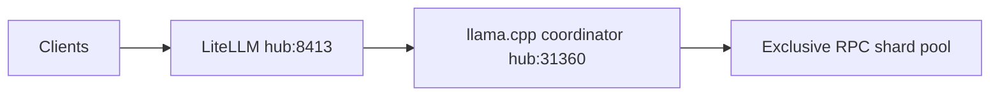
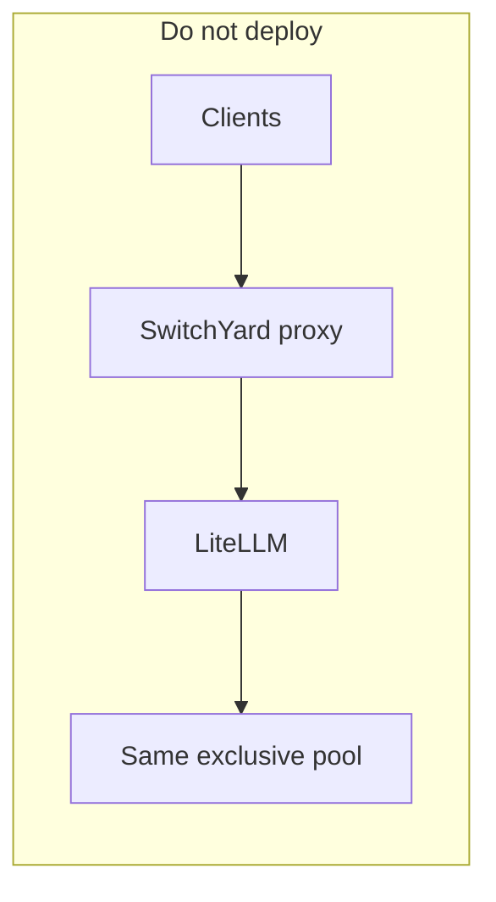

# NVIDIA NeMo SwitchYard and Nemotron vs alfa-ai (research)

> **Status:** Research complete 2026-08-11. **Not production.** No SwitchYard proxy,
> no Nemotron hub seed, and no escalation routing code in this evaluation pass.
> **Gate:** Pool80 exclusive start green + `secondary` online before any follow-on
> implementation. See [GREV80_80B_OPERATOR.md](../GREV80_80B_OPERATOR.md).

## Summary

| Piece | Official source | alfa-ai decision |
|-------|-----------------|------------------|
| **NeMo SwitchYard** | Open Rust routing middleware / SDK ([NVIDIA-NeMo/Switchyard](https://github.com/NVIDIA-NeMo/Switchyard), [NVIDIA blog 2026-08-11](https://developer.nvidia.com/blog/route-ai-agent-workloads-across-models-with-nvidia-nemo-switchyard/)) | **Do not** insert as a second gateway in front of LiteLLM. Overlaps existing gateway + operator pool switching. High-value algorithms need concurrent strong+weak backends; our GPU path is **one exclusive pool** at a time. |
| **Nemotron** | Open model family (Nano / Super / Ultra; hybrid Mamba-Transformer MoE) ([developer.nvidia.com/nemotron](https://developer.nvidia.com/nemotron), [Nemotron training recipes](https://docs.nvidia.com/nemotron/latest/index.html), [llama.cpp Nemotron perf](https://github.com/ggml-org/llama.cpp/discussions/20421)) | **Future weight candidate** — especially **Nemotron 3 Nano ~30B-A3B** as a concurrent weak/agent sidecar. **Not** a drop-in replacement for exclusive inference/72/80 Qwen stacks. |

**Commitment:** Keep **LiteLLM** (`hub:8413`) as the only OpenAI-compatible production gateway. Implement SwitchYard-*style* routing in LiteLLM/brain/agent layers only after a **concurrent weak backend** exists. Treat Nemotron as hub-first model research **after** Pool80 is green.

## Current alfa-ai inference path

| Layer | Where | Role |
|-------|-------|------|
| Gateway | [deploy/litellm_config.yaml](../../deploy/litellm_config.yaml), pool overlays (`litellm_config.pool80.yaml`, etc.) | Alias routing (`frontier-code`, `frontier`, `fast`, `chat`, ...) |
| Operator pool switch | [Start-Stop-AlfaAi.ps1](../../deploy/cluster-members/orchestrator/Start-Stop-AlfaAi.ps1), [models-desktop-menu.ps1](../../deploy/cluster-members/orchestrator/models-desktop-menu.ps1) | Exclusive **inference / Pool72 / Pool80** via `-InferenceMode` |
| Inference engine | llama.cpp RPC mesh | One loaded GGUF across shards; coordinator on `hub` |

SSoT for pool topology: [.cursor/plans/FOUR_HOST_FRONTIER_POOL.md](../../.cursor/plans/FOUR_HOST_FRONTIER_POOL.md).

## What SwitchYard provides (official)

Per [Switchyard getting started](https://github.com/NVIDIA-NeMo/Switchyard/blob/main/docs/getting_started.md) and the [NVIDIA technical blog](https://developer.nvidia.com/blog/route-ai-agent-workloads-across-models-with-nvidia-nemo-switchyard/):

- **Server path:** Standalone Rust proxy; OpenAI Chat, OpenAI Responses, Anthropic Messages in/out.
- **Library path (`switchyard-libsy`):** Embed routing in a Rust host; algorithm picks target, host performs the HTTP call.
- **Routing algorithms (tuning-free):** random weighting, **LLM classifier**, **stage router** (coding-agent phases), **escalation router** (start weak, escalate on difficulty).
- **Tunable routers:** e.g. prefill router (residual-stream MLP trained on accuracy labels) — requires training pipeline and model-internal signals.
- **Metrics:** selected model, rationale, tokens, latency (server reference).
- **Ecosystem:** NVIDIA blog cites LiteLLM plug-in, Kong, agent frameworks; NeMo Platform virtual models with `nemo-switchyard` middleware ([NeMo optimize agents](https://docs.nvidia.com/nemo-platform/documentation/agents/optimize-agents)).

### Why a SwitchYard proxy is redundant here

1. **LiteLLM already is the gateway** — second hop adds failure surface without new GPU capacity.
2. **Exclusive pools** — inference, Pool72, and Pool80 each load **one** GGUF on the full mesh. Classifier/stage/escalation routers need **two+ live backends** (strong + weak) at once.
3. **Operator routing already exists** — GUI / CLI `-InferenceMode` switches the entire pool; that is coarse routing, not per-request, but matches our VRAM policy ([llama-cpp-rpc-only](../../.cursor/rules/llama-cpp-rpc-only.mdc)).
4. **Single-operator-path** — if we adopt SwitchYard algorithms later, prefer **LiteLLM / brain integration** (NVIDIA's own LiteLLM plug-in mention), not a parallel `:port` proxy ([single-operator-path](../../.cursor/rules/single-operator-path.mdc)).

## SwitchYard features mapped to alfa-ai (native path)

| SwitchYard idea | alfa-ai native approach | Prerequisite |
|-----------------|-------------------------|--------------|
| Random / weighted A/B | LiteLLM `router_settings` + multiple `model_list` entries | Two concurrent backends |
| LLM classifier | Brain / Ask ALFa: classify then pick LiteLLM alias | Weak model alias + L1 oversight ([AI_AUTONOMY_AND_OVERSIGHT.md](../AI_AUTONOMY_AND_OVERSIGHT.md)) |
| Stage router | Agent worker: explore on weak alias; implement on `frontier-code` when tool loop / errors | Weak + strong aliases live |
| Escalation router | Same as stage; session affinity in agent state | Weak + strong aliases live |
| Anthropic ↔ OpenAI translation | Only if a tool requires Anthropic wire format; else unnecessary | Product requirement |
| Tunable prefill router | **Out of scope** — needs residual-stream training; not available on RPC GGUF path | N/A |
| Route metrics / rationale | Extend `ai_actions` / LiteLLM callbacks; log chosen alias server-side | Implementation follow-on |

Without a **concurrent weak backend**, "implement SwitchYard features" reduces to operator **inference/72/80** switching only.

## Nemotron family (official) and cluster fit

Official references:

- [NVIDIA Nemotron models](https://developer.nvidia.com/nemotron)
- [Nemotron training recipes](https://docs.nvidia.com/nemotron/latest/index.html)
- [llama.cpp Nemotron 3 performance notes](https://github.com/ggml-org/llama.cpp/discussions/20421)
- [DGX Spark Nemotron + llama.cpp playbook](https://github.com/NVIDIA/dgx-spark-playbooks/blob/main/nvidia/nemotron/README.md)

| Model (family) | Rough role | alfa-ai fit |
|----------------|------------|-------------|
| **Nemotron 3 Nano ~30B-A3B** | Efficient hybrid MoE; ~3B active; llama.cpp supported | **Best candidate** for optional **weak / agent-step** sidecar on a **dedicated** `llama-server` (not the exclusive RPC pool). Hub-seed GGUF on `hub` only ([HUB_ARTIFACTS.md](../HUB_ARTIFACTS.md)). LiteLLM alias e.g. `nemotron-nano`. |
| **Nemotron 3 Super ~120B-A12B** | Long-context agentic MoE | **Later exclusive InferenceMode** research (same class as Pool72/80). Needs full mesh; not concurrent with inference/80. |
| **Nemotron 3 Ultra ~550B** | Frontier agentic | **Out of scope** for homelab mesh. |
| **NIM / NeMo fine-tune** | Enterprise packaging, custom training | Useful only if we customize Nemotron weights; does not replace orchestrator or hub policy. |

Nemotron helps **as weights**, not as a reason to deploy SwitchYard. Escalation (Nano → Coder-Next) is a **LiteLLM + agent** pattern once both endpoints are up.

## Recommended follow-on (after Pool80 green)

**Not in this change set.** Sequence when operator approves:

1. Pool80 start succeeds; full mesh including `secondary` ([GREV80_80B_OPERATOR.md](../GREV80_80B_OPERATOR.md)).
2. Hub-seed **Nemotron 3 Nano** GGUF on `hub` (`scripts/hub_hub_models.sh` or documented pull; hub-first only).
3. Dedicated small `llama-server` (single host or CPU path) — **must not** compete with exclusive RPC VRAM.
4. LiteLLM `model_list` entry `nemotron-nano` pointing at that endpoint.
5. Agent / Ask ALFa escalation rules (weak first, escalate to `frontier-code` on failure signals) with L1/L2 oversight unchanged.

## Explicit non-goals (this evaluation)

- SwitchYard Rust server or compose service in `deploy/`.
- Second production gateway port in front of LiteLLM.
- Replacing inference/80 with Nemotron Super/Ultra.
- Prefill / residual-stream tunable routers.
- NVIDIA NIM as cluster brain.
- Public-internet GGUF download on workers.

## Related docs

- [FOUR_HOST_FRONTIER_POOL.md](../../.cursor/plans/FOUR_HOST_FRONTIER_POOL.md) — plan item **A5**
- [ROADMAP.md](../ROADMAP.md) — model upgrade ladder + priority queue
- [DATA_FLYWHEEL_OPERATOR.md](../operations/DATA_FLYWHEEL_OPERATOR.md) — MAPE learning loop (Tier A live)
- [LORA_ADAPTER_OPERATOR.md](../operations/LORA_ADAPTER_OPERATOR.md) — QLoRA → GGUF promote path
- [GREV80_80B_OPERATOR.md](../GREV80_80B_OPERATOR.md) — Pool80 bring-up
- [POOL_SWITCH_OPERATOR.md](../POOL_SWITCH_OPERATOR.md) — exclusive pool switching
- [AI_AUTONOMY_AND_OVERSIGHT.md](../AI_AUTONOMY_AND_OVERSIGHT.md) — agent escalation gates
