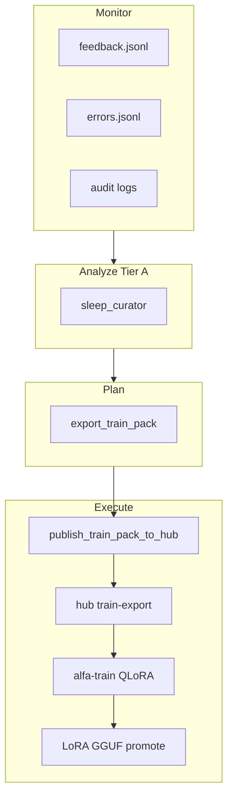

# Data flywheel operator (MAPE loop)

> **Status:** Implemented in alfa-ai brain (2026-08-11). **Tier A** runs on `hub`
> (monitor → analyze → plan). **Tier B** train + LoRA promote remains operator /
> trainer island (`gaming-c`/`gaming-b`, optional `gaming-a`; `inference` stays on 27B core) with human gates.
>
> NVIDIA NeMo "data flywheel" reference architecture is **deprecated as a
> blueprint** ([NVIDIA-AI-Blueprints/data-flywheel](https://github.com/NVIDIA-AI-Blueprints/data-flywheel))
> but the **MAPE** methodology (Monitor, Analyze, Plan, Execute) remains the
> industry pattern for continuous agent improvement.

Related: [LEARNING_LOOP_JUDGE_SLEEP.md](../../.cursor/plans/LEARNING_LOOP_JUDGE_SLEEP.md) (L5–L7),
[ROADMAP.md](../ROADMAP.md#custom-model--fine-tune-ladder-l3l7),
[SLEEP_CURATOR_NIGHTLY.md](SLEEP_CURATOR_NIGHTLY.md),
[SLEEP_TRAIN_TIER_B.md](SLEEP_TRAIN_TIER_B.md),
[LORA_ADAPTER_OPERATOR.md](LORA_ADAPTER_OPERATOR.md),
[experimental/NEMOTRON_SWITCHYARD_EVAL.md](../experimental/NEMOTRON_SWITCHYARD_EVAL.md).

## What alfa-ai implements

| MAPE phase | alfa-ai component | Mutates weights? |
|------------|-------------------|------------------|
| **Monitor** | Feedback JSONL, error catalog, mission/audit logs | No |
| **Analyze** | `sleep-curator` skill / `run_sleep_curator` | Memory only (Tier A) |
| **Plan** | `export-train-pack` / `export_train_pack` | No |
| **Execute (staging)** | `publish_train_pack_to_hub.sh` → hub training path | No |
| **Execute (train)** | alfa-train QLoRA (OP-LL-3) → LoRA GGUF promote | Yes (L3 gated) |

Production **27B / 72B / 80B RPC pools stay frozen** until morning eval passes
([AI_AUTONOMY_AND_OVERSIGHT.md](../AI_AUTONOMY_AND_OVERSIGHT.md)).



## One-shot flywheel (brain API container)

From `hub` with `alfa-ai-api` running:

```bash
cd /mnt/HDDs/Alfa-AI/repo/alfa-ai
sudo docker exec -w /app alfa-ai-api python scripts/run_data_flywheel.py
```

Dry run (monitor + analyze only, no export):

```bash
sudo docker exec -w /app alfa-ai-api python scripts/run_data_flywheel.py --dry-run
```

Skip curator or export:

```bash
sudo docker exec -w /app alfa-ai-api python scripts/run_data_flywheel.py --skip-curator
sudo docker exec -w /app alfa-ai-api python scripts/run_data_flywheel.py --skip-export
```

Report JSON is written under `{ALFA_AI_DATA}/flywheel/` (latest pointer:
`flywheel/LATEST.txt`).

Admin snapshot (JWT): `GET /alfa-ai/api/admin/learning-loop/status` — flywheel
LATEST summary, train-export MANIFEST counts, LoRA registry. See
[LEARNING_LOOP_OPERATOR_CHECKLIST.md](LEARNING_LOOP_OPERATOR_CHECKLIST.md).

## Nightly schedule (Tier A)

[learning_loop_tier_a.sh](../../scripts/learning_loop_tier_a.sh) runs clear → curator/export
(or flywheel when `ALFA_AI_FLYWHEEL_ENABLED=1`) → copy to staging → **hub publish**
(unless `--skip-publish`):

```bash
cd /mnt/HDDs/Alfa-AI/repo/alfa-ai
bash scripts/learning_loop_tier_a.sh
```

Set in brain `deploy/.env`:

```text
ALFA_AI_FLYWHEEL_ENABLED=1
```

Optional cron (`hub` as `operator`, after `alfa-ai-api` is up):

```cron
15 3 * * * cd /mnt/HDDs/Alfa-AI/repo/alfa-ai && bash scripts/learning_loop_tier_a.sh >> /mnt/HDDs/Alfa-AI/agent-audit-logs/learning-loop-tier-a.log 2>&1
```

Or enable sleep curator cron per [SLEEP_CURATOR_NIGHTLY.md](SLEEP_CURATOR_NIGHTLY.md)
and run flywheel after.

## Tier B execute (operator, not automatic GPU train)

**Staging (automated in Tier A):** latest pack published to `ALFA_AI_TRAIN_HUB_HINT` with
`scan_pass` recorded in MANIFEST — see [TRAIN_PACK_MANIFEST.md](TRAIN_PACK_MANIFEST.md).

Manual publish only:

```bash
bash scripts/publish_train_pack_to_hub.sh
```

**GPU train (OP-LL-3, manual):**

1. On `gaming-c`: [SLEEP_TRAIN_TIER_B.md](SLEEP_TRAIN_TIER_B.md) / `run-qlora-night.ps1`.
2. Convert adapter to GGUF on `hub` ([LORA_ADAPTER_OPERATOR.md](LORA_ADAPTER_OPERATOR.md)).
3. Promote with eval ≥ 70% before coordinator `--lora` apply.

Flywheel **does not** auto-start GPU training or reload the RPC coordinator.

## Environment

| Variable | Default | Purpose |
|----------|---------|---------|
| `ALFA_AI_SLEEP_CURATOR_ENABLED` | `0` | Gate scheduled curator (manual skill always OK) |
| `ALFA_AI_TRAIN_EXPORT_PATH` | `{ALFA_AI_DATA}/train-export` | Train pack output |
| `ALFA_AI_TRAIN_HUB_HINT` | `/mnt/HDDs/Alfa-AI/training/alfa-train/datasets/from-alfa-ai` | Hub publish target |
| `ALFA_AI_TRAIN_BASE_MODEL` | `qwen3.6-27b` | MANIFEST `base_model_target` hint for alfa-train |
| `ALFA_AI_FLYWHEEL_ENABLED` | `0` | Use flywheel path in `learning_loop_tier_a.sh` |

See [deploy/env.example](../../deploy/env.example).

## Governance

- **L1 default:** flywheel enriches and exports; no silent weight changes.
- **L2:** operator approves alfa-train nights and LoRA promote.
- **L3:** eval-gated adapter on coordinator only after documented smoke.
